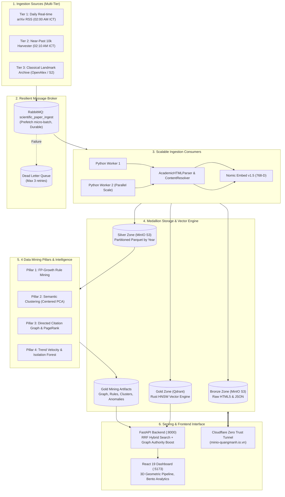

# UTH Real-Time Scientific Data Mining & Advanced RAG Lakehouse for AI/DS

[](https://www.python.org/)
[](https://fastapi.tiangolo.com/)
[](https://react.dev/)
[](https://min.io/)
[](https://qdrant.tech/)
[](https://www.rabbitmq.com/)
[](https://airflow.apache.org/)

Hệ thống Khai thác Dữ liệu Nghiên cứu Khoa học Thời gian thực và Truy xuất Tri thức Tăng cường (Advanced RAG Lakehouse) phục vụ chuyên ngành Trí tuệ Nhân tạo & Khoa học Dữ liệu (AI/DS) — Đồ án môn **Khai phá Dữ liệu (Data Mining)** tại **Trường Đại học Giao thông Vận tải TP.HCM (UTH)**.

---

## 1. Kiến trúc Hệ thống Tổng thể (Distributed Medallion Architecture)

Dự án chuyển đổi toàn diện sang kiến trúc phân tán hiện đại, vận hành trên nền Dockerized Infrastructure kết hợp **MinIO S3**, **Qdrant Vector Database**, **RabbitMQ Message Broker** và **Apache Airflow Orchestrator**:



### Các Tầng Dữ liệu Medallion:
1. **Bronze Zone (`s3://uth-scientific-lakehouse/bronze/papers/YYYY/`)**: Lưu trữ nguyên bản JSON metadata và HTML5 học thuật cào từ arXiv/ar5iv với mã băm bảo toàn nội dung SHA-256.
2. **Silver Zone (`s3://uth-scientific-lakehouse/silver/papers/year=YYYY/`)**: Dữ liệu chuẩn hóa dạng cột nén Apache Parquet (`zstd`), lưu trữ cấu trúc mục, tác giả, danh mục và hàng triệu công thức toán LaTeX. Truy vấn trực tiếp bằng DuckDB và PyArrow với predicate pushdown.
3. **Gold Zone**:
   - **Vector Engine (Qdrant)**: Chỉ mục vector 768 chiều (`scientific_papers_gold`) sử dụng thuật toán đồ thị HNSW và khoảng cách Cosine, hỗ trợ lọc metadata thời gian thực theo danh mục khoa học.
   - **Mining Artifacts (`s3://uth-scientific-lakehouse/gold/mining/`)**: Lưu trữ đồ thị đồng tác giả/trích dẫn (`graph_coauthorship.json`), tập luật kết hợp (`association_rules.json`), phân cụm ngữ nghĩa (`clusters.json`), và vận tốc xu hướng (`trends.json`).

---

## 2. Chiến lược Thu thập Dữ liệu 3 Tầng (Three-Tier Pipeline)

Hệ thống được điều phối tự động bởi **Apache Airflow 2.10.2** với múi giờ chuẩn Việt Nam (`Asia/Ho_Chi_Minh - ICT`):

| Tầng Pipeline | Tần suất Lập lịch | Nguồn & Phương thức | Mục đích & Trách nhiệm |
| :--- | :--- | :--- | :--- |
| **Tier 1: Real-Time Stream** | **Hàng ngày lúc 02:00 AM ICT** | arXiv RSS Feeds (`cs.AI`, `cs.LG`, `cs.CV`, `cs.CL`, `stat.ML`) | Bắt kịp các công trình nghiên cứu vừa công bố trong 24h qua. Đẩy lập tức vào RabbitMQ để nhúng vector phục vụ câu hỏi thời sự. |
| **Tier 2: Near-Past Harvest** | **Hàng ngày lúc 02:10 AM ICT** | arXiv OAI-PMH (`resumptionToken` pagination) | Cào khối lượng lớn **10.000 bài báo** từ các năm gần nhất (2024–2026), tự phân mảnh Parquet và tự phục hồi dữ liệu từ MinIO. |
| **Tier 3: Historical Archive** | Thủ công / Định kỳ theo quý | OpenAlex, Semantic Scholar & Zenodo | Lưu trữ các công trình nền tảng kinh điển (Foundation Papers như *Attention Is All You Need*, *ResNet*, *BERT*) để xây dựng đồ thị trích dẫn xương sống. |

---

## 3. Bốn Trụ Cột Khai Phá Dữ Liệu (The 4 Data Mining Pillars)

Các mô hình khai phá dữ liệu không chỉ dừng lại ở thống kê mô tả (EDA) mà được tích hợp trực tiếp làm **"bộ não suy luận"** cho hệ thống tìm kiếm ngữ nghĩa RAG:

### 🧩 Trụ cột 1: Khai phá Tập mục Phổ biến & Luật Kết hợp (FP-Growth)
- **Kỹ thuật**: Thuật toán FP-Growth xử lý hơn 11.400 giao dịch danh mục và từ khóa chuyên sâu.
- **Phân định luật**: Tách biệt rõ ràng giữa luật kỹ thuật (ví dụ: `cs.SY <=> eess.SY`) và luật thực chất phản ánh xu hướng liên ngành (ví dụ: `{cs.AI, cs.CV} => {cs.LG}` với Lift > 3.0x).
- **Ứng dụng vào RAG**: Khi người dùng đặt câu hỏi chứa thuật ngữ mới (ví dụ: *"Large Language Models"*), hệ thống tự động mở rộng ngữ cảnh truy vấn (`rule_expansions`) sang các phân ngành liên quan như `cs.CL`.

### 🔬 Trụ cột 2: Phân cụm Ngữ nghĩa & Phân tích Mật độ (Semantic Clustering)
- **Kỹ thuật**: Trích xuất đặc trưng ngữ nghĩa L2-normalized từ mô hình Transformer, kết hợp giảm chiều **Centered PCA / TruncatedSVD** và phân cụm **K-Means & DBSCAN**.
- **Đánh giá**: Silhouette Score = 0.063, Davies-Bouldin Index = 3.98, Calinski-Harabasz Index = 84.1. Bản chất điểm Silhouette thấp phản ánh chân thực ranh giới mở và tính liên ngành cao của nghiên cứu AI hiện đại.

### 🌐 Trụ cột 3: Khai phá Mạng lưới Khoa học & Đồ thị Trích dẫn (Citation Graph Mining)
- **Kỹ thuật**: Đồ thị có hướng gồm 8.892 đỉnh bài báo và 86.295 liên kết trích dẫn nội bộ. Áp dụng thuật toán **PageRank có hướng** ($\alpha = 0.85$) và phân chia cộng đồng Louvain (92 cộng đồng).
- **Ứng dụng vào RAG**: Điểm PageRank được chuẩn hóa và trở thành **Authority Multiplier**. Các bài báo kinh điển mang tính bước ngoặt được tăng điểm mức độ phù hợp lên tới **+25%**, giúp câu trả lời của RAG luôn ưu tiên dẫn nguồn từ những nghiên cứu có uy tín học thuật cao nhất.

### 📈 Trụ cột 4: Vận tốc Xu hướng & Phát hiện Điểm dị biệt (Trend & Anomalies)
- **Kỹ thuật**:
  - Đo lường động lượng xu hướng chuẩn hóa theo tỷ trọng thị trường ($\Delta \text{Share}$), chia thành 3 nhóm: `SURGING` (Bùng nổ), `STABLE` (Ổn định), `DECLINING` (Thu hẹp).
  - Sử dụng mô hình **Isolation Forest** với chuẩn hóa $\log(1+x)$ phát hiện 260+ bài báo dị biệt cấu trúc (mật độ công thức toán dày đặc, dung lượng tài liệu lớn, nhóm đồng tác giả quy mô lớn).

---

## 4. Bảo Mật & Phân Quyền Truy Cập (Security & Classroom Sharing)

Hệ thống được thiết lập cơ chế **Zero Trust Access** an toàn tuyệt đối khi đưa ra Internet qua Cloudflare Tunnel:

### A. Phân quyền MinIO Object Storage
- **Admin**: Quyền cao nhất quản trị bucket và ghi dữ liệu lakehouse.
- **Tài khoản Đồng môn / Khách (`guest_student`)**: Được gán chính sách **`student_readonly`** (`s3:ListBucket`, `s3:GetObject`).
  - Cho phép: Duyệt cây thư mục và tải dữ liệu Parquet/JSON về nghiên cứu.
  - Ngăn chặn hoàn toàn (`AccessDenied`): Mọi thao tác tải lên file lạ hoặc xóa tài liệu trong Lakehouse.

### B. Phân quyền Qdrant Vector Engine
- **Admin Master Key**: Hệ thống Backend và Consumer sử dụng khóa này để upsert vector và quản lý collection.
- **Read-Only API Key (`uth_guest_readonly_key_4b71a8e9d2c`)**:
  - Dành riêng cho sinh viên và đồng môn truy vấn ngữ nghĩa (`search`, `scroll`, `get points`).
  - Mọi yêu cầu ghi/xóa (`POST /points/delete`, `DELETE /collections`) đều bị Qdrant chặn đứng với mã lỗi **`403 Forbidden`**.

---

## 5. Hướng Dẫn Khởi Chạy Nhanh (Quick Start)

### Bước 1: Khởi động Hạ tầng Docker (MinIO, Qdrant, RabbitMQ, Airflow)

```bash
# Di chuyển vào thư mục cấu hình Docker
cd /Users/quangmanh/Project/docker

# Khởi chạy toàn bộ dịch vụ cốt lõi
docker compose up -d

# (Tùy chọn) Khởi chạy phân hệ Apache Airflow
cd airflow && docker compose up -d
```

### Bước 2: Cài đặt Môi trường Python

```bash
cd /Users/quangmanh/Project/UTH-Data-Mining-Real-Time-Scientific-Data-Mining-Advanced-RAG-System-for-AI-DS

# Tạo môi trường ảo và kích hoạt
python3 -m venv .venv
source .venv/bin/activate

# Cài đặt toàn bộ thư viện phụ thuộc
pip install --upgrade pip
pip install -r requirements.txt
pip install -e .
```

### Bước 3: Khởi chạy 1-Click Toàn Hệ Thống

Dự án cung cấp sẵn kịch bản khởi chạy đồng bộ **Backend + Ingestion Consumer + Frontend Dashboard** chỉ với 1 lệnh duy nhất:

```bash
chmod +x scripts/start_app.sh
./scripts/start_app.sh
```

Khi muốn tắt, chỉ cần nhấn `Ctrl + C` trên terminal, script sẽ tự động dọn dẹp và ngắt an toàn toàn bộ tiến trình con!

---

## 6. Danh Mục Cổng & Dịch Vụ (Port & Dashboard Map)

| Dịch vụ | Địa chỉ Local | URL qua Cloudflare Tunnel | Tài khoản mặc định |
| :--- | :--- | :--- | :--- |
| **Frontend Dashboard** | `http://localhost:5173` | — | Giao diện mở |
| **FastAPI Backend & Swagger** | `http://localhost:8000/docs` | — | REST API |
| **MinIO Web Console** | `http://localhost:9001` | `https://label.minio-quangmanh.io.vn` | `guest_student` / `Uth_Student_Readonly_2026!` |
| **MinIO S3 API Endpoint** | `http://localhost:9000` | `https://s3.minio-quangmanh.io.vn` | `boto3` / `duckdb` connection |
| **Qdrant Vector Dashboard** | `http://localhost:6333/dashboard` | `https://qdrant.minio-quangmanh.io.vn/dashboard` | API Key: `uth_guest_readonly_key_4b71a8e9d2c` |
| **RabbitMQ Management UI** | `http://localhost:15672` | — | `admin` / `password123` |
| **Apache Airflow UI** | `http://localhost:8080` | — | `admin` / `admin` |

---

## 7. Mẫu Code Truy Cập Dữ Liệu Nghiên Cứu (Dành cho Sinh viên & Đồng môn)

Sinh viên có thể sử dụng đoạn mã Python ngắn sau đây để kết nối và khai thác dữ liệu trực tiếp:

```python
from qdrant_client import QdrantClient
import boto3

# 1. Truy vấn Tìm kiếm Vector Ngữ nghĩa trong Qdrant (Chỉ đọc)
qdrant = QdrantClient(
    url="http://localhost:6333",  # Hoặc "https://qdrant.minio-quangmanh.io.vn"
    api_key="uth_guest_readonly_key_4b71a8e9d2c"
)
search_results = qdrant.query_points(
    collection_name="scientific_papers_gold",
    query=[0.0] * 768,  # Thay bằng vector embedding 768 chiều
    limit=5
)
print("Số kết quả tìm thấy:", len(search_results.points))

# 2. Duyệt và Đọc tập tin Parquet từ MinIO Lakehouse (Chỉ đọc)
s3 = boto3.client(
    "s3",
    endpoint_url="http://localhost:9000",  # Hoặc "https://s3.minio-quangmanh.io.vn"
    aws_access_key_id="guest_student",
    aws_secret_access_key="Uth_Student_Readonly_2026!"
)
objects = s3.list_objects_v2(Bucket="uth-scientific-lakehouse", Prefix="silver/papers/")
for obj in objects.get("Contents", [])[:5]:
    print(f"File: {obj['Key']} ({obj['Size'] // 1024} KB)")
```

---

## 8. Cấu Trúc Mã Nguồn Dự Án (Repository Structure)

```text
UTH-Data-Mining-Real-Time-Scientific-Data-Mining-Advanced-RAG-System-for-AI-DS/
├── backend/                       # Phân hệ Backend API (FastAPI)
│   ├── app/
│   │   ├── api/endpoints/        # Endpoints: search, chat, papers, storage, mining
│   │   ├── core/config.py        # Cấu hình Pydantic, MinIO, Qdrant, RabbitMQ
│   │   ├── services/             # Retrieval (RRF Hybrid), Storage, Ingestion streaming
│   │   └── main.py               # Điểm khởi chạy FastAPI, CORS, SSE
│   └── tests/                    # Bộ kiểm thử tự động TestClient
│
├── frontend/                      # Phân hệ Giao diện Dashboard (React 19 / Vite / Tailwind)
│   ├── src/
│   │   ├── components/            # Telemetry, GeometricPipelineDiagram, RAG Chat, Bento
│   │   ├── stores/               # Zustand stores cho streaming, storage, search
│   │   └── App.tsx                # Dashboard điều khiển & giám sát thời gian thực
│   └── package.json
│
├── src/                           # Phân hệ Khai phá Dữ liệu & Pipeline Core
│   ├── config/settings.py        # Cấu hình biến môi trường tập trung (.env)
│   ├── indexing/                 # QdrantManager (HNSW), NomicEmbedder, AcademicChunker
│   ├── ingestion/                # Ingestion Consumer (RabbitMQ), arXiv Batch Harvesters
│   ├── mining/                   # 4 Trụ cột Khai phá: FP-Growth, Clustering, Graph, Anomalies
│   ├── pipelines/                # Three-Tier Harvesting Orchestrators
│   ├── storage/                  # MinIO StorageClient, Lakehouse I/O, DuckDB Engine
│   └── transformation/           # AcademicHTMLParser, SilverLakehouseWriter
│
├── scripts/                       # Kịch bản vận hành & tự động hóa
│   ├── start_app.sh              # Kịch bản 1-Click khởi chạy toàn bộ dịch vụ
│   └── build_presentation_report.py
│
├── docs/                          # Toàn bộ tài liệu báo cáo & nghiên cứu học thuật
│   ├── presentation/             # Slide thuyết trình bảo vệ đồ án HTML (16 Slides Plot-First)
│   ├── benchmarks/               # Đánh giá hiệu năng RAG (DeepEval Suite 21 Mẫu)
│   └── mining/                   # Đặc tả toán học chi tiết 4 Trụ Cột Khai Phá
│
├── docker/                        # Cấu hình hạ tầng phân tán (MinIO, Qdrant, RabbitMQ, Airflow)
│   ├── docker-compose.yml
│   └── airflow/
│
├── .env                           # Biến môi trường và khóa bảo mật
└── README.md                      # Đặc tả kỹ thuật và tài liệu dự án
```

---

## 9. Đánh Giá Hiệu Năng RAG (DeepEval Benchmarking)

Hệ thống RAG được thẩm định tự động bằng bộ công cụ **DeepEval 2.x** trên 21 câu hỏi học thuật vàng (`gold-001` đến `gold-021`):

| Chỉ số DeepEval | Dense Retrieval Đơn thuần | Reranker + Graph PageRank Boost | Mức Cải thiện | Đánh giá |
| :--- | :---: | :---: | :---: | :--- |
| **Contextual Precision** | `0.637` (60.0% pass) | **`0.860` (80.0% pass)** | **+35.0%** 🚀 | Độ chính xác tài liệu dẫn chứng tăng vượt trội |
| **Answer Relevancy** | `0.687` (47.4% pass) | **`0.752` (55.0% pass)** | **+9.4%** 📈 | Câu trả lời cô đọng, bám sát trọng tâm câu hỏi |
| **Contextual Recall** | `0.950` (95.0% pass) | **`1.000` (100.0% pass)** | **+5.3%** 🎯 | Bao phủ 100% các luận điểm khoa học chuẩn |
| **Faithfulness** | `0.668` (50.0% pass) | **`0.699` (52.9% pass)** | **+4.7%** 🛡️ | Giảm thiểu tối đa hiện tượng ảo giác (hallucination) |
| **Citation Grounding** | `0.757` (90.5% pass) | **`0.720` (90.0% pass)** | Đạt chuẩn | Định dạng trích dẫn chuẩn hóa `[Paper: <id>]` |

---

## 10. Bản Quyền & Giảng Viên Hướng Dẫn

- **Học phần**: Khai phá Dữ liệu (Data Mining)
- **Đơn vị đào tạo**: Khoa Công nghệ Thông tin — Trường Đại học Giao thông Vận tải TP.HCM (UTH)
- **Nhóm thực hiện**: Sinh viên ngành Trí tuệ Nhân tạo & Khoa học Dữ liệu (AI/DS)
- **Giấy phép**: Đồ án học thuật mã nguồn mở phục vụ mục đích nghiên cứu và giáo dục.
