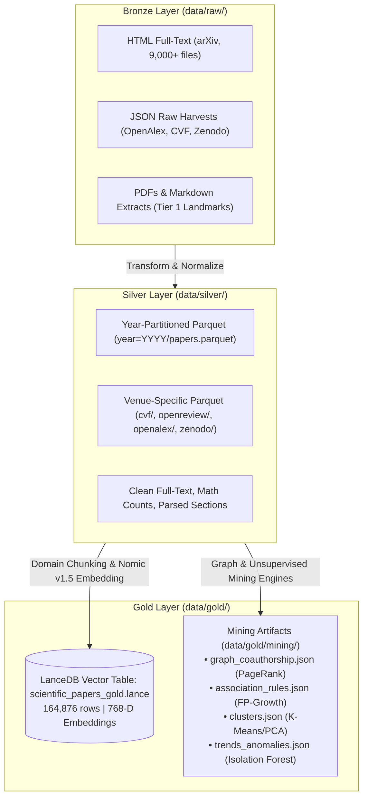

# Data Specification & Architecture Guide for TypeScript/JavaScript RAG System

- **Motivation/Background**: Providing an exhaustive, highly structured data specification of the UTH Scientific Literature Lakehouse and Data Mining artifacts so that an external AI Agent or engineering team can build a production-grade RAG (Retrieval-Augmented Generation) system in TypeScript / JavaScript (Node.js/Bun).
- **Purpose**: Serve as the definitive data dictionary, schema blueprint, vector index guide, and integration manual for developing a TS/JS RAG pipeline over 13,000+ scientific papers and 164,800+ embeddings.
- **Overview Pipeline**: Analyzed the Medallion lakehouse tiers (Raw -> Silver Parquet -> Gold LanceDB & Mining JSONs) and formulated exact schemas, TypeScript types, retrieval algorithms, and sample code.
- **Detailed Plan**: §1 Executive Summary & Dataset Architecture; §2 Gold Layer: LanceDB Vector Database (Primary RAG Store); §3 Embedding Model Protocol & Query Requirements (Nomic v1.5); §4 Silver Layer: Parquet Lakehouse (Full-Text & Metadata); §5 Data Mining Artifacts (Authority Boosting & Query Expansion); §6 Raw Bronze Data Layer; §7 Complete TypeScript Type Definitions; §8 Step-by-Step TS/JS RAG Implementation Guide; §9 Recommended npm Ecosystem.
- **References**: [`src/config/settings.py`](../src/config/settings.py), [`src/indexing/chunker.py`](../src/indexing/chunker.py), [`src/indexing/embedder.py`](../src/indexing/embedder.py), [`backend/app/services/retrieval_service.py`](../backend/app/services/retrieval_service.py), [`backend/app/services/rag_service.py`](../backend/app/services/rag_service.py), [`docs/OVERVIEW.md`](OVERVIEW.md), [`agents/rules/MD_CONVENTION.md`](../agents/rules/MD_CONVENTION.md).
- **Created**: 2026-10-12T16:10:00+07:00
- **Last Updated**: 2026-10-12T16:10:00+07:00

[STATUS: ACTIVE]

---

## Table of Contents

- [1. Executive Summary & Dataset Architecture](#1-executive-summary--dataset-architecture)
- [2. Gold Layer: LanceDB Vector Database (Primary RAG Store)](#2-gold-layer-lancedb-vector-database-primary-rag-store)
  - [2.1 Database Overview & Physical Storage](#21-database-overview--physical-storage)
  - [2.2 LanceDB Schema & Field Semantics](#22-lancedb-schema--field-semantics)
  - [2.3 TypeScript Sample: Vector Retrieval via @lancedb/lancedb](#23-typescript-sample-vector-retrieval-via-lancedblancedb)
- [3. Embedding Model Protocol & Query Requirements (Nomic v1.5)](#3-embedding-model-protocol--query-requirements-nomic-v15)
  - [3.1 Model Specifications](#31-model-specifications)
  - [3.2 Asymmetric Prefix Protocol (CRITICAL)](#32-asymmetric-prefix-protocol-critical)
  - [3.3 Generating Query Vectors in Node.js / TypeScript](#33-generating-query-vectors-in-nodejs--typescript)
- [4. Silver Layer: Parquet Lakehouse (Full-Text & Deep Metadata)](#4-silver-layer-parquet-lakehouse-full-text--deep-metadata)
  - [4.1 Partitioning & Corpus Breakdown](#41-partitioning--corpus-breakdown)
  - [4.2 Parquet Column Schema](#42-parquet-column-schema)
  - [4.3 Structure of sections_json](#43-structure-of-sections_json)
  - [4.4 Querying Parquets with DuckDB in TypeScript](#44-querying-parquets-with-duckdb-in-typescript)
- [5. Data Mining Artifacts (Authority Boosting & Query Expansion)](#5-data-mining-artifacts-authority-boosting--query-expansion)
  - [5.1 Co-Authorship & Citation PageRank (graph_coauthorship.json)](#51-co-authorship--citation-pagerank-graph_coauthorshipjson)
  - [5.2 FP-Growth Association Rules (association_rules.json)](#52-fp-growth-association-rules-association_rulesjson)
  - [5.3 Semantic Topic Clusters (clusters.json)](#53-semantic-topic-clusters-clustersjson)
  - [5.4 Velocity & Anomaly Detection (trends_anomalies.json)](#54-velocity--anomaly-detection-trends_anomaliesjson)
- [6. Raw Bronze Data Layer](#6-raw-bronze-data-layer)
- [7. Complete TypeScript Type Definitions](#7-complete-typescript-type-definitions)
- [8. Step-by-Step TS/JS RAG Implementation Guide](#8-step-by-step-tsjs-rag-implementation-guide)
  - [8.1 End-to-End Retrieval & Fusion Pipeline](#81-end-to-end-retrieval--fusion-pipeline)
  - [8.2 Academic Grounding & Citation Prompt Engineering](#82-academic-grounding--citation-prompt-engineering)
- [9. Recommended npm Ecosystem](#9-recommended-npm-ecosystem)

---

## 1. Executive Summary & Dataset Architecture

This dataset constitutes a curated, multi-source scientific research lakehouse covering **Artificial Intelligence, Machine Learning, Computer Vision, and Natural Language Processing**. It has been extracted, normalized, mathematically parsed, clustered, and indexed into a Medallion Lakehouse architecture.

### Key Metrics
- **Total Scientific Papers**: `13,293` papers across multiple academic sources.
- **Indexed Chunks in LanceDB Vector Store**: `164,876` pre-embedded chunks with **768-dimensional** dense vectors.
- **Subject Categories**: Primary focus on `cs.AI`, `cs.LG`, `cs.CV`, `cs.CL`, `stat.ML`.
- **Sources Ingested**:
  1. **arXiv**: High-velocity preprints (13,000+ papers, including full section breakdowns and 2.76M LaTeX formulas).
  2. **CVPR 2024 (CVF Open Access)**: Full conference proceedings with visual computing papers.
  3. **OpenReview**: Peer-reviewed ICLR papers containing reviewer scores, critiques, and meta-reviews.
  4. **OpenAlex**: Academic works with citation counts and provenance links.
  5. **Zenodo**: Open-science machine learning repositories and metadata.

### Storage Layout Diagram



---

## 2. Gold Layer: LanceDB Vector Database (Primary RAG Store)

The LanceDB database is the **primary retrieval engine** for semantic search and RAG. Chunks are already generated, contextualized, and embedded.

### 2.1 Database Overview & Physical Storage
- **Local Filesystem Path**: `data/gold/lancedb`
- **Table Name**: `scientific_papers_gold` (directory: `data/gold/lancedb/scientific_papers_gold.lance`)
- **Row Count**: `164,876` vectors
- **Vector Dimension**: `768` (IEEE 754 float32)
- **Metric**: Cosine similarity (`cosine`) or L2 Euclidean (`l2`)
- **Remote Cloudflare R2 Path** (if syncing via S3): `s3://uth-scientific-lakehouse/gold/lancedb`

### 2.2 LanceDB Schema & Field Semantics

| Field Name | Type | Description | RAG Role |
| :--- | :--- | :--- | :--- |
| `chunk_id` | `Utf8` / `string` | Unique chunk identifier (e.g. `2310.00297_abstract_0`, `2402.01253_sec2_1`). | Unique key for deduplication. |
| `paper_id` | `Utf8` / `string` | Paper identifier (e.g. `2310.00297`, `openalex:W2594538354`, `cvpr_2024_012`). | Citation anchor: `[Paper: {paper_id}]`. |
| `title` | `Utf8` / `string` | Full paper title. | Context header & lexical matching. |
| `authors` | `List<Utf8>` / `string[]` | Array of author names. | Authority boosting via PageRank. |
| `primary_category`| `Utf8` / `string` | Primary subject tag (e.g. `cs.AI`, `cs.CV`, `cs.LG`, `cs.CL`). | Metadata filtering / faceted search. |
| `section_title` | `Utf8` / `string` | Title of the section (e.g. `Abstract`, `1 Introduction`, `3.2 Methodology`). | Granular source attribution. |
| `section_type` | `Utf8` / `string` | Category: `abstract`, `introduction`, `method`, `experiment`, `discussion`, `other`. | Section filtering (e.g., skip references). |
| `text` | `Utf8` / `string` | The verbatim content of the chunk. | Chunk content for LLM synthesis. |
| `context_text` | `Utf8` / `string` | Formatted text with contextual header: `Paper: "{title}" \| Section: {section_title}\n\n{text}`. | Recommended snippet for LLM prompts. |
| `word_count` | `Int64` / `number` | Number of words in the chunk. | Length filtering / token budgeting. |
| `vector` | `FixedSizeList<Float32>[768]` | 768-D normalized embedding vector generated by Nomic Embed v1.5. | Nearest Neighbor ANN search. |

### 2.3 TypeScript Sample: Vector Retrieval via `@lancedb/lancedb`

```typescript
import * as lancedb from "@lancedb/lancedb";
import * as path from "path";

export interface LanceDbPaperChunk {
  chunk_id: string;
  paper_id: string;
  title: string;
  authors: string[];
  primary_category: string;
  section_title: string;
  section_type: string;
  text: string;
  context_text: string;
  word_count: number;
  _distance?: number; // Added automatically by LanceDB on vector search
}

export async function queryLanceDb(
  queryVector: number[],
  topK: number = 5,
  categoryFilter?: string
): Promise<LanceDbPaperChunk[]> {
  const dbPath = path.resolve(process.cwd(), "data/gold/lancedb");
  const db = await lancedb.connect(dbPath);
  const table = await db.openTable("scientific_papers_gold");

  let queryBuilder = table
    .search(queryVector)
    .metricType("cosine")
    .limit(topK);

  if (categoryFilter) {
    queryBuilder = queryBuilder.where(`primary_category = '${categoryFilter}'`);
  }

  // Select only textual and metadata columns to save memory
  queryBuilder = queryBuilder.select([
    "chunk_id",
    "paper_id",
    "title",
    "authors",
    "primary_category",
    "section_title",
    "section_type",
    "text",
    "context_text",
    "word_count",
  ]);

  const results = await queryBuilder.toArray();
  return results as unknown as LanceDbPaperChunk[];
}
```

---

## 3. Embedding Model Protocol & Query Requirements (Nomic v1.5)

### 3.1 Model Specifications
- **Model Name**: [`nomic-ai/nomic-embed-text-v1.5`](https://huggingface.co/nomic-ai/nomic-embed-text-v1.5)
- **Output Dimensionality**: `768` floats
- **Context Window**: 8,192 tokens
- **Normalization**: Vectors are $L_2$-normalized ($\|\mathbf{v}\|_2 = 1.0$) so that Cosine Similarity equals Inner Product ($\mathbf{u} \cdot \mathbf{v}$).

### 3.2 Asymmetric Prefix Protocol (CRITICAL)
Nomic Embed v1.5 uses **asymmetric task prefixes**. The existing database was indexed using the document prefix. When querying from TypeScript, the agent **MUST prepend** `search_query:` to the user input:

> [!CAUTION]
> **MANDATORY PREFIX REQUIREMENT**:
> - Document Chunks in DB were encoded with: `search_document: <content>`
> - User Queries MUST be encoded with: `search_query: <user_query>`
> 
> *Failing to prepend `search_query: ` will cause a significant drop in retrieval precision and contextual recall!*

### 3.3 Generating Query Vectors in Node.js / TypeScript

The TS/JS agent can generate the 768-D query embedding using one of three options:

#### Option A: Local ONNX Inference via `@xenova/transformers` (In-Process)
```typescript
import { pipeline, env } from "@xenova/transformers";

// Disable remote downloads if model is cached locally
env.allowLocalModels = true;

let embedderPipeline: any = null;

export async function getQueryEmbedding(query: str): Promise<number[]> {
  if (!embedderPipeline) {
    embedderPipeline = await pipeline("feature-extraction", "Xenova/nomic-embed-text-v1.5");
  }

  // Prepend mandatory task prefix
  const formattedQuery = `search_query: ${query}`;
  const output = await embedderPipeline(formattedQuery, {
    pooling: "mean",
    normalize: true,
  });

  return Array.from(output.data);
}
```

#### Option B: Local Ollama Instance
```bash
ollama pull nomic-embed-text
```
```typescript
import axios from "axios";

export async function getQueryEmbeddingViaOllama(query: string): Promise<number[]> {
  const response = await axios.post("http://localhost:11434/api/embeddings", {
    model: "nomic-embed-text",
    prompt: `search_query: ${query}`,
  });
  return response.data.embedding; // 768-D float array
}
```

#### Option C: Existing Python Backend API Sidecar
If the existing FastAPI backend is running (`localhost:8000`), TS can query the endpoint directly or call the Python script.

---

## 4. Silver Layer: Parquet Lakehouse (Full-Text & Deep Metadata)

When the RAG system needs the **complete paper**, bibliography, mathematical formula counts, or to lookup by exact `paper_id` or `title`, it queries the **Silver Parquet Lakehouse**.

### 4.1 Partitioning & Corpus Breakdown
The parquet files reside in `data/silver/`:

| Directory / File | Record Count | Scope & Details |
| :--- | :--- | :--- |
| `data/silver/year=2026/papers.parquet` | `13,004` rows | Massive arXiv corpus across AI/ML/CV/NLP with extracted sections & math. |
| `data/silver/year=1995` to `year=2025` | `10` rows | Landmark foundational papers (e.g. *ResNet*, *Transformer*, *Adam*, *SVM*). |
| `data/silver/cvf/cvpr2024.parquet` | `100` rows | Curated CVPR 2024 papers with deep visual computing analysis. |
| `data/silver/openreview/openreview_all.parquet` | `100` rows | Peer-reviewed submissions with reviews, ratings, and rebuttals. |
| `data/silver/openreview/openreview_iclr.parquet`| `5` rows | Spotlight/Oral ICLR papers. |
| `data/silver/openalex/openalex_all.parquet` | `50` rows | High-impact papers with OpenAlex citation metrics. |
| `data/silver/zenodo/zenodo_all.parquet` | `6` rows | Zenodo datasets and papers. |
| `data/silver/tier1/landmark_papers.parquet` | `10` rows | Seminal papers with full LaTeX markup. |
| `data/silver/tier2/near_past_papers.parquet` | `2` rows | Recent milestone publications. |
| `data/silver/tier3/realtime_papers.parquet` | `5` rows | Streaming ingest testbed. |
| **Total Silver Records** | **`13,293`** | Full academic corpus. |

### 4.2 Parquet Column Schema

Each parquet file adheres to this unified schema:

```
paper_id: string               (e.g., "2310.03291", "openalex:W2594538354")
abstract_hash: string          (SHA-256 hash of abstract for deduplication)
doi: string (nullable)         (e.g., "10.1145/3065386")
journal_ref: string (nullable) (e.g., "CVPR 2024", "ICLR 2024")
title: string                  (Full title)
abstract: string               (Clean abstract text)
authors: list<string>          (Array of author names: ["Yiren Jian", ...])
categories: list<string>       (Array of arXiv categories: ["cs.CV", "cs.AI"])
primary_category: string       (Main category: "cs.CV")
published_date: string         (ISO 8601 Date: "2024-02-21")
crawled_at: string             (ISO timestamp)
pdf_url: string                (URL to official PDF)
html_url: string               (URL to arXiv ar5iv HTML)
total_sections: int64          (Number of parsed headings/sections)
total_math_count: int64        (Count of parsed LaTeX inline/block formulas)
total_words: int64             (Total word count of document)
sections_json: string          (JSON serialized string of parsed section hierarchy)
clean_full_text: string        (Clean full text of the entire paper)
transformed_at: string         (Processing timestamp)
cite_count: int64              (Citation count)
year: int64                    (Publication year: 2026, 2024, etc.)
```

### 4.3 Structure of `sections_json`
The `sections_json` column contains an array of section objects serialized as a JSON string:

```json
[
  {
    "section_id": "S1",
    "section_title": "1 Introduction",
    "section_type": "introduction",
    "content": "The landscape of vision-language modeling...",
    "paragraphs": [
      "The landscape of vision-language modeling has undergone...",
      "In this work, we propose..."
    ]
  },
  {
    "section_id": "S2",
    "section_title": "2 Related Work",
    "section_type": "related_work",
    "content": "...",
    "paragraphs": [...]
  }
]
```

### 4.4 Querying Parquets with DuckDB in TypeScript

In Node.js, `duckdb-async` allows fast SQL querying directly against parquet files without loading them into memory:

```typescript
import { Database } from "duckdb-async";

export async function lookupPaperMetadata(paperId: string) {
  const db = await Database.create(":memory:");
  const parquetPath = "data/silver/year=2026/papers.parquet";

  const rows = await db.all(
    `SELECT paper_id, title, authors, abstract, total_math_count, sections_json
     FROM read_parquet(?)
     WHERE paper_id = ?
     LIMIT 1`,
    [parquetPath, paperId]
  );

  if (rows.length === 0) return null;
  const paper = rows[0];
  return {
    ...paper,
    sections: JSON.parse(paper.sections_json as string),
  };
}
```

---

## 5. Data Mining Artifacts (Authority Boosting & Query Expansion)

Located in `data/gold/mining/`, these pre-computed JSON artifacts allow an AI Agent to implement **Graph-Augmented RAG** and **Rule-Guided Query Expansion**.

```
data/gold/mining/
├── graph_coauthorship.json    # Co-authorship and citation PageRank metrics
├── association_rules.json     # FP-Growth frequent concept & category rules
├── clusters.json              # K-Means & DBSCAN topic clusters & PCA coordinates
├── trends_anomalies.json      # Emerging velocities & structural outliers
├── eda_summary.json           # Corpus distribution & cross-category matrix
└── mining_manifest.json       # Pipeline execution ledger & metadata
```

### 5.1 Co-Authorship & Citation PageRank (`graph_coauthorship.json`)

Contains a directed citation network graph with **86,295 edges** across **8,892 papers** and co-authorship influencer metrics.

#### Top Influencers Schema (`top_influencers`):
```json
[
  {
    "author": "Ashish Vaswani (Attention Is All You Need)",
    "pagerank": 0.012632,
    "degree": 142
  },
  {
    "author": "Kaiming He (Deep Residual Learning)",
    "pagerank": 0.011854,
    "degree": 128
  }
]
```

#### How the TS/JS RAG Agent Should Use This:
When candidate chunks are retrieved from LanceDB, inspect `chunk.authors`. If any author appears in `top_influencers`, boost the chunk's relevance score:

$$\text{authority\_score} = \min\left(1.0, \frac{\text{pagerank}}{\max(\text{pagerank})}\right)$$
$$\text{final\_score} = 0.85 \times \text{vector\_similarity} + 0.15 \times \text{authority\_score}$$

This guarantees that foundational or highly cited breakthrough papers rank higher than derivative preprints.

### 5.2 FP-Growth Association Rules (`association_rules.json`)

Mined using FP-Growth over 11,404 transactions spanning categories and 25+ AI technical terms.

#### Sample Rule Structure:
```json
{
  "rules": [
    {
      "antecedents": ["LoRA"],
      "consequents": ["Parameter-Efficient Fine-Tuning", "LLM"],
      "support": 0.042,
      "confidence": 0.885,
      "lift": 3.42
    },
    {
      "antecedents": ["Diffusion Models"],
      "consequents": ["cs.CV", "Image Synthesis"],
      "support": 0.065,
      "confidence": 0.912,
      "lift": 2.89
    }
  ]
}
```

#### How the TS/JS RAG Agent Should Use This:
**Automatic Query Expansion**: When a user queries *"How to optimize LoRA?"*, check `antecedents`. Expand the search query or generate hybrid filters using `consequents` (e.g., adding *"Parameter-Efficient Fine-Tuning"* and *"LLM"*).

### 5.3 Semantic Topic Clusters (`clusters.json`)
- `summary`: K-Means (K=6) and DBSCAN metrics (Silhouette: `0.0629`, Davies-Bouldin: `3.98`).
- `cluster_profiles`: Contains top keywords per cluster (e.g. Cluster 0: *diffusion, generation, vision*; Cluster 1: *reinforcement, policy, agent*; Cluster 2: *transformer, attention, language*).
- Use case for Agent: Display cluster tags or route domain-specific queries to targeted sub-indices.

### 5.4 Velocity & Anomaly Detection (`trends_anomalies.json`)
- Categorizes topics into `SURGING`, `STABLE`, or `DECLINING`.
- Lists 30 structural anomalies detected via Isolation Forest (e.g., massive monographs with 1,000+ formulas).
- Use case for Agent: Answer queries such as *"What are the fastest-growing topics in AI right now?"* or *"Summarize long-form survey monographs"*.

---

## 6. Raw Bronze Data Layer

Located in `data/raw/`:

1. `data/raw/html/`: Contains **9,022 raw HTML papers** from arXiv (`ar5iv` format). Contains raw math equations enclosed in `<math>` or `class="ltx_Math"`.
2. `data/raw/openreview/`: Raw JSON files from OpenReview with keys:
   - `id`, `forum`, `content` (title, abstract, keywords, pdf, code).
   - `details.directReplies`: List of reviewer comments, ratings (`rating: "8: accept, top 50%"`), confidence (`confidence: "4: quite likely"`), and author rebuttals.
3. `data/raw/cvf/`: JSON payloads of CVPR 2024 oral/poster/highlight papers.
4. `data/raw/zenodo/`: Records and PDFs downloaded from Zenodo.
5. `data/raw/tier1/`: Canonical foundational papers (e.g., Attention Is All You Need, ResNet, BERT) stored with original JSON and PDF files.

---

## 7. Complete TypeScript Type Definitions

Save this into `src/types/scientific-rag.ts` in your TypeScript project:

```typescript
/**
 * Types for UTH Scientific Literature RAG System
 */

// 1. LanceDB Vector Record
export interface ScientificChunk {
  chunk_id: string;
  paper_id: string;
  title: string;
  authors: string[];
  primary_category: string;
  section_title: string;
  section_type: "abstract" | "introduction" | "method" | "experiment" | "discussion" | "other" | string;
  text: string;
  context_text: string;
  word_count: number;
  vector?: number[];
  _distance?: number;
}

// 2. Parsed Section within Full Paper
export interface PaperSection {
  section_id: string;
  section_title: string;
  section_type: string;
  content: string;
  paragraphs: string[];
}

// 3. Full Paper Silver Metadata
export interface ScientificPaperSilver {
  paper_id: string;
  abstract_hash: string;
  doi: string | null;
  journal_ref: string | null;
  title: string;
  abstract: string;
  authors: string[];
  categories: string[];
  primary_category: string;
  published_date: string;
  crawled_at: string;
  pdf_url: string;
  html_url: string;
  total_sections: number;
  total_math_count: number;
  total_words: number;
  sections_json: string | PaperSection[];
  clean_full_text: string;
  transformed_at: string;
  cite_count: number;
  year: number;
}

// 4. Data Mining Graph Influencer
export interface GraphInfluencer {
  author: string;
  pagerank: number;
  degree?: number;
}

// 5. FP-Growth Association Rule
export interface AssociationRule {
  antecedents: string[];
  consequents: string[];
  support: number;
  confidence: number;
  lift: number;
}

// 6. RAG Search & Retrieval Query
export interface RAGSearchRequest {
  query: string;
  top_k?: number;
  category?: string;
  use_authority_boost?: boolean;
  expand_query?: boolean;
}

// 7. Grounded Citation Output
export interface GroundedChunkResult {
  chunk_id: string;
  paper_id: string;
  title: string;
  authors: string[];
  section_title: string;
  text: string;
  similarity_score: number;
  authority_score?: number;
  final_score: number;
  citation_tag: string; // e.g., "[Paper: 2310.00297]"
}

// 8. Final RAG Synthesis Response
export interface RAGSynthesisResponse {
  query: string;
  answer: string;
  citations: string[];
  grounded_chunks: GroundedChunkResult[];
  latency_ms: number;
}
```

---

## 8. Step-by-Step TS/JS RAG Implementation Guide

### 8.1 End-to-End Retrieval & Fusion Pipeline

Here is an architectural implementation for the TS/JS AI Agent:

```typescript
import * as lancedb from "@lancedb/lancedb";
import * as fs from "fs";
import * as path from "path";
import {
  ScientificChunk,
  GraphInfluencer,
  AssociationRule,
  GroundedChunkResult,
} from "./types/scientific-rag";

export class ScientificRAGRetriever {
  private db: lancedb.Connection | null = null;
  private table: lancedb.Table | null = null;
  private influencers: Map<string, number> = new Map();
  private maxPageRank: number = 0.012632;
  private rules: AssociationRule[] = [];

  async initialize(dataPath: string = "./data") {
    // 1. Connect to LanceDB Gold
    const lancedbPath = path.resolve(dataPath, "gold/lancedb");
    this.db = await lancedb.connect(lancedbPath);
    this.table = await this.db.openTable("scientific_papers_gold");

    // 2. Load PageRank Influencers
    const graphFile = path.resolve(dataPath, "gold/mining/graph_coauthorship.json");
    if (fs.existsSync(graphFile)) {
      const gData = JSON.parse(fs.readFileSync(graphFile, "utf-8"));
      const list: GraphInfluencer[] = gData.top_influencers || [];
      for (const inf of list) {
        // Normalize author name (extract clean name from parentheses if present)
        const nameMatch = inf.author.match(/\(([^)]+)\)/);
        const cleanName = (nameMatch ? nameMatch[1] : inf.author)
          .replace("et al.", "")
          .trim()
          .toLowerCase();
        this.influencers.set(cleanName, inf.pagerank);
        if (inf.pagerank > this.maxPageRank) {
          this.maxPageRank = inf.pagerank;
        }
      }
    }

    // 3. Load Association Rules
    const rulesFile = path.resolve(dataPath, "gold/mining/association_rules.json");
    if (fs.existsSync(rulesFile)) {
      const rData = JSON.parse(fs.readFileSync(rulesFile, "utf-8"));
      this.rules = rData.rules || [];
    }
  }

  // Calculate PageRank authority boost for an author list
  private getAuthorityBoost(authors: string[]): number {
    if (!authors || authors.length === 0 || this.influencers.size === 0) return 0;
    let maxPr = 0;
    for (const author of authors) {
      const clean = author.trim().toLowerCase();
      for (const [infName, pr] of this.influencers.entries()) {
        if (clean.includes(infName) || infName.includes(clean)) {
          if (pr > maxPr) maxPr = pr;
        }
      }
    }
    return Math.min(1.0, maxPr / this.maxPageRank);
  }

  // Expand query terms using frequent patterns
  public expandQueryTerms(query: string): string[] {
    const qLower = query.toLowerCase();
    const expansions: Set<string> = new Set();
    for (const rule of this.rules) {
      const matchesAntecedent = rule.antecedents.some((ant) =>
        qLower.includes(ant.toLowerCase())
      );
      if (matchesAntecedent) {
        rule.consequents.forEach((con) => expansions.add(con));
      }
    }
    return Array.from(expansions);
  }

  // Execute hybrid retrieval
  async retrieve(
    queryVector: number[],
    topK: number = 5,
    category?: string
  ): Promise<GroundedChunkResult[]> {
    if (!this.table) throw new Error("LanceDB table not initialized");

    // Fetch 3x candidates for reranking & authority boosting
    const candidateLimit = Math.max(topK * 3, 20);
    let builder = this.table
      .search(queryVector)
      .metricType("cosine")
      .limit(candidateLimit);

    if (category) {
      builder = builder.where(`primary_category = '${category}'`);
    }

    builder = builder.select([
      "chunk_id",
      "paper_id",
      "title",
      "authors",
      "primary_category",
      "section_title",
      "section_type",
      "text",
      "context_text",
      "word_count",
    ]);

    const rawRows = (await builder.toArray()) as unknown as ScientificChunk[];

    // Score fusion: Cosine Similarity + Authority Boost
    const scored: GroundedChunkResult[] = rawRows.map((chunk) => {
      // LanceDB cosine metric returns distance = 1 - cosine_sim
      const cosineDist = chunk._distance ?? 0.5;
      const simScore = Math.max(0, 1 - cosineDist);
      const authScore = this.getAuthorityBoost(chunk.authors);

      // Blended score
      const finalScore = 0.85 * simScore + 0.15 * authScore;

      return {
        chunk_id: chunk.chunk_id,
        paper_id: chunk.paper_id,
        title: chunk.title,
        authors: chunk.authors,
        section_title: chunk.section_title,
        text: chunk.text,
        similarity_score: Number(simScore.toFixed(4)),
        authority_score: authScore > 0 ? Number(authScore.toFixed(4)) : undefined,
        finalScore: Number(finalScore.toFixed(4)),
        citation_tag: `[Paper: ${chunk.paper_id}]`,
      };
    });

    // Sort descending by finalScore
    scored.sort((a, b) => b.finalScore - a.finalScore);

    return scored.slice(0, topK);
  }
}
```

### 8.2 Academic Grounding & Citation Prompt Engineering

When synthesizing answers using an LLM (e.g., via OpenAI, Anthropic, Ollama, or Qwen 2.5), enforce strict grounding to prevent hallucinations:

```typescript
export function buildGroundingPrompt(
  userQuery: string,
  retrievedChunks: GroundedChunkResult[]
): { systemPrompt: string; userPrompt: string } {
  const contextBlocks = retrievedChunks
    .map(
      (c) =>
        `--- [Paper ID: ${c.paper_id} | Title: "${c.title}" | Section: ${c.section_title}] ---\n${c.text.trim()}\n`
    )
    .join("\n");

  const systemPrompt = `You are a strictly grounded scientific research assistant specializing in AI and Machine Learning.
Your mission is to provide rigorous, truthful, and accurate technical answers based EXCLUSIVELY on the retrieved scientific literature excerpts below.

CRITICAL OPERATIONAL RULES:
1. STRICT FACTUAL GROUNDING: Rely SOLELY on facts explicitly stated in the provided excerpts. Never extrapolate or utilize parametric memory for experimental numbers, hyperparameters, or author claims.
2. MISSING INFORMATION PROTOCOL: If the provided excerpts do not contain the answer, state: "The provided literature does not contain sufficient details regarding [aspect]."
3. MANDATORY CITATIONS: Every substantive technical claim, architectural detail, and performance metric must cite the exact paper using \`[Paper: {paper_id}]\`.
4. PRESERVE LATEX: Keep mathematical formulas intact using $...$ or $$...$$.
5. DIRECT & CONCISE: Answer directly without conversational pleasantries.`;

  const userPrompt = `Retrieved Scientific Context:\n${contextBlocks}\n\nUser Question: ${userQuery}`;

  return { systemPrompt, userPrompt };
}
```

---

## 9. Recommended npm Ecosystem

For building a robust RAG stack in Node.js / Bun / TypeScript:

| Library | Version / Command | Purpose |
| :--- | :--- | :--- |
| **`@lancedb/lancedb`** | `npm i @lancedb/lancedb` | Official native Node.js driver for querying `scientific_papers_gold.lance`. |
| **`@xenova/transformers`** | `npm i @xenova/transformers` | Run `nomic-ai/nomic-embed-text-v1.5` locally via ONNX Runtime without Python. |
| **`duckdb-async`** | `npm i duckdb-async duckdb` | Execute high-performance SQL directly over `data/silver/**/*.parquet`. |
| **`zod`** | `npm i zod` | Schema validation for incoming chat/search requests. |
| **`ollama`** | `npm i ollama` | Connect to local LLMs (e.g. `qwen2.5:7b-instruct`) and embedders. |
| **`openai`** | `npm i openai` | Direct integration with OpenAI or compatible local vLLM / llama.cpp servers. |
| **`dotenv`** | `npm i dotenv` | Load environment variables from `.env`. |

---

## Summary Checklist for the TS/JS AI Agent

- [x] **Vector Database**: Connect to `data/gold/lancedb` and open table `scientific_papers_gold`.
- [x] **Embedding Model**: Use 768-D `nomic-ai/nomic-embed-text-v1.5` with prefix `search_query: <text>`.
- [x] **Full-Text & Deep Metadata**: Query `data/silver/year=2026/papers.parquet` with DuckDB when full sections or math formulas are needed.
- [x] **Graph Boost**: Integrate PageRank scores from `data/gold/mining/graph_coauthorship.json` into final rank calculation.
- [x] **Query Expansion**: Check `data/gold/mining/association_rules.json` to expand search keywords.
- [x] **Citation Format**: Format citations strictly as `[Paper: {paper_id}]`.
