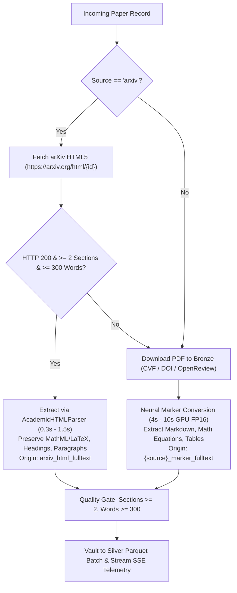

# Distributed Multi-Machine Full-Text Harvester & HTML-First Architecture

## 1. Executive Summary

This document specifies the architecture and operational guide for the **Distributed Multi-Source Academic Full-Text Harvester** (`src/pipelines/run_tier2_fulltext_harvest.py`) and its integration with the **Pure Full-Text LanceDB Gold Vector Lakehouse** (`src/pipelines/run_embed_all_existing_fulltext.py`).

The architecture enables multiple independent machines (e.g., Windows RTX GPUs, macOS Apple Silicon, Linux nodes) to harvest tens of thousands of genuine scientific papers simultaneously with:
1. **Mathematical Partitioning**: Zero download duplication across peer nodes.
2. **Collision-Free Cloud Vaulting**: Independent shard keys in Cloudflare R2.
3. **HTML-First Optimization**: Instant (~0.3s) academic HTML5 extraction for arXiv preprints, bypassing GPU OCR overhead while preserving LaTeX formulas and document structure.
4. **Universal Marker Fallback**: Neural layout and OCR parsing (CUDA FP16) for PDF-only publishers (CVF, DOI journal papers, OpenReview).
5. **Seamless Master Merging**: Deduplicated consolidation of peer shards into the lakehouse master table.

---

## 2. Distributed Architecture & Hash-Modulo Sharding

```
                        +---------------------------------------+
                        | Candidates Pool (near_past_papers)    |
                        | (OpenReview + CVF + DOI + arXiv)      |
                        +---------------------------------------+
                                            |
                       Hash-Modulo Partition: MD5(PID) % N
                     /                      |                   \
       Shard Index 0                  Shard Index 1       Shard Index K
    [Machine 0: Win/GPU]           [Machine 1: macOS]    [Machine K: Linux]
             |                              |                   |
    arXiv HTML5 / Marker           arXiv HTML5 / Marker  arXiv HTML5 / Marker
             |                              |                   |
   fulltext_papers_shard0         fulltext_papers_shard1  fulltext_papers_shardK
             \                              |                  /
              \                             |                 /
               +---------------------------------------------+
               |  Cloudflare R2 Bucket (silver/tier2/...)    |
               +---------------------------------------------+
                                     |
                       Single-Command Consolidation:
                       --merge-shards --sync-r2
                                     |
               +---------------------------------------------+
               |   Master Table: fulltext_papers.parquet     |
               |       (100% Deduplicated, Pure Fulltext)    |
               +---------------------------------------------+
                                     |
                       Vectorization & Gold Indexing:
                       run_embed_all_existing_fulltext.py
                                     |
               +---------------------------------------------+
               |   LanceDB Gold: scientific_papers_gold      |
               |   Option 2 High-Fidelity IVF-PQ Index       |
               +---------------------------------------------+
```

### 2.1 Hash-Modulo Partitioning Formula
Each candidate paper with unique identifier `paper_id` is assigned to a specific shard worker using deterministic MD5 hashing:

$$\text{worker\_shard} = \text{int}\Big(\text{MD5}(\text{paper\_id}), 16\Big) \pmod{\text{total\_shards}}$$

* If $\text{worker\_shard} == \text{shard\_index}$, the machine processes the paper.
* Otherwise, the paper is skipped instantly (0 ms CPU cost), ensuring **zero redundant downloads**.

### 2.2 Deduplication Shield & Safe Resharding
Before downloading or parsing any document, the harvester queries local and remote Parquet caches via `_load_existing_ids()`.
* **Safe Resharding**: When expanding from $N=2$ to $N=4$ machines, workers can be reconfigured with a new `--total-shards` setting at any time. Any paper already collected in earlier shard files is automatically recognized and skipped. No duplicate work is ever executed.
* **Collision-Free R2 Storage**: Each worker uploads exclusively to its dedicated remote path: `silver/tier2/fulltext_papers_shard{shard_index}.parquet`.

---

## 3. Dual-Engine Extraction: HTML-First with Marker Fallback

Scientific literature is heterogeneous in distribution formats:
* **DOI Journals** (Nature, IEEE, Springer, ACM, PLOS) and **CVF Conferences** (CVPR, ICCV) distribute papers exclusively as **PDFs**.
* **arXiv Preprints** provide experimental **arXiv HTML5** (`https://arxiv.org/html/{paper_id}`) for submissions compiled with LaTeXML (late 2023+).

### 3.1 Decision Flow



### 3.2 Feature Matrix: HTML5 vs. Marker PDF

| Dimension | arXiv HTML5 Engine | Neural Marker Engine |
| :--- | :--- | :--- |
| **Target Sources** | arXiv preprints (2023–2026) | All publishers (DOI, CVF, OpenReview, arXiv) |
| **Latency per Paper** | **0.3s – 1.5s** (Instant DOM parse) | **4.0s – 10.0s** (Vision Transformer OCR) |
| **Hardware Required** | Lightweight CPU | GPU recommended (CUDA FP16 / Apple MPS) |
| **Math Preservation** | MathML and inline LaTeX annotations | Layout Transformer LaTeX OCR |
| **Section Hierarchy** | Structured `<section>`, `<h2>` tags | Markdown headers (`#`, `##`, `###`) |
| **Network Footprint** | ~200 KB – 800 KB (HTML payload) | ~2.0 MB – 15.0 MB (Binary PDF) |

---

## 4. Multi-Machine Operational Deployment Guide

### 4.1 Running with 2 Machines (User + 1 Friend)
* **Machine 0 (Your PC)**:
  ```powershell
  .venv\Scripts\python.exe src/pipelines/run_tier2_fulltext_harvest.py --max-papers 25000 --batch-size 50 --shard-index 0 --total-shards 2 --sync-r2
  ```
* **Machine 1 (Friend's Mac/Linux)**:
  ```bash
  .venv/bin/python src/pipelines/run_tier2_fulltext_harvest.py --max-papers 25000 --batch-size 50 --shard-index 1 --total-shards 2 --sync-r2
  ```

### 4.2 Scaling to 4 Machines (User + 3 Friends)
* **Machine 0 (You)**: `--shard-index 0 --total-shards 4 --sync-r2`
* **Machine 1 (Friend 1)**: `--shard-index 1 --total-shards 4 --sync-r2`
* **Machine 2 (Friend 2)**: `--shard-index 2 --total-shards 4 --sync-r2`
* **Machine 3 (Friend 3)**: `--shard-index 3 --total-shards 4 --sync-r2`

### 4.3 Consolidating All Peer Shards (Master Merge)
When the desired harvesting target is reached, run the consolidation command on any machine connected to R2:
```powershell
.venv\Scripts\python.exe src/pipelines/run_tier2_fulltext_harvest.py --merge-shards --sync-r2
```
This merges `fulltext_papers_shard0.parquet`, `fulltext_papers_shard1.parquet`, etc., into `data/silver/tier2/fulltext_papers.parquet`, deduplicates by `paper_id`, and syncs the consolidated master to Cloudflare R2.

---

## 5. Current Lakehouse Full-Text Audit & Vectorization Metrics

As of **October 13, 2026**:

| Metric | Value | Description |
| :--- | :--- | :--- |
| **Total Genuine Full-Text Papers** | **12,639** | Unique verified academic papers with full body sections across Silver |
| — *Deep Chunks Lakehouse (`chunks.parquet`)* | **8,729** | Peer-reviewed DOI journal works (Nature, IEEE, Springer, PLOS) |
| — *Tier 1 Landmark Works (`landmark_papers.parquet`)* | **3,000** | Canonical breakthrough AI/ML foundational papers |
| — *Tier 2 Distributed Harvest (`fulltext_papers.parquet`)* | **910** | Consolidated master harvest (501 arXiv, 248 CVF, 161 DOI) |
| **Already Embedded in LanceDB Gold** | **12,488 (98.8%)** | Fully vectorized with Nomic-Embed-Text 768-D |
| **Pending Vectorization** | **151 (1.2%)** | Unembedded papers from the most recent harvest session |
| **Total Dense Vectors in Gold Layer** | **601,509** | Vaulted in `scientific_papers_gold.lance` |
| **Vector Index Type** | **IVF-PQ Option 2** | High-Fidelity ($K=1024$ centroids, $M=192$ sub-vectors, Cosine) |
| **R2 Remote Storage Utilization** | **~4.15 GB** | Safe headroom within the 10.00 GB free tier |
