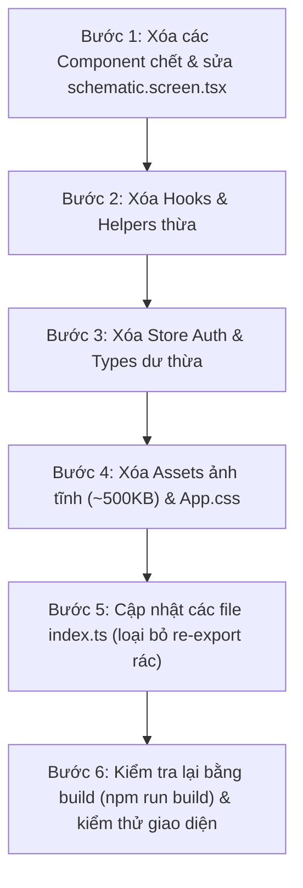

# Frontend Cleanup & Dead Code Audit

Tài liệu này tổng hợp toàn bộ các thành phần mã nguồn dư thừa, không sử dụng (dead code), component mồ côi (orphaned), asset rác và các module đã lỗi thời trong thư mục `frontend/`. 
Bạn có thể dùng tài liệu này làm checklist để theo dõi quá trình tinh gọn và tối ưu hóa frontend.

---

## 📊 Tổng quan Thống kê

| Phân loại | Số lượng file | Ước tính dung lượng / dòng code | Độ an toàn khi xóa |
| :--- | :---: | :---: | :---: |
| **Component "chết" & lỗi thời** | 15 files | ~1.850 dòng code | ✅ An toàn tuyệt đối (100% không ai import) |
| **Hooks & Tiện ích thừa** | 5 files | ~220 dòng code | ✅ An toàn (Không còn nơi nào gọi) |
| **Store & Type dư thừa** | 4 files | ~110 dòng code | ✅ An toàn (Chỉ liên quan tới auth/search cũ) |
| **File Điều hướng (Routing) ảo** | 2 files | ~120 dòng code | ✅ An toàn (App dùng state, không dùng router) |
| **Asset ảnh tĩnh & Template rác** | 5 files | ~505 KB bundle size | ✅ An toàn (Ảnh chụp màn hình nhầm & logo mẫu) |
| **CSS mẫu & Theme TypeScript thừa**| 6 files | ~300 dòng code | ✅ An toàn (CSS thuần đã chuyển vào `index.css`) |
| **File rỗng dạng placeholder** | 5 files | 5 dòng (`export {};`) | ✅ An toàn |

---

## 1. Danh sách Chi tiết các Thành phần cần loại bỏ

### 1.1. Các Component "chết" (Dead / Orphaned Components)

| Đường dẫn file | Dòng code | Lý do kỹ thuật chi tiết |
| :--- | :---: | :--- |
| `frontend/src/components/schematic/GeometricPipelineDiagram.component.tsx` | 591 | Sơ đồ pipeline dạng hộp cũ. Đã được thay thế hoàn toàn bởi `InteractiveWorkflowCanvas.component.tsx`. Hiện không được `schematic.screen.tsx` import. |
| `frontend/src/components/schematic/PipelineFlow.component.tsx` | 336 | Sơ đồ luồng 4 pha (Phase 1-4) phiên bản cũ. Bị thay thế hoàn toàn bởi `InteractiveWorkflowCanvas.component.tsx`. |
| `frontend/src/components/charts/GeometricTelemetryGauges.component.tsx` | 18 | Được render trong `schematic.screen.tsx` (dòng 129) dưới dạng `<GeometricTelemetryGauges />` **không có children**. Chỉ sinh ra 1 thẻ `<div>` rỗng có `marginBottom: 24px` gây khoảng trắng thừa. |
| `frontend/src/components/charts/CategoryStatsCard.component.tsx` | 80 | Biểu đồ thanh ngang phân bố danh mục. Không có màn hình nào import. |
| `frontend/src/components/charts/RadialGauge.component.tsx` | 110 | Đồng hồ đo hình tròn SVG. Không màn hình nào import. |
| `frontend/src/components/charts/LatentMatrix.component.tsx` | 95 | Ma trận phân bố không gian tiềm ẩn. Không màn hình nào import. |
| `frontend/src/components/charts/WaveformBars.component.tsx` | 75 | Thanh sóng âm thanh/xung nhịp giả lập. Không màn hình nào import. |
| `frontend/src/components/charts/TimelineChart.component.tsx` | 130 | Biểu đồ đường mốc thời gian độc lập. Màn hình EDA hiện tại tự render biểu đồ timeline riêng. |
| `frontend/src/components/home/home.component.tsx`<br/>`frontend/src/components/home/index.ts` | 33 | Component bọc layout `Home` (`toolbar`, `content`, `footer`). Hệ thống không dùng trang home này. |
| `frontend/src/components/paper/PaperCard.component.tsx`<br/>`frontend/src/components/paper/index.ts` | 83 | Thẻ hiển thị tóm tắt bài báo độc lập. Không màn hình nào sử dụng. |
| `frontend/src/components/chat/ChatBubble.component.tsx`<br/>`frontend/src/components/chat/index.ts` | 45 | Bong bóng chat. Màn hình `GroundedRagChat.component.tsx` đã tự xây dựng giao diện hiển thị tin nhắn và trích dẫn inline. |
| `frontend/src/components/common/TrendingTopicCard.component.tsx` | 42 | Thẻ chủ đề xu hướng mockup, không liên kết API hay màn hình Pillars. |
| `frontend/src/components/glass/GlassCard.component.tsx`<br/>`frontend/src/components/glass/GlassBackground.component.tsx`<br/>`frontend/src/components/glass/index.ts` | 150 | Thử nghiệm hiệu ứng kính mờ 3D ban đầu. Không có màn hình nào import. |
| `frontend/src/navigation/header/ThemeToggle.component.tsx` | 38 | Bị trùng lặp: `NavRail.component.tsx` đã dùng `navigation/rail/ThemeToggle.component.tsx`. File ở header bị mồ côi, không được export trong `navigation/header/index.ts`. |
| `frontend/src/navigation/header/StatusBar.component.tsx` | 49 | Thanh footer cũ (32px) hiển thị tổng số paper. Đã bị loại bỏ khi đưa các chỉ số lên `HeaderBar` đầu trang. |

---

### 1.2. Hooks & Hàm Tiện Ích thừa (Dead Hooks & Helpers)

| Đường dẫn file | Lý do kỹ thuật chi tiết |
| :--- | :--- |
| `frontend/src/hooks/utils/cn.ts` | Tiện ích gộp class name `cn(...)`. Dự án sử dụng 100% inline styles (`style={{ ... }}`), hàm này không được gọi ở bất kỳ file nào. |
| `frontend/src/hooks/utils/useToast.ts` | Hook quản lý toast notification. Hoàn toàn không có component nào gọi. |
| `frontend/src/hooks/utils/useTilt3D.ts` | Hook bắt sự kiện chuột tạo độ nghiêng 3D, chỉ được import trong component chết `GlassCard.component.tsx`. |
| `frontend/src/hooks/useEdaFormulas.ts` | Hook đọc công thức toán, chỉ được dùng bởi 2 file sơ đồ chết `GeometricPipelineDiagram` và `PipelineFlow`. |
| `frontend/src/hooks/helpers/index.ts` | File rỗng chỉ có `export {};`. |

---

### 1.3. Stores & Types không phục vụ hệ thống

| Đường dẫn file | Lý do kỹ thuật chi tiết |
| :--- | :--- |
| `frontend/src/store/auth.store.ts` | Store quản lý user và đăng nhập/đăng xuất (`useAuthStore`). Hệ thống là công cụ khai phá dữ liệu học thuật mở, không có cơ chế xác thực tài khoản. |
| `frontend/src/types/entities/user.entity.ts` | Định nghĩa `UserEntity` chỉ phục vụ store auth ở trên. |
| `frontend/src/types/entities/search.entity.ts` | Định nghĩa các interface `SearchQuery`, `SearchHit`, `SearchResponse`, `SearchSortBy`, `SearchFilters`. Tính năng tìm kiếm trên Canvas sử dụng `LakehouseSearchResult` từ `analytics.entity.ts`. |
| `frontend/src/types/entities/section.entity.ts` | Đặt tên sai ngữ nghĩa: file tên `section.entity.ts` nhưng thực tế chứa type điều hướng UI (`AppTab`, `NavItem`, `PipelineStageKey`), không chứa thông tin section của bài báo. |

---

### 1.4. File Điều Hướng (Navigation) ảo

| Đường dẫn file | Lý do kỹ thuật chi tiết |
| :--- | :--- |
| `frontend/src/navigation/linking.ts` | Hỗ trợ URL routing và deep-linking (`LINKING_CONFIG`, `buildPaperLink`, `matchTabFromPath`). Ứng dụng hiện tại chuyển tab thuần túy qua React state (`activeTab` trong `App.tsx`) và không cài thư viện router. |
| `frontend/src/navigation/routes.ts` | Mảng `NAV_ITEMS` và hàm `navigateToTab`. `NavRail` đã tự định nghĩa `NAV_RAIL_ITEMS` trong `NavRail.types.ts` và dùng callback qua props. |

---

### 1.5. Asset Ảnh tĩnh, Template rác & CSS thừa

| Đường dẫn file | Dung lượng / Dòng | Lý do kỹ thuật chi tiết |
| :--- | :---: | :--- |
| `frontend/src/assets/ui.png` | **211 KB** | Ảnh chụp giao diện cũ lưu nhầm vào thư mục source code, không hề được import vào web. |
| `frontend/src/assets/ui_ex.jpg` | **271 KB** | Tương tự, ảnh chụp màn hình demo cũ bị commit nhầm vào `src/assets/`. |
| `frontend/src/assets/hero.png` | **13 KB** | Ảnh minh họa cũ, không được sử dụng. |
| `frontend/src/assets/react.svg` | 4.1 KB | Logo React mặc định khi khởi tạo project bằng Vite. |
| `frontend/src/assets/vite.svg` | 8.6 KB | Logo Vite mặc định khi khởi tạo project. |
| `frontend/src/App.css` | 184 dòng | File CSS mặc định của template Vite (chứa class `.counter`, `.hero`, `.vite`), không được import ở bất cứ đâu. |
| `frontend/src/theme/colors.ts`<br/>`spacing.ts`<br/>`typography.ts`<br/>`tw.ts`<br/>`index.ts` | ~120 dòng | Toàn bộ các file TypeScript khai báo token theme bằng JS object. Dự án đã chuyển hoàn toàn sang CSS variables trong `index.css`, không file nào import các hằng số này. |
| `assets/index.ts`<br/>`assets/icon/index.ts`<br/>`assets/images/index.ts`<br/>`assets/images/background/index.ts` | 4 dòng | 4 file trống chỉ chứa `export {};`. |

---

### 1.6. Vấn đề File Đa ngôn ngữ (i18n)

* `frontend/src/assets/languages/en.json` & `vi.json` (**566 dòng**):
  * Trong toàn bộ dự án, chỉ có đúng **~10 key** thuộc nhóm `nav.*` (`nav.schematic`, `nav.eda`, `nav.pillars`, `nav.rag`, `nav.logs`, `nav.schematicTitle`, ...) là được gọi qua hàm `t(...)`.
  * Hơn **270 key** còn lại (`common.*`, `dashboard.*`, `search.*`, `rag.*`, `eda.*`, `storage.*`) hoàn toàn **không được gọi**, vì các component đều viết điều kiện ngôn ngữ trực tiếp dạng `language === 'vi' ? '...' : '...'`.

---

## 2. Kế hoạch Dọn dẹp theo từng bước (Step-by-step Execution Plan)

Khi bạn muốn bắt đầu dọn dẹp, quy trình thực hiện an toàn như sau:



### Bước 1: Xóa các component chết
- Xóa `components/schematic/GeometricPipelineDiagram.component.tsx` và `components/schematic/PipelineFlow.component.tsx`.
- Gỡ bỏ `<GeometricTelemetryGauges />` trong `screens/schematic.screen.tsx` và xóa file `components/charts/GeometricTelemetryGauges.component.tsx`.
- Xóa các chart mồ côi: `CategoryStatsCard`, `RadialGauge`, `LatentMatrix`, `WaveformBars`, `TimelineChart`.
- Xóa các thư mục không dùng: `components/home/`, `components/paper/`, `components/chat/`, `components/glass/`.
- Xóa `navigation/header/ThemeToggle.component.tsx` và `navigation/header/StatusBar.component.tsx`.

### Bước 2: Xóa Hooks và Helpers thừa
- Xóa `hooks/utils/cn.ts`, `hooks/utils/useToast.ts`, `hooks/utils/useTilt3D.ts`, `hooks/useEdaFormulas.ts`.
- Xóa file rỗng `hooks/helpers/index.ts`.

### Bước 3: Xóa Stores và Types thừa
- Xóa `store/auth.store.ts`.
- Xóa `types/entities/user.entity.ts`, `types/entities/search.entity.ts`.
- Chuyển các type UI trong `types/entities/section.entity.ts` vào đúng vị trí hoặc đổi tên phù hợp.

### Bước 4: Xóa Assets rác và CSS thừa
- Xóa `frontend/src/assets/ui.png`, `ui_ex.jpg`, `hero.png`, `react.svg`, `vite.svg`.
- Xóa `frontend/src/App.css`.
- Xóa các file `index.ts` rỗng trong `assets/`.
- Xóa các file TypeScript theme không dùng trong `frontend/src/theme/` (`colors.ts`, `spacing.ts`, `typography.ts`, `tw.ts`, `index.ts`).

### Bước 5: Cập nhật các file `index.ts`
- Cập nhật các file `index.ts` trong `components/charts/`, `components/schematic/`, `components/common/`, `navigation/header/`, `hooks/`, `store/`, `types/` để gỡ bỏ export các file đã xóa.

### Bước 6: Kiểm tra xác thực (Validation)
- Chạy lệnh build kiểm tra TypeScript:
  ```bash
  npm run build --prefix frontend
  ```
- Đảm bảo 0 lỗi biên dịch và giao diện hot-reload trên [http://localhost:5173](http://localhost:5173) hoạt động trơn tru.
