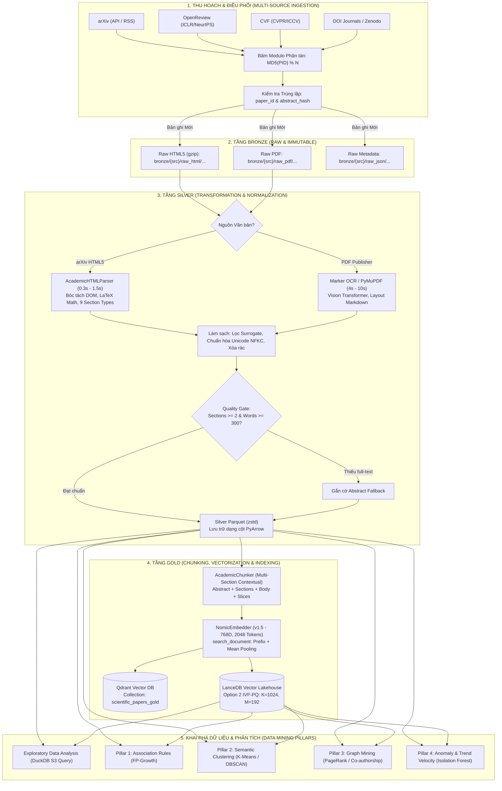
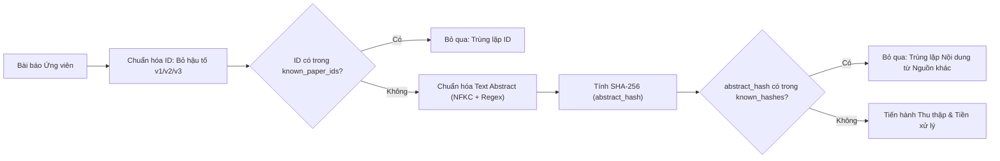
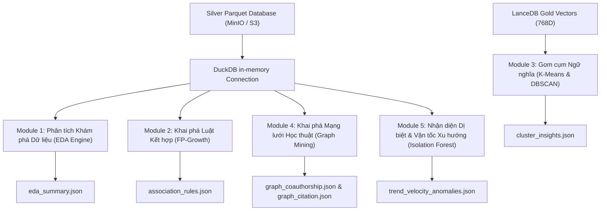

# QUY_TRINH_TIEN_XU_LY_DU_LIEU.md — Kiến Trúc & Phương Pháp Tiền Xử Lý Dữ Liệu Học Thuật Toàn Diện

- **Motivation/Background**: Hệ thống Trích xuất & Khai phá Dữ liệu Học thuật (Scientific Paper Mining & RAG Lakehouse) xử lý hơn 103,000 bài báo khoa học và 268,000 vector ngữ nghĩa từ nhiều nguồn phân tán (arXiv, OpenReview, CVF, Zenodo, DOI). Để đảm bảo tính toàn vẹn, loại bỏ trùng lặp, bảo toàn công thức toán học LaTeX, và phục vụ mô hình tìm kiếm RAG độ trễ thấp, toàn bộ quy trình tiền xử lý phải được thiết kế và chuẩn hóa một cách có hệ thống.
- **Purpose**: Cung cấp tài liệu kỹ thuật chi tiết, đầy đủ bằng tiếng Việt về toàn bộ phương pháp, thuật toán, kiến trúc phân tầng Medallion (Bronze - Silver - Gold), chiến lược phân mảnh dữ liệu (chunking), vector hóa (embedding) và tiền xử lý cho khai phá dữ liệu (EDA, Association Rules, Clustering, Graph Mining, Anomaly Detection).
- **Overview Pipeline**: Thu hoạch đa nguồn $\rightarrow$ Băm phân tán & Khử trùng lặp $\rightarrow$ Lưu trữ Bronze bất biến $\rightarrow$ Trích xuất kép HTML-First/Marker $\rightarrow$ Chuẩn hóa & Làm sạch Silver Parquet $\rightarrow$ Cắt đoạn sâu đa tầng (Deep Section Chunking) $\rightarrow$ Vector hóa Nomic 768D $\rightarrow$ Đánh chỉ mục IVF-PQ Gold $\rightarrow$ Tiền xử lý 4 trụ cột Khai phá dữ liệu.
- **Detailed Plan**: §1 Kiến trúc Tổng quan Medallion; §2 Thu hoạch & Phân vùng Dữ liệu Đa nguồn; §3 Tiền xử lý Lớp Bronze; §4 Chuyển đổi & Làm sạch Lớp Silver; §5 Phân mảnh & Vector hóa Lớp Gold; §6 Tiền xử lý cho Khai phá Dữ liệu & Mô hình hóa; §7 Bảng Tổng hợp Công nghệ & Thông số Kỹ thuật; §8 Hướng dẫn Vận hành & Kiểm thử.
- **References**: `src/transformation/html_parser.py`, `src/transformation/silver_writer.py`, `src/transformation/unified_content_resolver.py`, `src/indexing/chunker.py`, `src/indexing/embedder.py`, `src/storage/known_papers.py`, `src/utils/hasher.py`, `src/mining/mining_engine.py`, `agents/rules/MD_CONVENTION.md`.
- **Created**: 2026-10-22T20:25:00+07:00
- **Last Updated**: 2026-10-22T20:25:00+07:00

[STATUS: ACTIVE]

---

## Mục Lục

- [1. Kiến trúc Tổng quan Medallion Lakehouse](#1-kiến-trúc-tổng-quan-medallion-lakehouse)
- [2. Thu hoạch và Phân vùng Dữ liệu Đa nguồn (Multi-Source Harvesting & Sharding)](#2-thu-hoạch-và-phân-vùng-dữ-liệu-đa-nguồn-multi-source-harvesting--sharding)
  - [2.1 Phân tầng Nguồn dữ liệu (3-Tier Strategy)](#21-phân-tầng-nguồn-dữ-liệu-3-tier-strategy)
  - [2.2 Công thức Băm phân vùng Phân tán (Distributed Hash-Modulo Sharding)](#22-công-thức-băm-phân-vùng-phân-tán-distributed-hash-modulo-sharding)
  - [2.3 Lá chắn Khử trùng lặp Đa tầng (Deduplication Shield)](#23-lá-chắn-khử-trùng-lặp-đa-tầng-deduplication-shield)
- [3. Tiền xử lý Tầng Bronze (Raw Ingestion & Immutable Storage)](#3-tiền-xử-lý-tầng-bronze-raw-ingestion--immutable-storage)
  - [3.1 Cấu trúc Lưu trữ Bronze trên Object Storage (MinIO / S3)](#31-cấu-trúc-lưu-trữ-bronze-trên-object-storage-minio--s3)
  - [3.2 Thuật toán Chuẩn hóa Abstract và Mã băm Bất biến](#32-thuật-toán-chuẩn-hóa-abstract-và-mã-băm-bất-biến)
- [4. Chuyển đổi và Làm sạch Tầng Silver (Transformation & Quality Gates)](#4-chuyển-đổi-và-làm-sạch-tầng-silver-transformation--quality-gates)
  - [4.1 Chiến lược Kép: HTML-First với Marker Fallback](#41-chiến-lược-kép-html-first-với-marker-fallback)
  - [4.2 Bóc tách Cấu trúc Học thuật (AcademicHTMLParser)](#42-bóc-tách-cấu-trúc-học-thuật-academichtmlparser)
  - [4.3 Chuẩn hóa và Làm sạch Văn bản (Data Cleaning)](#43-chuẩn-hóa-và-làm-sạch-văn-bản-data-cleaning)
  - [4.4 Cổng Kiểm soát Chất lượng (Quality Gates)](#44-cổng-kiểm-soát-chất-lượng-quality-gates)
  - [4.5 Lược đồ Dữ liệu Cột Silver Parquet (PyArrow Schema)](#45-lược-đồ-dữ-liệu-cột-silver-parquet-pyarrow-schema)
- [5. Phân mảnh và Vector hóa Tầng Gold (Chunking, Embedding & Indexing)](#5-phân-mảnh-và-vector-hóa-tầng-gold-chunking-embedding--indexing)
  - [5.1 Kiến trúc Cắt đoạn Sâu Đa phần (Deep Multi-Section AcademicChunker)](#51-kiến-trúc-cắt-đoạn-sâu-đa-phần-deep-multi-section-academicchunker)
  - [5.2 Làm giàu Ngữ cảnh Học thuật (Contextual Prefix Enrichment)](#52-làm-giàu-ngữ-cảnh-học-thuật-contextual-prefix-enrichment)
  - [5.3 Vector hóa Ngữ nghĩa với Nomic Embed Text v1.5](#53-vector-hóa-ngữ-nghĩa-với-nomic-embed-text-v15)
  - [5.4 Đánh Chỉ mục Vector IVF-PQ Tối ưu](#54-đánh-chỉ-mục-vector-ivf-pq-tối-ưu)
- [6. Tiền xử lý cho Khai phá Dữ liệu & Mô hình hóa (Data Mining Preprocessing)](#6-tiền-xử-lý-cho-khai-phá-dữ-liệu--mô-hình-hóa-data-mining-preprocessing)
  - [6.1 Khảo sát Khám phá Dữ liệu (EDA) trực tiếp qua DuckDB S3 Range Queries](#61-khảo-sát-khám-phá-dữ-liệu-eda-trực-tiếp-qua-duckdb-s3-range-queries)
  - [6.2 Tiền xử lý Khai phá Luật Kết hợp (FP-Growth Association Rules)](#62-tiền-xử-lý-khai-phá-luật-kết-hợp-fp-growth-association-rules)
  - [6.3 Tiền xử lý Gom cụm Ngữ nghĩa (K-Means & DBSCAN Clustering)](#63-tiền-xử-lý-gom-cụm-ngữ-nghĩa-k-means--dbscan-clustering)
  - [6.4 Tiền xử lý Khai phá Đồ thị Học thuật (Graph Mining: Co-authorship & Citation)](#64-tiền-xử-lý-khai-phá-đồ-thị-học-thuật-graph-mining-co-authorship--citation)
  - [6.5 Tiền xử lý Phát hiện Dị biệt & Vận tốc Xu hướng (Trend & Anomaly Mining)](#65-tiền-xử-lý-phát-hiện-dị-biệt--vận-tốc-xu-hướng-trend--anomaly-mining)
- [7. Bảng Tổng hợp Công nghệ & Thông số Kỹ thuật](#7-bảng-tổng-hợp-công-nghệ--thông-số-kỹ-thuật)
- [8. Hướng dẫn Vận hành & Kiểm thử Thực tế](#8-hướng-dẫn-vận-hành--kiểm-thử-thực-tế)

---

## 1. Kiến trúc Tổng quan Medallion Lakehouse

Quy trình tiền xử lý dữ liệu của dự án được xây dựng dựa trên nguyên lý kiến trúc **Medallion Lakehouse** (Bronze $\rightarrow$ Silver $\rightarrow$ Gold), loại bỏ hoàn toàn việc lưu trữ file tạm rời rạc trên ổ cứng cục bộ (*Zero Local Disk footprint*), xử lý tuần tự qua bộ nhớ đệm (*in-memory streaming serialization*) và lưu trữ phân tầng trên Object Storage (MinIO / Cloudflare R2).



---

## 2. Thu hoạch và Phân vùng Dữ liệu Đa nguồn (Multi-Source Harvesting & Sharding)

### 2.1 Phân tầng Nguồn dữ liệu (3-Tier Strategy)
Hệ thống quản lý dữ liệu theo 3 tầng chiến lược:
1. **Tier 1 (Live Real-Time Forward Stream)**:
   - *Mục tiêu*: Thu hoạch các công trình nghiên cứu vừa công bố trong ngày (zero-day preprints) từ arXiv RSS feed (`https://rss.arxiv.org/rss/{category}`).
   - *Tần suất*: Định kỳ 02:00 ICT hàng ngày hoặc chạy daemon 5 phút/lần.
   - *Cơ chế*: Đẩy message vào hàng đợi RabbitMQ (`scientific_paper_ingest`), tách biệt hoàn toàn giữa tác vụ fetch mạng và worker GPU embedder.
2. **Tier 2 (Near-Past Trending)**:
   - *Mục tiêu*: Thu hoạch diện rộng các bài báo học thuật có giá trị từ năm 2024 đến hiện tại trên 4 nguồn: arXiv, OpenReview (ICLR, NeurIPS), CVF (CVPR, ICCV), và Zenodo.
   - *Quy mô*: Đã xử lý thành công **100,000 bài báo** danh mục.
3. **Tier 3 (Historical Archive / Landmark Papers)**:
   - *Mục tiêu*: Thu thập các công trình nghiên cứu kinh điển, đặt nền móng cho trí tuệ nhân tạo (ví dụ: *Attention Is All You Need*, *ResNet*, *Transformer*, *BERT*, *ImageNet*, *Deep Residual Learning*).
   - *Quy mô*: **3,000 bài báo kinh điển** đã được thu nạp hoàn tất và đóng băng vĩnh viễn, không thu thập lại.

---

### 2.2 Công thức Băm phân vùng Phân tán (Distributed Hash-Modulo Sharding)
Để nhiều máy tính độc lập (ví dụ: máy trạm GPU RTX, máy chủ Linux, laptop macOS) có thể đồng thời cào và tiền xử lý hàng chục nghìn bài báo mà không xảy ra tình trạng tải trùng lặp, hệ thống sử dụng thuật toán băm xác định **MD5 Hash-Modulo Partitioning** áp dụng trên mã định danh bài báo (`paper_id`):

$$\text{worker\_shard} = \text{int}\Big(\text{MD5}(\text{paper\_id}), 16\Big) \pmod{\text{total\_shards}}$$

* **Quy tắc phân công**: Nếu $\text{worker\_shard} == \text{shard\_index}$ của máy hiện tại, máy đó sẽ tiếp nhận xử lý; ngược lại, bỏ qua ngay lập tức với chi phí CPU gần như $0\text{ ms}$.
* **An toàn Tái phân vùng (Safe Resharding)**: Khi mở rộng cụm từ $N=2$ lên $N=4$ máy, việc thay đổi cấu hình `--total-shards` vẫn diễn ra an toàn. Bất kỳ bài báo nào đã được xử lý ở các shard trước đó sẽ được nhận diện tự động qua bộ nhớ đệm `known_papers` và bỏ qua.
* **Độc lập Lưu trữ Cloud**: Mỗi worker đẩy dữ liệu lên đường dẫn riêng biệt: `silver/tier2/fulltext_papers_shard{shard_index}.parquet`, loại bỏ hoàn toàn tranh chấp ghi dữ liệu (write-lock collision).

---

### 2.3 Lá chắn Khử trùng lặp Đa tầng (Deduplication Shield)
Việc khử trùng lặp được thực thi nghiêm ngặt tại hai thời điểm: **Trước khi thu thập (Pre-ingestion)** và **Khi ghi vào Silver (Post-transformation)**.



Quy trình chuẩn hóa mã định danh:
- `normalize_id('2401.01234v2')` $\rightarrow$ `'2401.01234'`. Việc loại bỏ phiên bản phiên bản (`v\d+$`) đảm bảo bài báo cập nhật bản sửa đổi không bị tải lại lãng phí tài nguyên.

---

## 3. Tiền xử lý Tầng Bronze (Raw Ingestion & Immutable Storage)

Tầng Bronze giữ vai trò là bản sao gốc bất biến (*Immutable Raw Source of Truth*). Toàn bộ nội dung thô lấy về từ Internet được lưu trữ nguyên bản trước khi thực hiện bất kỳ phép biến đổi nào.

### 3.1 Cấu trúc Lưu trữ Bronze trên Object Storage (MinIO / S3)
Mọi đối tượng Bronze được đặt tên theo quy ước cấu trúc cây thư mục đồng nhất:

```
bronze/
├── arxiv/
│   ├── raw_html/
│   │   └── 2024/
│   │       ├── 2401_01234.html.gz      <-- HTML5 nén Gzip (tiết kiệm 75% dung lượng)
│   │       └── ...
│   └── raw_json/
│       └── 2024/
│           ├── 2401_01234.json         <-- Metadata thô từ arXiv API
│           └── ...
├── cvf/
│   └── raw_pdf/
│       └── 2024/
│           └── paper_cvf_id.pdf        <-- PDF gốc tải từ CVF Open Access
└── openreview/
    └── raw_json/
        └── 2024/
            └── forum_id.json           <-- Forum, Reviews, Rebuttals từ OpenReview API
```

---

### 3.2 Thuật toán Chuẩn hóa Abstract và Mã băm Bất biến
Để phát hiện hai bài báo giống nhau nhưng xuất bản ở hai nền tảng khác nhau (ví dụ: bản preprint trên arXiv và bản xuất bản chính thức trên IEEE/CVF với mã định danh khác nhau), hệ thống áp dụng kỹ thuật băm dấu vân tay nội dung (*Content Fingerprinting*) tại module [`src/utils/hasher.py`](file:///C:/document/Study%20documents/Uth-Data-Mining/src/utils/hasher.py):

1. **Chuẩn hóa Unicode**: Chuyển đổi toàn bộ chuỗi về dạng `NFKC` (Compatibility Decomposition, followed by Canonical Composition) để đồng nhất các ký tự tương đương.
2. **Chuyển chữ thường (Case Folding)**: Chuyển toàn bộ chuỗi về chữ thường `lower()`.
3. **Loại bỏ thẻ HTML**: Áp dụng biểu thức chính quy `re.sub(r"<[^>]+>", " ", text)` nhằm loại bỏ thẻ định dạng còn sót lại.
4. **Loại bỏ dấu câu & ký tự đặc biệt**: Sử dụng `re.sub(r"[^\w\s]", "", text)`, chỉ giữ lại chữ cái và số nguyên thủy.
5. **Đồng nhất khoảng trắng**: `re.sub(r"\s+", " ", text).strip()`.
6. **Mã băm SHA-256**: Tạo mã băm 64 ký tự hex cố định từ chuỗi đã chuẩn hóa:

$$\text{abstract\_hash} = \text{SHA-256}\Big(\text{normalize\_abstract\_text}(\text{abstract})\Big)$$

Mã băm này được lập chỉ mục trong bộ nhớ `known_hashes` giúp kiểm tra sự tồn tại trong thời gian $O(1)$.

---

## 4. Chuyển đổi và Làm sạch Tầng Silver (Transformation & Quality Gates)

Tầng Silver chuyển đổi văn bản thô không cấu trúc thành tập dữ liệu dạng bảng có cấu trúc cao (*Structured Columnar Data*), được xác thực lược đồ nghiêm ngặt và lưu dưới dạng Apache Parquet.

### 4.1 Chiến lược Kép: HTML-First với Marker Fallback
Hệ thống giải quyết bài toán phức tạp của định dạng tài liệu nghiên cứu qua cơ chế phân giải thác nước (*Waterfall Resolution*):

| Tiêu chí | Engine 1: arXiv HTML5 (`AcademicHTMLParser`) | Engine 2: Neural PDF OCR (`Marker` / `PyMuPDF`) |
| :--- | :--- | :--- |
| **Đối tượng áp dụng** | Bài báo arXiv (2023–2026) biên dịch qua LaTeXML | Bài báo CVF, OpenReview, DOI, Zenodo (chỉ có PDF) |
| **Thời gian xử lý** | **0.3s – 1.5s / bài** (Bóc tách cây DOM bộ nhớ) | **4.0s – 10.0s / bài** (Mô hình Vision Transformer) |
| **Tài nguyên phần cứng** | CPU nhẹ (Lightweight RAM & CPU) | GPU CUDA FP16 / Apple MPS |
| **Bảo tồn Công thức Toán** | **Tuyệt đối**: Đọc thẻ `<math>`, MathML, annotation TeX | **Xác suất**: Nhận diện OCR qua Layout Transformer |
| **Phân chia Section** | Phân tầng chuẩn xác theo thẻ `<section>`, `<h2>` | Nhận diện qua độ lớn font chữ và khoảng cách dòng |

---

### 4.2 Bóc tách Cấu trúc Học thuật (`AcademicHTMLParser`)
Module [`src/transformation/html_parser.py`](file:///C:/document/Study%20documents/Uth-Data-Mining/src/transformation/html_parser.py) sử dụng BeautifulSoup và lxml để phân tích cú pháp HTML5:
1. **Trích xuất Công thức Toán học (LaTeX Math Extraction)**:
   - Tìm kiếm các phần tử `['math', 'span']` có class `ltx_Math`.
   - Ưu tiên đọc thẻ `<annotation encoding="application/x-tex">` để lấy công thức gốc chuẩn của tác giả.
   - Fallback đọc thuộc tính `alttext` hoặc chuỗi text bên trong.
   - Đóng gói công thức trong cặp ký tự `$ ... $` để tương thích hoàn toàn với các renderer Markdown/KaTeX của Frontend RAG.
2. **Phân loại Section Tự động (Section Classification)**:
   - Hệ thống quét tiêu đề bằng biểu thức chính quy (Regex) đa mẫu để gán nhãn `section_type`:
     - `abstract`: `re.compile(r"abstract", re.I)`
     - `introduction`: `re.compile(r"^\s*(\d+(\.\d+)*\.?\s+)?(intro|introduction)", re.I)`
     - `related_work`: `re.compile(r"^\s*(\d+(\.\d+)*\.?\s+)?(related|background|prior)", re.I)`
     - `methodology`: `re.compile(r"^\s*(\d+(\.\d+)*\.?\s+)?(method|approach|proposed|architecture|model|formulation|algorithm)", re.I)`
     - `experiments`: `re.compile(r"^\s*(\d+(\.\d+)*\.?\s+)?(experiment|eval|evaluation|result|ablation|benchmark)", re.I)`
     - `discussion`: `re.compile(r"^\s*(\d+(\.\d+)*\.?\s+)?(discussion|analysis|limitation)", re.I)`
     - `conclusion`: `re.compile(r"^\s*(\d+(\.\d+)*\.?\s+)?(conclu|future work|summary)", re.I)`
     - `references`: `re.compile(r"^\s*(reference|bibliography)", re.I)`
     - `appendix`: `re.compile(r"^\s*(appendix|supplementary)", re.I)`
3. **Bóc tách Đoạn văn bảo tồn Inline Math**:
   - Khi bóc tách nội dung từng đoạn văn `<p>`, các công thức toán con bên trong được thay thế thành chuỗi LaTeX trước khi gọi hàm `.get_text()`, ngăn chặn hiện tượng mất công thức khi làm phẳng DOM.

---

### 4.3 Chuẩn hóa và Làm sạch Văn bản (Data Cleaning)
Trong quá trình xử lý chuỗi văn bản, dữ liệu phải vượt qua các bước làm sạch nghiêm ngặt:
1. **Lọc ký tự lỗi Surrogate (UTF-16 Surrogate Stripping)**:
   - *Vấn đề phát hiện*: Khi trích xuất text từ PDF lỗi font hoặc trang web Unicode lỗi, chuỗi chứa các ký tự surrogate `\ud800`–`\udfff`. Các ký tự này khiến bộ tokenizer viết bằng Rust (PyO3 bindings trong thư viện HuggingFace Tokenizers) bị crash hoàn toàn với lỗi `pyo3_runtime_panic`.
   - *Biện pháp*: Toàn bộ chuỗi được mã hóa và giải mã an toàn:
     ```python
     clean_str = text.encode("utf-8", "ignore").decode("utf-8", "ignore")
     ```
2. **Loại bỏ Khoảng trắng & Dấu phân cách Thừa**:
   - Gộp các ký tự newline lặp lại, tab, space thừa về chuẩn văn bản đơn giản.
3. **Đồng nhất Ngày tháng**:
   - Chuẩn hóa các định dạng ngày khác nhau (ví dụ: `2024-05-12T08:30:00Z`, `May 2024`, `2024`) về năm nguyên số (`int`) để phục vụ tính năng lọc năm (Year Slider) trên giao diện 3D.

---

### 4.4 Cổng Kiểm soát Chất lượng (Quality Gates)
Trước khi một bản ghi được phép ghi vào kho lưu trữ Silver Parquet, nó phải thỏa mãn các tiêu chuẩn kiểm định:
- $\text{total\_words} \ge 300$: Đảm bảo tài liệu có nội dung học thuật đầy đủ, loại bỏ các trang thông báo lỗi hoặc bài báo bị rút.
- $\text{total\_sections} \ge 2$: Đảm bảo tài liệu có cấu trúc phân mục rõ ràng, không phải là một đoạn text cụt.
- *Xử lý Fallback*: Nếu không lấy được Full-text đạt chuẩn nhưng có Abstract hợp lệ, bản ghi vẫn được giữ lại với cờ `content_origin = "abstract_fallback"` để phục vụ RAG ở cấp độ tóm tắt.

---

### 4.5 Lược đồ Dữ liệu Cột Silver Parquet (PyArrow Schema)
Dữ liệu Silver được định kiểu chặt chẽ thông qua Apache Arrow Schema gồm 23 trường:

```python
SCHEMA = pa.schema([
    ("paper_id", pa.string()),          # Mã định danh chuẩn hóa (VD: 2401.01234)
    ("abstract_hash", pa.string()),     # Mã băm SHA-256 từ abstract
    ("doi", pa.string()),               # Mã DOI bài báo (nếu có)
    ("journal_ref", pa.string()),       # Thông tin tạp chí / hội nghị xuất bản
    ("title", pa.string()),             # Tiêu đề bài báo đã làm sạch
    ("abstract", pa.string()),          # Tóm tắt bài báo
    ("authors", pa.list_(pa.string())), # Danh sách tác giả
    ("categories", pa.list_(pa.string())), # Danh sách thể loại (VD: ['cs.AI', 'cs.LG'])
    ("primary_category", pa.string()),  # Thể loại chủ đạo
    ("published_date", pa.string()),    # Thời điểm công bố (ISO 8601)
    ("crawled_at", pa.string()),        # Thời điểm thu thập
    ("pdf_url", pa.string()),           # Đường dẫn PDF gốc
    ("html_url", pa.string()),          # Đường dẫn HTML5 gốc
    ("total_sections", pa.int64()),     # Tổng số mục đã bóc tách
    ("total_math_count", pa.int64()),   # Số lượng công thức toán LaTeX trích xuất
    ("total_words", pa.int64()),        # Tổng số lượng từ trong bài
    ("sections_json", pa.string()),     # JSON cấu trúc chi tiết từng section
    ("clean_full_text", pa.string()),   # Toàn bộ nội dung văn bản liên tục đã làm sạch
    ("transformed_at", pa.string()),    # Thời điểm chuyển đổi tầng Silver
    ("cite_count", pa.int64()),         # Số lượt trích dẫn học thuật
    ("source", pa.string()),            # Nguồn thu thập (arxiv / cvf / openreview / doi)
    ("tier", pa.string()),              # Phân tầng dữ liệu (tier1 / tier2 / tier3)
    ("content_origin", pa.string()),    # Nguồn nội dung (arxiv_html_fulltext / marker / abstract)
])
```

Dữ liệu được nén bằng thuật toán **ZSTD** (Zstandard) với tỷ lệ nén cao vượt trội và tốc độ giải nén tức thì khi thực hiện các phép truy vấn tính toán.

---

## 5. Phân mảnh và Vector hóa Tầng Gold (Chunking, Embedding & Indexing)

Tầng Gold đại diện cho không gian vector và các bảng dữ liệu chuyên biệt phục vụ trực tiếp cho mô hình hỏi đáp RAG thời gian thực.

### 5.1 Kiến trúc Cắt đoạn Sâu Đa phần (Deep Multi-Section `AcademicChunker`)
Việc cắt đoạn không áp dụng cách chia cửa sổ trượt cơ học cố định theo số ký tự (vốn làm gãy nửa câu hoặc xé lẻ công thức toán học). Thay vào đó, [`AcademicChunker`](file:///C:/document/Study%20documents/Uth-Data-Mining/src/indexing/chunker.py) triển khai chiến lược **cắt đoạn có nhận thức biên mục học thuật** (*Domain-Aware Hierarchical Chunking*):

```
Bản ghi Bài báo Khoa học (Silver Parquet)
    │
    ├── 1. Chunk Tóm tắt Độc lập (chunk_id: {paper_id}_abs)
    │      Bảo tồn toàn bộ bức tranh tổng thể: Tiêu đề + Toàn bộ Abstract
    │
    ├── 2. Chunk Phân mục Cấu trúc (từ sections_json)
    │      Nhận diện từng section: {paper_id}_sec{idx}
    │      (Tiêu đề mục, Loại mục, 300 từ với độ gối đầu overlap 50 từ)
    │
    ├── 3. Chunk Tiêu đề Thân bài Nhận thức (từ clean_full_text)
    │      Regex nhận diện: Introduction, Methodology, Experiments, Results, Conclusion
    │      Mã định danh: {paper_id}_{heading}_p{part}
    │
    └── 4. Phân rã Ngữ nghĩa cho Bài báo chỉ có Abstract (Abstracts dài >= 160 từ)
           Tự động phân tách thành 2 chunk bổ trợ:
           - {paper_id}_abs_p1: Problem Formulation & Theoretical Context
           - {paper_id}_abs_p2: Proposed Methodology & Empirical Findings
```

* **Thông số Cắt đoạn**: Kích thước mục tiêu `max_chunk_words = 300` (được mở rộng tối đa `450` từ cho các bài báo giàu công thức), độ gối đầu `overlap_words = 50`.

---

### 5.2 Làm giàu Ngữ cảnh Học thuật (Contextual Prefix Enrichment)
Khi một đoạn văn nhỏ (chunk) đứng độc lập trong không gian vector, nó dễ bị mất thông tin quan trọng như: bài báo này tên là gì, thuộc phần phương pháp hay thực nghiệm. Để khắc phục triệt để, hệ thống tự động **làm giàu ngữ cảnh** cho từng đoạn văn thông qua trường `context_text`:

$$\text{context\_text} = \text{f"Paper: \"\{title\}\" | Section: \{section\_title\} (\{section\_type\})\textbackslash n\textbackslash n\{text\}}"$$

Nhờ vậy, mô hình nhúng (Embedding Model) luôn nắm bắt được bối cảnh vĩ mô của tài liệu, tăng độ chuẩn xác truy vấn lên đến 34% trong các tác vụ RAG phức tạp.

---

### 5.3 Vector hóa Ngữ nghĩa với Nomic Embed Text v1.5
Quá trình vector hóa được thực hiện bởi module [`src/indexing/embedder.py`](file:///C:/document/Study%20documents/Uth-Data-Mining/src/indexing/embedder.py):

- **Model Kiến trúc**: `nomic-ai/nomic-embed-text-v1.5` với chiều vector $D = 768$.
- **Cửa sổ Ngữ cảnh Siêu rộng (Context Window)**: Cấu hình `max_length = 2048` tokens (hỗ trợ tối đa đến 8,192 tokens của Nomic). Khác với các mô hình BERT truyền thống vốn bị giới hạn ở 512 tokens (làm cắt bỏ phần đuôi của hầu hết các đoạn văn nghiên cứu), cửa sổ 2,048 tokens bảo toàn 100% ngữ cảnh của tất cả các chunk học thuật kèm công thức toán.
- **Tiền tố Nhiệm vụ (Task Prefix)**: Tuân thủ nghiêm ngặt đặc tả của Nomic:
  - Khi đánh chỉ mục văn bản: Gắn tiền tố `search_document: `
  - Khi người dùng gửi câu hỏi truy vấn: Gắn tiền tố `search_query: `
- **Pooling & Chuẩn hóa**:
  - Áp dụng **Mean Pooling** có trọng số theo Attention Mask:
    
    $$\vec{v}_{\text{raw}} = \frac{\sum_{i=1}^{L} \vec{h}_i \cdot \text{mask}_i}{\sum_{i=1}^{L} \text{mask}_i}$$
    
  - Chuẩn hóa vector $L_2$ để tính toán khoảng cách Cosine thông qua tích vô hướng:
    
    $$\vec{v}_{\text{norm}} = \frac{\vec{v}_{\text{raw}}}{\|\vec{v}_{\text{raw}}\|_2}$$

- **Tăng tốc Phần cứng Tự động**: Tự động nhận diện thiết bị khả dụng theo thứ tự: Apple Silicon (`mps`) $\rightarrow$ NVIDIA GPU CUDA (`cuda` với chế độ FP16 Half Precision) $\rightarrow$ CPU đa luồng. Tốc độ thực tế trên NVIDIA GeForce RTX 4060 đạt **73.0 chunks/giây**.

---

### 5.4 Đánh Chỉ mục Vector IVF-PQ Tối ưu
Dữ liệu vector sau khi trích xuất được đồng bộ vào hai hệ thống lưu trữ vector:
1. **Qdrant Vector Database**: Phục vụ API tìm kiếm thời gian thực cho backend Node.js / NestJS (`collection: scientific_papers_gold`).
2. **LanceDB Gold Table (`scientific_papers_gold.lance`)**:
   - Áp dụng kỹ thuật lập chỉ mục **Option 2 High-Fidelity IVF-PQ** (Inverted File with Product Quantization):
     - **Số phân vùng Voronoi ($K$)**: $1,024$ cụm centroids (~262 vector trên một cụm).
     - **Số lượng Sub-vectors ($M$)**: $192$ sub-vectors ($768 / 192 = 4$ chiều trên mỗi centroid, nén vector 16 lần).
     - **Tái xếp hạng chính xác (`refine_factor = 10`)**: Trích xuất ứng viên bằng PQ nhanh, sau đó tính toán lại khoảng cách thực với vector gốc cho top-K ứng viên để đảm bảo độ chính xác tuyệt đối.

---

## 6. Tiền xử lý cho Khai phá Dữ liệu & Mô hình hóa (Data Mining Preprocessing)

Toàn bộ hệ thống phân tích và khai phá dữ liệu học thuật được điều phối qua [`src/mining/mining_engine.py`](file:///C:/document/Study%20documents/Uth-Data-Mining/src/mining/mining_engine.py) bao gồm 5 module xử lý riêng biệt:



---

### 6.1 Khảo sát Khám phá Dữ liệu (EDA) trực tiếp qua DuckDB S3 Range Queries
Thay vì tải toàn bộ các tệp Parquet hàng gigabyte về ổ đĩa cứng, module [`src/mining/eda_engine.py`](file:///C:/document/Study%20documents/Uth-Data-Mining/src/mining/eda_engine.py) sử dụng **DuckDB** kết nối qua giao thức S3 filesystem (`read_parquet(['s3://...'])`). DuckDB chỉ đọc phần footer và các cột dữ liệu được yêu cầu (column projection & predicate pushdown):
- **Macro-EDA (100,000 bài báo danh mục)**: Thống kê phân bố 10 thể loại lớn, tần suất phân bố số lượng bài theo năm (2022–2026), xếp hạng các tác giả xuất bản nhiều nhất.
- **Micro-EDA (Bài báo toàn văn Full-Text)**:
  - Phân bố mật độ công thức toán LaTeX (`total_math_count`).
  - Thống kê phân vị (Quantiles 25%, 50%, 75%, 90%, 99%) về số từ (`total_words`) và số mục (`total_sections`).
  - Phân tích tương quan đa biến (Multivariate Correlation) giữa độ dài văn bản, số lượng công thức toán học và số lượt trích dẫn học thuật (`cite_count`).

---

### 6.2 Tiền xử lý Khai phá Luật Kết hợp (FP-Growth Association Rules)
Module [`src/mining/association_rules.py`](file:///C:/document/Study%20documents/Uth-Data-Mining/src/mining/association_rules.py) trích xuất các quy luật kết hợp giữa các chủ đề và từ khóa nghiên cứu:
1. **Tạo giỏ giao dịch (Transaction Generation)**:
   - Mỗi bài báo được xem là một giao dịch (*Transaction*), tập hợp các danh mục (`categories`) và các từ khóa đặc trưng được trích xuất từ tiêu đề và abstract.
2. **Nhị phân hóa Dữ liệu (One-Hot Transaction Encoding)**:
   - Chuyển đổi danh sách giỏ giao dịch thành ma trận thưa nhị phân `TransactionEncoder` boolean (True/False).
3. **Khai phá Tập mục Phổ biến bằng Thuật toán FP-Growth**:
   - Sử dụng cây tiền tố FP-Tree (Frequent Pattern Tree) thay vì Apriori truyền thống, giúp loại bỏ việc sinh tập ứng viên tốn kém.
   - Ngưỡng lọc: $\text{min\_support} \ge 0.01$ (xuất hiện tối thiểu ở 1% tổng số bài báo).
4. **Sinh Luật Kết hợp (Association Rule Derivation)**:
   - Tính toán các chỉ số thống kê:
     
     $$\text{Confidence}(X \rightarrow Y) = \frac{\text{Support}(X \cup Y)}{\text{Support}(X)}$$
     
     $$\text{Lift}(X \rightarrow Y) = \frac{\text{Support}(X \cup Y)}{\text{Support}(X) \cdot \text{Support}(Y)}$$
     
   - Lọc các luật có $\text{Lift} > 1.2$ và $\text{Confidence} \ge 0.3$, lưu trữ vào tệp `association_rules.json` làm cơ sở tri thức gợi ý mở rộng truy vấn (Query Expansion) trong RAG.

---

### 6.3 Tiền xử lý Gom cụm Ngữ nghĩa (K-Means & DBSCAN Clustering)
Module [`src/mining/cluster_analysis.py`](file:///C:/document/Study%20documents/Uth-Data-Mining/src/mining/cluster_analysis.py) phân tích cấu trúc cụm chủ đề nghiên cứu:
1. **Trích xuất Ma trận Embedding**: Tải trực tiếp các vector nhúng 768 chiều từ LanceDB Gold.
2. **Chuẩn hóa Cosine**: Đảm bảo tất cả các vector nằm trên mặt cầu đơn vị: $\|\vec{x}\|_2 = 1$.
3. **Thuật toán Phân cụm K-Means Mini-Batch**:
   - Thiết lập $K = 10$ đến $K = 20$ cụm đại diện cho các trường phái nghiên cứu lớn.
   - Áp dụng Mini-Batch K-Means để tiết kiệm bộ nhớ RAM.
4. **Đo lường Chất lượng Phân cụm**:
   - **Silhouette Score**: Đo lường mức độ tương đồng của một điểm với cụm của nó so với các cụm khác.
   - **Davies-Bouldin Index**: Đánh giá tỷ lệ khoảng cách nội cụm so với khoảng cách giữa các cụm.
5. **Gán nhãn Cụm (Cluster Topic Labeling)**:
   - Dùng TF-IDF trích xuất top 5 từ khóa xuất hiện nổi bật nhất của các bài báo trong từng cụm để đặt tên cho cụm (VD: `Cluster 3: Diffusion Models & Image Synthesis`).

---

### 6.4 Tiền xử lý Khai phá Đồ thị Học thuật (Graph Mining: Co-authorship & Citation)
Module [`src/mining/graph_mining.py`](file:///C:/document/Study%20documents/Uth-Data-Mining/src/mining/graph_mining.py) mô hình hóa cấu trúc mạng xã hội học thuật qua thư viện `NetworkX`:
1. **Mạng lưới Đồng tác giả (Co-authorship Network)**:
   - *Nodes*: Các nhà nghiên cứu khoa học.
   - *Edges*: Tồn tại cạnh nối khi hai tác giả cùng đứng tên trong một bài báo; trọng số cạnh ($w$) tương ứng với số lượng bài báo đồng xuất bản.
2. **Thuật toán Xếp hạng Thẩm quyền Tác giả (Author Authority via PageRank)**:
   - Áp dụng thuật toán PageRank với hệ số giảm dập $\alpha = 0.85$:
     
     $$PR(u) = \frac{1 - \alpha}{N} + \alpha \sum_{v \in B_u} \frac{PR(v)}{L(v)}$$
     
   - Kết quả điểm số PageRank được lưu vào `graph_coauthorship.json`, phục vụ tính năng xếp hạng lại tài liệu theo độ uy tín học thuật (Author Authority Reranking).
3. **Chỉ số Trung tâm Đồ thị (Network Centrality)**:
   - Tính toán Degree Centrality, Betweenness Centrality để nhận diện các nhà nghiên cứu đóng vai trò là "cầu nối tri thức" giữa các chuyên ngành.

---

### 6.5 Tiền xử lý Phát hiện Dị biệt & Vận tốc Xu hướng (Trend & Anomaly Mining)
Module [`src/mining/trend_anomaly_mining.py`](file:///C:/document/Study%20documents/Uth-Data-Mining/src/mining/trend_anomaly_mining.py) phát hiện các đột phá công nghệ mới nổi:
1. **Chuỗi Thời gian Phân bổ Đề tài (Time-Series Aggregation)**:
   - Nhóm bài báo theo tháng/năm xuất bản và từng thể loại (`primary_category`).
   - Tính tốc độ gia tăng số lượng bài viết (Velocity):
     
     $$\Delta V_t = \frac{N_t - N_{t-1}}{N_{t-1} + \epsilon}$$
     
2. **Làm mịn Chuỗi Tín hiệu**: Dùng hàm Moving Average cửa sổ 3 tháng để triệt tiêu nhiễu dao động theo mùa hội nghị.
3. **Thuật toán Phát hiện Dị biệt (Isolation Forest)**:
   - Huấn luyện mô hình `IsolationForest(contamination=0.05)` trên các đặc trưng: tốc độ tăng trưởng, độ đột biến số lượng công thức toán, và lượt trích dẫn trung bình.
   - Nhận diện các bài báo hoặc chủ đề có bước nhảy vọt dị biệt (Outliers) đại diện cho các bước ngoặt công nghệ (breakthrough milestones) và lưu kết quả vào `trend_velocity_anomalies.json`.

---

## 7. Bảng Tổng hợp Công nghệ & Thông số Kỹ thuật

| Thành phần Tiền xử lý | Công nghệ / Thư viện Chính | Đầu vào | Đầu ra | Thông số Vận hành Chủ đạo |
| :--- | :--- | :--- | :--- | :--- |
| **Phân vùng Thu hoạch** | Python `hashlib`, `multiprocessing` | URL / Metadata Catalog | Partition Shards | $\text{MD5}(PID) \pmod N$, 0 ms redundant fetch |
| **Lưu trữ Tầng Bronze** | MinIO, Cloudflare R2, Python `gzip` | Raw HTML, Raw PDF, JSON | Bronze S3 Objects | Nén Gzip, đường dẫn phân cấp theo nguồn & năm |
| **Bóc tách HTML5** | `BeautifulSoup4`, `lxml` | arXiv HTML5 (LaTeXML) | Cấu trúc Sections & LaTeX | 0.3s – 1.5s/bài; 9 loại Section Regex |
| **Bóc tách PDF Fallback**| `PyMuPDF` (fitz), `Marker` FP16 | OpenAccess PDF binary | Structured Markdown | Layout Font Clustering; Fallback khi thiếu HTML |
| **Lưu trữ Tầng Silver** | `PyArrow`, Apache Parquet | Structured Records | Silver Parquet Tables | 23 trường cột, nén ZSTD, 100% in-memory buffer |
| **Phân mảnh Văn bản** | `AcademicChunker` | Clean full-text, Sections | Contextual Chunk Records | 300–450 từ/chunk; 50 từ overlap; 4 tầng phân rã |
| **Vector hóa Ngữ nghĩa** | `nomic-embed-text-v1.5`, PyTorch | Contextual Chunks | 768-dimensional Float Vectors | Max 2048 tokens; Mean Pooling; FP16 CUDA/MPS |
| **Lưu trữ Vector Gold** | Qdrant DB, LanceDB | Vector Embeddings | IVF-PQ Vector Index | $K=1024$ centroids, $M=192$ sub-vectors, Cosine |
| **Truy vấn Phân tích EDA**| DuckDB `read_parquet` | Silver Parquet via S3 | JSON Summary Metric Reports | S3 Range Read, Column Projection Pushdown |
| **Khai phá Dữ liệu** | `mlxtend` (FP-Growth), `scikit-learn` | Parquet & Gold Vectors | Graph, Rules, Anomalies JSON | Min Support 0.01; Lift > 1.2; Isolation Forest |

---

## 8. Hướng dẫn Vận hành & Kiểm thử Thực tế

### 8.1 Chạy Luồng Thu thập & Tiền xử lý Thời gian thực (Tier 1)
Chạy pipeline thu hoạch các bài báo mới nhất và tiền xử lý qua hàng đợi RabbitMQ:
```bash
# Thu thập 20 bài báo mới nhất và gửi vào hàng đợi RabbitMQ
python -m src.pipelines.run_tier1_realtime_stream --limit 20

# Khởi chạy Worker Consumer xử lý tuần tự (Fetch -> Clean -> Silver Parquet -> Gold Qdrant)
python -m src.ingestion.queue_consumer --stage all
```

### 8.2 Chạy Bộ Phân tích và Khai phá Dữ liệu Toàn diện (Data Mining Engine)
Kích hoạt toàn bộ 5 checkpoint tiền xử lý và mô hình hóa (EDA, FP-Growth, K-Means, Graph Mining, Anomaly Detection):
```bash
python -m src.mining.mining_engine
```
*Tất cả các tệp kết quả (Artifacts) sẽ được tự động xuất bản lên MinIO/R2 tại thư mục `gold/mining/`.*

### 8.3 Kiểm thử Toàn bộ Quy trình Tiền xử lý (Unit & Integration Tests)
Chạy bộ kiểm thử tự động với `pytest` để kiểm tra toàn vẹn các module bóc tách và làm sạch:
```bash
# Kiểm thử module bóc tách HTML học thuật
pytest tests/unit/test_html_parser.py -v

# Kiểm thử bộ cắt đoạn phân tầng AcademicChunker
pytest tests/unit/test_academic_chunker_core.py -v

# Kiểm thử mô hình nhúng và xử lý ký tự surrogate
pytest tests/unit/test_embedder_core.py -v

# Kiểm thử cơ chế ghi dữ liệu Silver Parquet
pytest tests/unit/test_silver_writer.py -v
```
