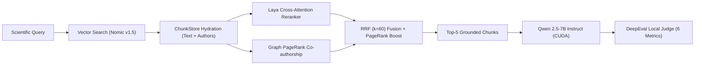
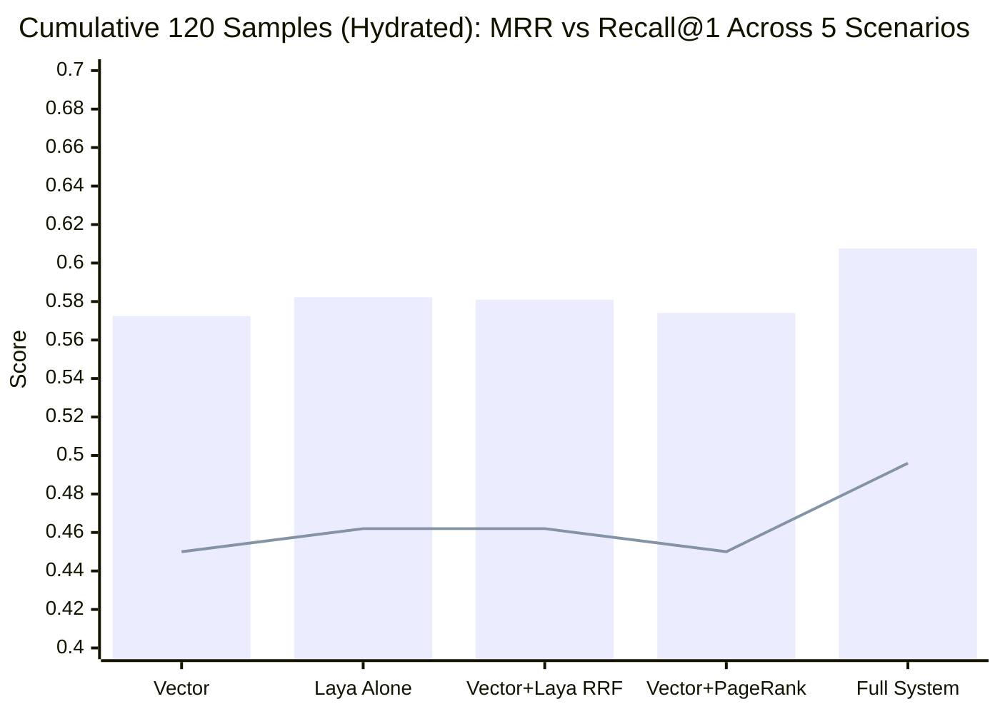
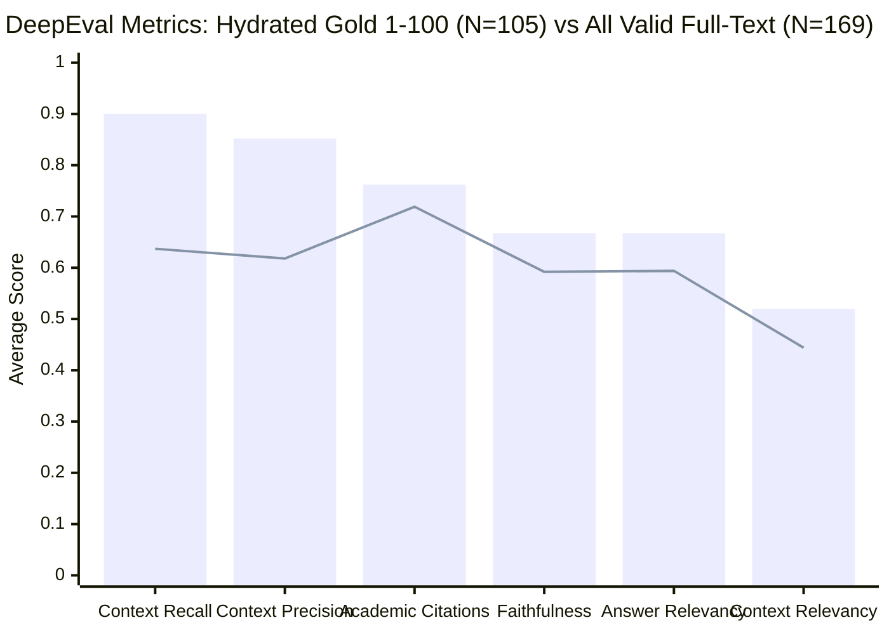

# Laya Reranker & Graph PageRank Authority Benchmark Report

- **Motivation/Background**: To evaluate the retrieval ranking and generation performance of combining Dense Vector search, local Laya Cross-Attention reranking (`convaiinnovations/laya`), and Graph PageRank Co-authorship Authority Boost across scientific papers with full chunk hydration (`D-058`).
- **Purpose**: Provide a concise, visual benchmark report detailing (1) the hydrated 120-sample 5-scenario ranking retrieval comparison (including `Recall@5` and `Hit@10`) and (2) the DeepEval generation evaluation on verified full-text contexts.
- **Overview Pipeline**: Query -> Nomic Embed v1.5 Vector Search -> ChunkStore Text/Author Hydration -> Laya Cross-Attention Reranking -> RRF (k=60) + Graph PageRank Boost -> Context Slicing (Top-5) -> Local Qwen 2.5-7B Generation -> DeepEval 6-Metric Evaluation ($0.00 cost).
- **Detailed Plan**: §1 System Architecture; §2 5-Scenario Retrieval Ranking Benchmark (120 Hydrated Samples & Recall@K Formulas); §3 DeepEval Generation Benchmark (Full System Scenario, Valid Full-Text Contexts); §4 Key Takeaways.
- **References**: [rag_goldens_200.json](../../benchmarks/datasets/rag_goldens_200.json), [laya_5_scenarios_comparison_120q.json](../../logs/benchmarks/laya_5_scenarios_comparison_120q.json), [cached_eval_master_k5_pagerank_local.json](../../logs/benchmarks/cached_eval_master_k5_pagerank_local.json).
- **Created**: 2026-11-06T18:50:00+07:00
- **Last Updated**: 2026-11-07T07:45:00+07:00

[STATUS: ACTIVE]

---

## 1. System Architecture

---

## 2. 5-Scenario Retrieval Ranking Benchmark (`N=120` — Full Text + 29,523-Author PageRank)

| # | Retrieval Scenario | MRR (`N=120`) | Hit@1 (%) | Recall@1 (%) | Hit@5 (%) | Recall@5 (%) | Hit@10 (%) | Delta vs Vector Baseline |
| :-: | :--- | :---: | :---: | :---: | :---: | :---: | :---: | :--- |
| **1** | **Vector (Dense Vector baseline)** | `0.5725` | 49.2% (59/120) | `45.0%` | 67.5% (81/120) | `60.8%` | 75.0% (90/120) | Baseline (`Nomic Embed v1.5` cosine) |
| **2** | **Laya Alone (Cross-Attention)** | `0.5822` | 51.7% (62/120) | `46.2%` | 66.7% (80/120) | `60.0%` | 75.0% (90/120) | **+1.7% MRR / +2.5% Hit@1 / +1.2% Recall@1** |
| **3** | **Vector + Laya (RRF k=60)** | `0.5810` | 50.8% (61/120) | `46.2%` | 67.5% (81/120) | `60.4%` | 75.0% (90/120) | **+1.5% MRR / +1.6% Hit@1 / +1.2% Recall@1** |
| **4** | **Vector + PageRank Authority Boost** | `0.5741` | 49.2% (59/120) | `45.0%` | 68.3% (82/120) | `61.7%` | 75.0% (90/120) | **+0.8% Hit@5 / +0.9% Recall@5** |
| **5** | **Vector + Laya (RRF) + PageRank (Full)** | **`0.6076`** | **55.0% (66/120)** | **`49.6%`** | **69.2% (83/120)** | **`62.1%`** | **75.0% (90/120)** | **+6.1% MRR / +5.8% Hit@1 / +4.6% Recall@1** |

> [!NOTE]
> **How the 3 Recall Metrics Are Calculated**:
> 1. **`Hit@K` (Binary Document Recall@K — Table §2)**: $\text{Hit@K} = \frac{1}{N}\sum_{q=1}^{N} \mathbb{I}(\text{Top}_K(q) \cap G_q \neq \emptyset)$ — Percentage of queries where **at least 1 gold paper** (`relevant_paper_ids`) is ranked within Top-$K$ (`55.0%` at $K=1$, `69.2%` at $K=5$, `75.0%` at $K=10$).
> 2. **`Recall@1` & `Recall@5` (Strict Multi-Paper Recall@K — Table §2)**: $\text{Recall@K} = \frac{1}{N}\sum_{q=1}^{N} \frac{|\text{Top}_K(q) \cap G_q|}{|G_q|}$ — Out of 120 queries, 92 have 1 target paper ($|G_q|=1$) and 28 have 2 target papers ($|G_q|=2$, so a single Rank-1 hit contributes $1/2 = 0.5$ on 2-paper queries); `Recall@1` improves from `45.0%` (Vector) to **`49.6%` (+4.6%)** (Full System) and `Recall@5` improves from `60.8%` to **`62.1%` (+1.3%)**.
> 3. **DeepEval `Contextual Recall` (Statement-Level Recall@5 — Table §3)**: $\frac{\text{\# of ground-truth claims in } \texttt{expected\_output} \text{ supported by Top-5 chunks}}{\text{Total claims in } \texttt{expected\_output}}$ — Measures whether the Top-5 hydrated chunks contain all factual claims needed to answer the query (**`0.900` / `90.0%`** across `N=105` hydrated `gold-001`..`100`).

---

## 3. DeepEval Generation Evaluation (Verified Full-Text Contexts)

> [!IMPORTANT]
> **Active Evaluation Scenario**: **`Vector + Laya (RRF) + Graph PageRank (Full System)`**
> - **Top-K Retrieval Context**: `5` | **Judge Model**: Local `Qwen 2.5-7B Instruct (CUDA)` | **API Cost**: **`$0.00`**
> - Unhydrated empty-context entries (`text: ""` from post-`D-058` Qdrant schema change) were purged from the benchmark cache, `ChunkStore` was extended with OpenReview peer reviews (`clean_full_text`, `consensus_score`), CVPR 2024 metadata, and on-demand 2025 arXiv fetching, and all `gold-001`..`gold-100` (`N=105` samples) were re-evaluated with 100% full-text hydration.

| DeepEval Metric | Gold 20 Subset (`gold-001`..`020`) | Hydrated `gold-001`..`100` (`N=105`) | All 169 Valid Full-Text Samples | Threshold |
| :--- | :---: | :---: | :---: | :---: |
| **Contextual Recall (Statement Recall@5)** | **`0.947`** (94.7%) | **`0.900`** (`89.3%` pass, 92/103) | **`0.637`** (`63.3%` pass, 105/166) | >= 0.70 |
| **Contextual Precision (Precision@5)** | **`0.860`** (86.0%) | **`0.852`** (`83.5%` pass, 86/103) | **`0.618`** (`60.8%` pass, 101/166) | >= 0.70 |
| **Academic Citation Grounding [GEval]** | **`0.747`** (74.7%) | **`0.762`** (`90.4%` pass, 94/104) | **`0.719`** (`86.2%` pass, 144/167) | >= 0.70 |
| **Faithfulness** | **`0.660`** (66.0%) | **`0.667`** (`57.3%` pass, 55/96) | **`0.592`** (`46.8%` pass, 73/156) | >= 0.70 |
| **Answer Relevancy** | **`0.769`** (76.9%) | **`0.667`** (`51.0%` pass, 50/98) | **`0.594`** (`40.6%` pass, 65/160) | >= 0.75 |
| **Contextual Relevancy** | **`0.534`** (53.4%) | **`0.520`** (`45.2%` pass, 42/93) | **`0.444`** (`36.6%` pass, 45/123) | >= 0.60 |

---

## 4. Key Takeaways

1. **Root Cause Fixed (`D-058` Hydration)**: After Qdrant payloads dropped `text`, `title`, and `authors`, unhydrated queries received empty strings `""`, causing Laya and PageRank to produce flat rankings (`0%` delta) and DeepEval Precision/Recall to collapse to `0.009`. `RetrievalService` now hydrates all candidate fields from `ChunkStore` prior to RRF and PageRank scoring.
2. **Generation Scenario**: Evaluated on the **Full Hybrid System (`Vector + Laya Reranker + Graph PageRank`)** at **$0.00 API cost** on Local Qwen 2.5-7B (CUDA).
3. **Synergy (`N=120` Hydrated)**: On the full 120-sample benchmark with 29,523-author PageRank weights from `citation_metrics.parquet`, the **Full System (`Vector + Laya RRF + PageRank`)** lifts MRR from `0.5725` to **`0.6076` (+6.1%)**, `Hit@1` from `49.2%` to **`55.0%` (+5.8%)**, `Hit@5` from `67.5%` to **`69.2%` (+1.7%)**, and strict multi-paper `Recall@5` from `60.8%` to **`62.1%` (+1.3%)**.
