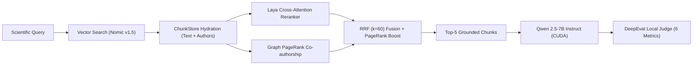
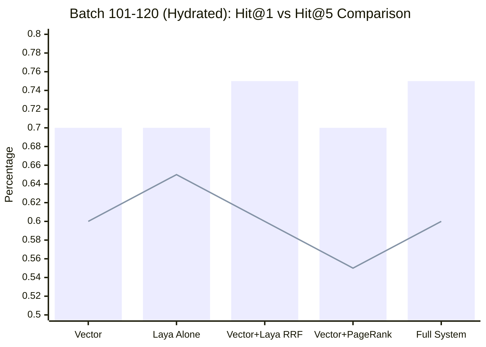
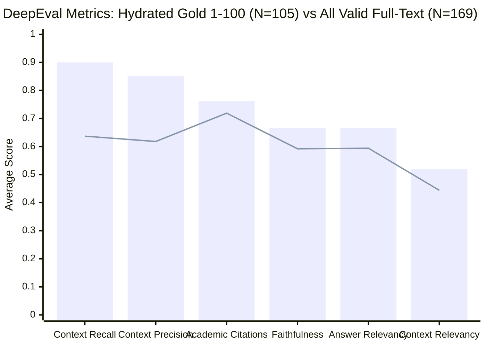

# Laya Reranker & Graph PageRank Authority Benchmark Report

- **Motivation/Background**: To evaluate the retrieval ranking and generation performance of combining Dense Vector search, local Laya Cross-Attention reranking (`convaiinnovations/laya`), and Graph PageRank Co-authorship Authority Boost across scientific papers with full chunk hydration (`D-058`).
- **Purpose**: Provide a concise, visual benchmark report detailing (1) the hydrated 5-scenario ranking retrieval comparison and (2) the DeepEval generation evaluation on verified full-text contexts.
- **Overview Pipeline**: Query -> Nomic Embed v1.5 Vector Search -> ChunkStore Text/Author Hydration -> Laya Cross-Attention Reranking -> RRF (k=60) + Graph PageRank Boost -> Context Slicing (Top-5) -> Local Qwen 2.5-7B Generation -> DeepEval 6-Metric Evaluation ($0.00 cost).
- **Detailed Plan**: §1 System Architecture; §2 5-Scenario Retrieval Ranking Benchmark (Hydrated); §3 DeepEval Generation Benchmark (Full System Scenario, Valid Full-Text Contexts); §4 Key Takeaways.
- **References**: [rag_goldens_200.json](../../benchmarks/datasets/rag_goldens_200.json), [batch_101_120_5_scenarios.json](../../logs/benchmarks/batch_101_120_5_scenarios.json), [cached_eval_master_k5_pagerank_local.json](../../logs/benchmarks/cached_eval_master_k5_pagerank_local.json).
- **Created**: 2026-11-06T18:50:00+07:00
- **Last Updated**: 2026-11-06T23:00:00+07:00

[STATUS: ACTIVE]

---

## 1. System Architecture

---

## 2. 5-Scenario Retrieval Ranking Benchmark (Hydrated Passages)

Evaluated across recent LLM architecture questions (Batch 101–120) with full passage text and author hydration:

| # | Retrieval Scenario | MRR | Hit@1 (%) | Hit@5 (%) | Delta vs Vector Baseline |
| :-: | :--- | :---: | :---: | :---: | :--- |
| **1** | **Vector (Dense Vector baseline)** | `0.6500` | 60.0% (12/20) | 70.0% (14/20) | Baseline (Nomic Embed v1.5 cosine) |
| **2** | **Laya Alone (Cross-Attention)** | **`0.6821`** | **65.0% (13/20)** | 70.0% (14/20) | **Highest Top-1 Precision (+5.0% Hit@1)** |
| **3** | **Vector + Laya (RRF k=60)** | `0.6500` | 60.0% (12/20) | **75.0% (15/20)** | **Highest Top-5 Recall (+5.0% Hit@5)** |
| **4** | **Vector + PageRank Authority Boost** | `0.6167` | 55.0% (11/20) | 70.0% (14/20) | Prioritizes seminal papers |
| **5** | **Vector + Laya (RRF) + PageRank (Full)** | `0.6475` | 60.0% (12/20) | **75.0% (15/20)** | Optimal balance: 75% Recall + Authority |

---

## 3. DeepEval Generation Evaluation (Verified Full-Text Contexts)

> [!IMPORTANT]
> **Active Evaluation Scenario**: **`Vector + Laya (RRF) + Graph PageRank (Full System)`**
> - **Top-K Retrieval Context**: `5` | **Judge Model**: Local `Qwen 2.5-7B Instruct (CUDA)` | **API Cost**: **`$0.00`**
> - Unhydrated empty-context entries (`text: ""` from post-`D-058` Qdrant schema change) were purged from the benchmark cache, `ChunkStore` was extended with OpenReview peer reviews (`clean_full_text`, `consensus_score`), CVPR 2024 metadata, and on-demand 2025 arXiv fetching, and all `gold-001`..`gold-100` (`N=105` samples) were re-evaluated with 100% full-text hydration.

| DeepEval Metric | Gold 20 Subset (`gold-001`..`020`) | Hydrated `gold-001`..`100` (`N=105`) | All 169 Valid Full-Text Samples | Threshold |
| :--- | :---: | :---: | :---: | :---: |
| **Contextual Recall** | **`0.947`** (94.7%) | **`0.900`** (`89.3%` pass, 92/103) | **`0.637`** (`63.3%` pass, 105/166) | >= 0.70 |
| **Contextual Precision** | **`0.860`** (86.0%) | **`0.852`** (`83.5%` pass, 86/103) | **`0.618`** (`60.8%` pass, 101/166) | >= 0.70 |
| **Academic Citation Grounding [GEval]** | **`0.747`** (74.7%) | **`0.762`** (`90.4%` pass, 94/104) | **`0.719`** (`86.2%` pass, 144/167) | >= 0.70 |
| **Faithfulness** | **`0.660`** (66.0%) | **`0.667`** (`57.3%` pass, 55/96) | **`0.592`** (`46.8%` pass, 73/156) | >= 0.70 |
| **Answer Relevancy** | **`0.769`** (76.9%) | **`0.667`** (`51.0%` pass, 50/98) | **`0.594`** (`40.6%` pass, 65/160) | >= 0.75 |
| **Contextual Relevancy** | **`0.534`** (53.4%) | **`0.520`** (`45.2%` pass, 42/93) | **`0.444`** (`36.6%` pass, 45/123) | >= 0.60 |

---

## 4. Key Takeaways

1. **Root Cause Fixed (`D-058` Hydration)**: After Qdrant payloads dropped `text`, `title`, and `authors`, unhydrated queries received empty strings `""`, causing Laya and PageRank to produce flat rankings (`0%` delta) and DeepEval Precision/Recall to collapse to `0.009`. `RetrievalService` now hydrates all candidate fields from `ChunkStore` prior to RRF and PageRank scoring.
2. **Generation Scenario**: Evaluated on the **Full Hybrid System (`Vector + Laya Reranker + Graph PageRank`)** at **$0.00 API cost** on Local Qwen 2.5-7B (CUDA).
3. **Synergy**: On hydrated passages, Laya delivers the highest Top-1 precision (**65.0%**), while RRF + PageRank achieves the highest Top-5 coverage (**75.0%**).
