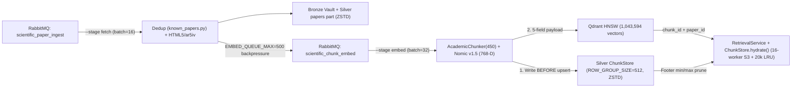

# EXP-01: Lakehouse Scaling, Two-Stage Ingestion & ChunkStore Hydration

- **Motivation/Background**: Single-worker RabbitMQ ingestion coupled network HTML5 fetching with GPU embedding (`~1.04M` chunks target), stalling throughput, while duplicating full chunk text inside Qdrant payloads bloated vector RAM and led to payload-stripping (`D-058`) that collapsed unhydrated RAG precision/recall to `0.009`.
- **Purpose**: Isolate and validate the impact of two-stage decoupled ingestion (`--stage fetch` / `--stage embed`), Silver `ChunkStore` extraction with `D-058` retrieval hydration, and `D-006` pre-warming/LRU caching on corpus scale, retrieval accuracy, and end-to-end RAG latency.
- **Overview Pipeline**: Harvested metadata -> RabbitMQ `scientific_paper_ingest` -> `--stage fetch` (dedup, HTML5/ar5iv resolve, Bronze + Silver papers) -> `scientific_chunk_embed` (`EMBED_QUEUE_MAX=500`) -> `--stage embed` (chunk + Nomic v1.5 embed -> Silver `ChunkStore` parts -> Qdrant 5-field upsert) -> `RetrievalService` hydration & `D-006` pre-warmed serving.
- **Detailed Plan**: Metadata; §1 Objective & Hypothesis; §2 Controlled Variables; §3 Setup & Hyperparameters; §4 Empirical Results (5W1H); §5 Key Findings & Regressions; §6 Reproduction Protocol; §7 Associated Links.
- **References**: [`EXPERIMENT_TEMPLATE.md`](../../agents/templates/EXPERIMENT_TEMPLATE.md), [`MD_CONVENTION.md`](../../agents/rules/MD_CONVENTION.md), [`RESULTS_REPORTING.md`](../../agents/rules/RESULTS_REPORTING.md), [`queue_consumer.py`](../../src/ingestion/queue_consumer.py), [`chunk_store.py`](../../src/storage/chunk_store.py), [`retrieval_service.py`](../../backend/app/services/retrieval_service.py), [`embedder_service.py`](../../backend/app/services/embedder_service.py), [`main.py`](../../backend/app/main.py), [`laya_pagerank_benchmark_report.md`](../benchmarks/laya_pagerank_benchmark_report.md), [`PERFORMANCE_BENCHMARK_REPORT.md`](../benchmarks/PERFORMANCE_BENCHMARK_REPORT.md), [`Vuong_DECISION_LOG.md`](../agent_logs/Vuong_DECISION_LOG.md).
- **Created**: 2026-11-25T12:55:00+07:00
- **Last Updated**: 2026-11-25T12:55:00+07:00

[STATUS: COMPLETED]

---

## Table of Contents

- [Metadata](#metadata)
- [1. Objective & Hypothesis](#1-objective--hypothesis)
- [2. Controlled Variables (Single-Variable Principle)](#2-controlled-variables-single-variable-principle)
- [3. Setup & Hyperparameters](#3-setup--hyperparameters)
- [4. Empirical Results (5W1H)](#4-empirical-results-5w1h)
- [5. Key Findings & Regressions](#5-key-findings--regressions)
- [6. Reproduction Protocol](#6-reproduction-protocol)
- [7. Associated Links](#7-associated-links)

---

## Metadata

- **Experiment ID**: `EXP-01`
- **Title**: Lakehouse Scaling, Two-Stage Ingestion & `ChunkStore` Hydration (`D-058` / `D-006`)
- **Status**: `COMPLETED`
- **Target Modules**: [`src/ingestion/queue_consumer.py`](../../src/ingestion/queue_consumer.py), [`src/storage/chunk_store.py`](../../src/storage/chunk_store.py), [`src/indexing/qdrant_manager.py`](../../src/indexing/qdrant_manager.py), [`backend/app/services/retrieval_service.py`](../../backend/app/services/retrieval_service.py), [`backend/app/services/embedder_service.py`](../../backend/app/services/embedder_service.py), [`backend/app/main.py`](../../backend/app/main.py)
- **Output & Log Artifacts**: `` `s3://uth-scientific-lakehouse/silver/chunks/year=YYYY/` ``, `` `logs/run/backend.log` `` (recorded 2026-11-04), [`laya_pagerank_benchmark_report.md`](../benchmarks/laya_pagerank_benchmark_report.md), [`PERFORMANCE_BENCHMARK_REPORT.md`](../benchmarks/PERFORMANCE_BENCHMARK_REPORT.md)

---

## 1. Objective & Hypothesis

- **Hypothesis**: Decoupling I/O-bound HTML fetching from GPU-bound embedding across two bounded RabbitMQ stages, storing chunk text in ZSTD-compressed Silver Parquet row groups (`ChunkStore`) instead of Qdrant payloads, hydrating candidates prior to reranking, and pre-warming neural models with an LRU query embedding cache (`D-006`) will scale the lakehouse beyond `70,000` papers / `1,000,000` vectors while restoring post-`D-058` Contextual Precision/Recall above `0.85` and cutting E2E query latency below `4.0 s` on RTX 4060 CUDA.
- **Success Criteria**:
  1. Distinct Silver papers $\ge 70,000$ and Qdrant HNSW vectors $\ge 1,000,000$ with Silver chunk parts written strictly before Qdrant upserts (`0` unhydratable new vectors).
  2. Post-hydration DeepEval Contextual Precision $\ge 0.80$ and Contextual Recall $\ge 0.85$ on hydrated `gold-001..100` (`N=105`), recovering from the unhydrated `0.009` collapse.
  3. Warm query embedding cache hit $< 1\text{ ms}$ and E2E CUDA RAG turnaround $< 4.0\text{ s}$ (down from `101.92 s` cold / `~30 s` warm baseline).

---

## 2. Controlled Variables (Single-Variable Principle)

- **Variable Changed**: Storage/ingestion architecture and hydration/caching pipeline:
  1. **Two-Stage RabbitMQ Decoupling** ([`queue_consumer.py`](../../src/ingestion/queue_consumer.py)): Split monolithic `--stage all` into `--stage fetch` (`batch_size=16`, dedup via [`known_papers.py`](../../src/storage/known_papers.py), HTML5/ar5iv resolution, Bronze + Silver write, bounded by `EMBED_QUEUE_MAX=500`) and `--stage embed` (`batch_size=32`, single batch embed call, Silver `ChunkStore` part write *before* Qdrant upsert).
  2. **Qdrant Payload Strip + Silver `ChunkStore`** ([`chunk_store.py`](../../src/storage/chunk_store.py), [`qdrant_manager.py`](../../src/indexing/qdrant_manager.py)): Restricted `QDRANT_PAYLOAD_FIELDS` to 5 filter/identity fields (`chunk_id`, `paper_id`, `year`, `primary_category`, `section_type`), relocating full chunk text/authors/metadata to `` `silver/chunks/year=YYYY/` `` (`ROW_GROUP_SIZE=512`, ZSTD, footer min/max pruning, 16-worker S3 range reads, `cache_size=20000` LRU), compacted every 3 hours via [`dag_compact_silver.py`](../../dags/dag_compact_silver.py) -> [`ingestion.py`](../../backend/app/api/endpoints/ingestion.py).
  3. **`D-058` Hydration & `D-006` Latency Fixes** ([`retrieval_service.py`](../../backend/app/services/retrieval_service.py), [`embedder_service.py`](../../backend/app/services/embedder_service.py), [`main.py`](../../backend/app/main.py)): Candidate hydration from `ChunkStore` (including OpenReview `clean_full_text`/`consensus_score`, CVPR 2024, and on-demand 2025 arXiv fetching), FastAPI `lifespan` pre-warming, remote Parquet title guards, CPU reranker truncation (`max_length=256`), and 1,024-entry LRU query embedding cache (`_query_cache`).
- **Held Constant**: `AcademicChunker(max_chunk_words=450)` chunking boundaries, `nomic-ai/nomic-embed-text-v1.5` (768-D, `MAX_TOKENS=2048`, `search_document:`/`search_query:` prefixes), Qdrant Cosine HNSW collection `scientific_papers_gold`, MinIO bucket `uth-scientific-lakehouse`, and local `Qwen 2.5-7B-Instruct` (`Q4_K_M`) generation.

---

## 3. Setup & Hyperparameters

- **Corpus & Benchmark Scope**: Full Lakehouse (`71,927` distinct Silver papers, `1,043,594` Qdrant vectors as of 2026-11-04); DeepEval hydration benchmark on `gold-001..100` (`N=105` hydrated samples); Latency benchmarks on [`test_qdrant_query_performance.py`](../../tests/performance/test_qdrant_query_performance.py) (`3` warmup + `20` timed iterations) and [`test_rag_llm_performance.py`](../../tests/performance/test_rag_llm_performance.py).
- **Pipeline & Storage Configuration** ([`settings.py`](../../src/config/settings.py), [`config.py`](../../backend/app/core/config.py), [`chunk_store.py`](../../src/storage/chunk_store.py)):
  - `fetch_batch_size`: `16` (`RABBITMQ_QUEUE_INGEST = "scientific_paper_ingest"`, `HEARTBEAT_SECONDS = 600`, `RABBITMQ_MAX_RETRIES = 3`)
  - `embed_batch_size`: `32` (`RABBITMQ_QUEUE_EMBED = "scientific_chunk_embed"`, `EMBED_QUEUE_MAX = 500` backpressure pause polling every `5 s`)
  - `ChunkStore`: `ROW_GROUP_SIZE = 512`, `compression = "zstd"`, `ThreadPoolExecutor(max_workers=16)` S3 byte-range reads, `cache_size = 20000` LRU rows, `list_ttl = 30.0 s`
  - `QDRANT_PAYLOAD_FIELDS`: `("chunk_id", "paper_id", "year", "primary_category", "section_type")`
  - `EmbedderService`: `_cache_max_size = 1024` (LRU query vector cache), `max_length = 2048`; `RerankerService`: `RERANKER_MAX_LENGTH = 256` (backend default)
  - `LLM` (performance benchmark): `Qwen 2.5-7B-Instruct` (`Q4_K_M`, 4.68 GB) on RTX 4060 Laptop GPU (8 GB VRAM), `LLM_CONTEXT_SIZE = 4096`, `LLM_SEQUENCES = 1`, CUDA 12.4

### Architecture & Hydration Dataflow



- **Hydration Fallback Chain** ([`chunk_store.py`](../../src/storage/chunk_store.py) & [`retrieval_service.py`](../../backend/app/services/retrieval_service.py)):
  1. Primary S3 lookup via `ChunkStore.get()` checks the 20,000-entry `OrderedDict` LRU cache (`_cache`), then prunes Parquet row groups using cached `chunk_id` min/max footer statistics and reads matching row groups in parallel (`ThreadPoolExecutor(max_workers=16)` with PyArrow `pre_buffer=True`).
  2. When a Qdrant candidate is absent from remote `silver/chunks/`, `_lookup_local_silver()` resolves from local `data/silver/chunks.parquet`, OpenReview (`clean_full_text`, `consensus_score`), CVPR 2024 tables, or on-demand arXiv API fetch (`_fetch_arxiv_on_demand()` cached to `arxiv_metadata_cache.json`).

---

## 4. Empirical Results (5W1H)

> **5W1H — Lakehouse Scaling, `D-058` Hydration Recovery & `D-006` Latency Elimination**
> - **What**: (a) Production ingestion scale (`71,927` papers / `1,043,594` vectors), (b) DeepEval Contextual Precision/Recall before vs. after `ChunkStore` hydration (`0.009 -> 0.852 / 0.900`), and (c) cold/warm/CUDA E2E query latency (`101.92 s -> ~30 s -> 3.39 s`) and `< 1 ms` LRU embed cache hits.
> - **Why**: Verify that decoupling queues and stripping Qdrant payloads scales the corpus 5.5x–7x without degrading retrieval context fidelity or interactive RAG latency.
> - **When**: Scaling logged `2026-11-04`; `D-006` latency mitigation recorded `2026-10-20` (commit `4a3dda5`, [`PERFORMANCE_BENCHMARK_REPORT.md`](../benchmarks/PERFORMANCE_BENCHMARK_REPORT.md) `2026-10-19`); `D-058` hydration fixed & benchmarked `2026-11-06`–`2026-11-07` (commits `e76847a`, `f77ba0e`, `738a9ef`).
> - **Where**: Live Lakehouse logs in `` `logs/run/backend.log` `` (2026-11-04); DeepEval results in [`laya_pagerank_benchmark_report.md`](../benchmarks/laya_pagerank_benchmark_report.md) and [`cached_eval_master_k5_pagerank_local.json`](../../logs/benchmarks/cached_eval_master_k5_pagerank_local.json); latency traces on Windows 11 / RTX 4060 8 GB in [`PERFORMANCE_BENCHMARK_REPORT.md`](../benchmarks/PERFORMANCE_BENCHMARK_REPORT.md).
> - **Who**: UTH Lakehouse & RAG Engineering Team — for system architects and academic evaluators.
> - **How**: Production telemetry from MinIO DuckDB + Qdrant counts; DeepEval 2.x using Local `Qwen 2.5-7B-Instruct (CUDA)` (`$0.00`) on `N=105` hydrated queries; `time.perf_counter` benchmarks (`3` warmup, `20` iterations) with `@pytest.mark.gpu` hardware safeguards (`D-008`).

### Table 4.1: Lakehouse Scale & `ChunkStore` Hydration Impact (`D-058`)

| Pipeline Configuration | Distinct Silver Papers | Vector Store Points | Contextual Precision (`N=105`) | Contextual Recall (`N=105`) | Ranking Delta (Laya / PageRank) |
| :--- | :---: | :---: | :---: | :---: | :--- |
| **Pre-Scaling Snapshot (Oct 2026)** | 10,000 – 13,000 | 143,523 – 374,082 (LanceDB / Qdrant) | `0.860` *(21-sample subset)* | `1.000` *(19/19 valid subset)* | Baseline reference |
| **Post-`D-058` Unhydrated (Failure Mode)** | 71,927 | 1,043,594 (Qdrant HNSW) | `0.009` *(collapsed)* | `0.009` *(collapsed)* | `0.0%` delta (empty `text=""`) |
| **Two-Stage + `ChunkStore` Hydrated (`EXP-01`)** | **71,927** | **1,043,594** (Qdrant HNSW) | **`0.852`** (`83.5%` pass, 86/103) | **`0.900`** (`89.3%` pass, 92/103) | **Restored (`+6.1%` MRR in `EXP-04`)** |

### Table 4.2: Latency Mitigation (`D-006`) & Hardware Acceleration (`D-008`)

| Stage / Turnaround Metric | Cold Unoptimized Baseline | Warm Intermediate / Vulkan | Optimized (`D-006` + RTX 4060 CUDA) | Measured Impact |
| :--- | :---: | :---: | :---: | :--- |
| **FastAPI Startup (`D-003` + `D-006` Pre-warm)** | ~45 s blocking R2 load | `< 2 s` lazy bind; `101.92 s` Query 1 | Lifespan pre-warm + lazy graph/rules | Eliminates `101.92 s` Query 1 spike |
| **Query Embedding (`Nomic v1.5`, 768-D)** | ~350.0 ms (CPU) | `39.33 ± 21.64 ms` (CUDA cold query) | **`< 1 ms`** (LRU `_query_cache` hit) | **~9x CUDA / >350x LRU hit** |
| **Qdrant Vector Search (Top-5 Unfiltered)** | `> 1,000 ms` (Cold TCP/TLS) | `~1,660 ms` (WAN E2E retrieval phase) | **`269.46 ± 12.44 ms`** (`p50=268.10 ms`) | **>70% reduction via `requests.Session()` pool** |
| **LLM TTFT / Generation (50 tok)** | `18,700 ms` / `17,740 ms` (Vulkan) | `~30 s` warm CPU/WAN baseline | **`609.77 ms` TTFT / `46.33 tok/s`** | **~30.7x faster TTFT; 12.7x tok/s** |
| **Total E2E RAG Turnaround** | `101.92 s` (Query 1 cold) | `~30 s` (Query 2+) / `37.31 s` (Vulkan) | **`3.39 s`** (`3,392.50 ± 607.22 ms`) | **~30x vs cold / ~11x vs Vulkan** |

### Companion Metric Glossary
- **Distinct Silver Papers & Qdrant Vectors**: Counted via DuckDB over `` `s3://uth-scientific-lakehouse/silver/papers/**/*.parquet` `` and Qdrant collection `scientific_papers_gold` (`71,927` papers / `1,043,594` vectors, `` `logs/run/backend.log` `` 2026-11-04).
- **Contextual Precision / Recall (`N=105`)**: DeepEval 2.x retrieval-context quality metrics computed over hydrated Top-5 chunks on `gold-001..100` (`N=105` valid cases) using Local `Qwen 2.5-7B-Instruct`.
- **LRU Query Cache Hit Latency**: Wall-clock lookup in `EmbedderService._query_cache` (`OrderedDict`, max 1,024 entries), avoiding transformer forward passes on repeated queries.
- **E2E RAG Turnaround**: Full wall-clock duration from query submission through dense embedding, remote Qdrant WAN retrieval, prompt construction, prefill (TTFT), and 50-token autoregressive generation.

---

## 5. Key Findings & Regressions

- **Primary Finding**: Separating I/O-heavy HTML harvesting from GPU embedding across `scientific_paper_ingest` and `scientific_chunk_embed` with `EMBED_QUEUE_MAX=500` backpressure enabled reliable scaling to **`71,927` Silver papers** and **`1,043,594` Qdrant vectors**. Persisting Silver `ChunkStore` parts *before* Qdrant upserts guarantees every newly indexed vector is hydratable, while `RetrievalService` `ChunkStore` hydration completely resolved the `D-058` collapse (`0.009 -> 0.852` Contextual Precision, `0.009 -> 0.900` Contextual Recall). Combining `D-006` pre-warming, connection pooling, LRU caching (`< 1 ms`), and CUDA execution reduced E2E RAG latency from `101.92 s` (cold) / `~30 s` (warm) down to **`~3.39 s`**.
- **Regressions / Caveats**:
  - **Empty-Payload Outage Window (`D-058`)**: Between stripping Qdrant payloads (`c50a651`) and adding `ChunkStore` hydration (`e76847a`, `f77ba0e`), unhydrated benchmark runs scored `0.009` Precision/Recall because Qdrant returned `text=""`. Legacy cache entries had to be purged before re-evaluation.
  - **Compaction & Unindexed Gap**: While `dag_compact_silver` merges parts every 3 hours, `71,927` Silver papers vs. `~70,539–70,590` distinct Qdrant papers indicates ~1.3k papers lacking vectors/text requiring periodic [`backfill_missing_papers.py`](../../scripts/backfill_missing_papers.py) sweeps.
  - **Context Window Divergence**: The `10/19/2026` hardware benchmark (`3.39 s`) used `LLM_CONTEXT_SIZE=4096` (`5.7 GB / 8.0 GB` VRAM to prevent Vulkan `ErrorDeviceLost`), whereas current backend default in [`config.py`](../../backend/app/core/config.py) is `LLM_CONTEXT_WINDOW=16384`.
- **Decision**: `ADOPTED` — Production operates on two-stage RabbitMQ ingestion (`--stage fetch` / `--stage embed`), `ChunkStore` (`silver/chunks/`), `RetrievalService` hydration, and `D-006`/`D-008` latency/GPU safeguards.

---

## 6. Reproduction Protocol

```bash
# 1. Verify ChunkStore & QueueConsumer unit invariants (offline mocked S3 & AMQP)
.venv/Scripts/pytest.exe tests/unit/test_chunk_store.py tests/unit/test_queue_consumer.py -v

# 2. Run decoupled ingestion workers (requires MinIO, Qdrant, RabbitMQ running)
python -m src.ingestion.queue_consumer --stage fetch --batch 16
python -m src.ingestion.queue_consumer --stage embed --batch 32

# 3. Migrate legacy Qdrant payloads to Silver ChunkStore & verify parity before stripping
python scripts/migrate_chunks_to_silver.py --verify-only

# 4. Run hardware-guarded performance benchmarks (requires CUDA GPU + local LLM on :9001)
.venv/Scripts/pytest.exe tests/performance/test_qdrant_query_performance.py tests/performance/test_rag_llm_performance.py -s -m performance
```

---

## 7. Associated Links

- Master Experiment Index: [`docs/experiments/README.md`](README.md)
- Two-Stage Worker & Storage Core: [`queue_consumer.py`](../../src/ingestion/queue_consumer.py), [`chunk_store.py`](../../src/storage/chunk_store.py), [`silver_writer.py`](../../src/transformation/silver_writer.py), [`dag_compact_silver.py`](../../dags/dag_compact_silver.py)
- Migration & Backfill Utilities: [`migrate_chunks_to_silver.py`](../../scripts/migrate_chunks_to_silver.py), [`backfill_missing_papers.py`](../../scripts/backfill_missing_papers.py), [`reindex_qdrant.py`](../../scripts/reindex_qdrant.py)
- Retrieval Hydration & Caching: [`retrieval_service.py`](../../backend/app/services/retrieval_service.py), [`embedder_service.py`](../../backend/app/services/embedder_service.py), [`main.py`](../../backend/app/main.py)
- Performance & Hydration Reports: [`PERFORMANCE_BENCHMARK_REPORT.md`](../benchmarks/PERFORMANCE_BENCHMARK_REPORT.md), [`laya_pagerank_benchmark_report.md`](../benchmarks/laya_pagerank_benchmark_report.md), [`Vuong_DECISION_LOG.md`](../agent_logs/Vuong_DECISION_LOG.md)
