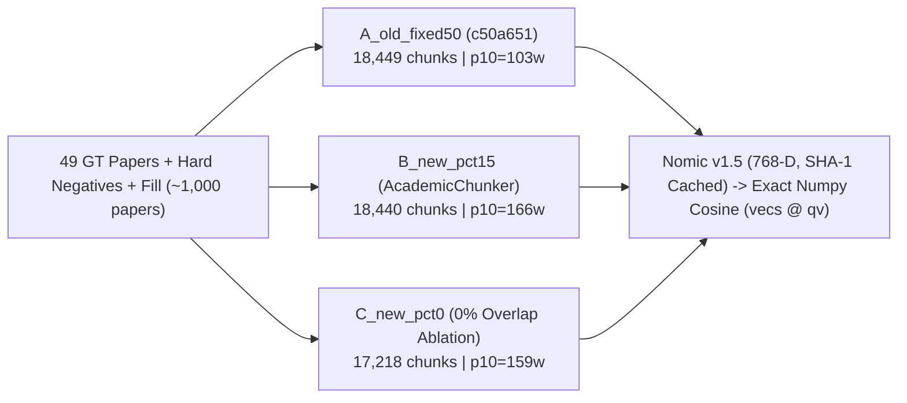

# EXP-02: Domain-Aware Scientific Chunking A/B Ablation

- **Motivation/Background**: Legacy fixed-width sliding windows (`450` words, fixed `50`-word overlap at commit `c50a651`) frequently left degenerate short tail chunks (10th percentile `p10 = 103` words) and severed sentences/equations mid-clause, degrading Top-5 retrieval precision.
- **Purpose**: Isolate the retrieval impact of balanced window sizing, proportional overlap (`15%` vs. `0%` ablation), sentence-boundary snapping, and short-tail merging under identical corpus, embedding model, and query conditions.
- **Overview Pipeline**: Sample corpus (`49` GT papers + hard negatives + random Silver fill to `1,000` target) -> Re-chunk 3 ways (`A_old_fixed50`, `B_new_pct15`, `C_new_pct0`) -> Embed via `nomic-embed-text-v1.5` (text-hash cached) -> Exact numpy cosine retrieval -> Evaluate paper-level `Recall@K`, `MRR@10`, `nDCG@10`, and `Chunk Hit@5`.
- **Detailed Plan**: Metadata; §1 Objective & Hypothesis; §2 Controlled Variables; §3 Setup & Hyperparameters; §4 Empirical Results (5W1H); §5 Key Findings & Regressions; §6 Reproduction Protocol; §7 Associated Links.
- **References**: [`EXPERIMENT_TEMPLATE.md`](../../agents/templates/EXPERIMENT_TEMPLATE.md), [`MD_CONVENTION.md`](../../agents/rules/MD_CONVENTION.md), [`RESULTS_REPORTING.md`](../../agents/rules/RESULTS_REPORTING.md), [`chunking_ab.py`](../../benchmarks/chunking_ab.py), [`chunker.py`](../../src/indexing/chunker.py), [`scientific_eval_v2.jsonl`](../../benchmarks/datasets/scientific_eval_v2.jsonl), [`table_chunking_ab.tex`](../../data-mining-latek/tables/table_chunking_ab.tex), [`test_chunker_split.py`](../../tests/unit/test_chunker_split.py).
- **Created**: 2026-11-25T12:55:00+07:00
- **Last Updated**: 2026-11-25T12:55:00+07:00

[STATUS: COMPLETED]

---

## Table of Contents

- [Metadata](#metadata)
- [1. Objective & Hypothesis](#1-objective--hypothesis)
- [2. Controlled Variables (Single-Variable Principle)](#2-controlled-variables-single-variable-principle)
- [3. Setup & Hyperparameters](#3-setup--hyperparameters)
- [4. Empirical Results (5W1H)](#4-empirical-results-5w1h)
- [5. Key Findings & Regressions](#5-key-findings--regressions)
- [6. Reproduction Protocol](#6-reproduction-protocol)
- [7. Associated Links](#7-associated-links)

---

## Metadata

- **Experiment ID**: `EXP-02`
- **Title**: Domain-Aware Scientific Chunking A/B & Overlap Ablation (`A_old_fixed50` vs. `B_new_pct15` vs. `C_new_pct0`)
- **Status**: `COMPLETED`
- **Target Script**: [`benchmarks/chunking_ab.py`](../../benchmarks/chunking_ab.py)
- **Chunker Module**: [`src/indexing/chunker.py`](../../src/indexing/chunker.py)
- **Output Directory**: `` `logs/benchmarks/chunking_ab/` `` (summarized in `` `logs/benchmarks/chunking_ab/summary.json` `` and [`table_chunking_ab.tex`](../../data-mining-latek/tables/table_chunking_ab.tex))

---

## 1. Objective & Hypothesis

- **Hypothesis**: Replacing fixed `450`-word / `50`-word sliding windows (`A_old_fixed50`) with balanced window partitioning, proportional `15%` overlap clamped to `[20, 80]` words, sentence-boundary snapping, and short-tail merging (`B_new_pct15`) will eliminate sub-120-word degenerate tail chunks (raising `p10` word count) and improve `Recall@5` by $\ge +0.03$ absolute without increasing total chunk count; an overlap-free ablation (`C_new_pct0`) tests how much of the gain comes from overlap vs. balanced sentence snapping itself.
- **Success Criteria**:
  1. `p10` chunk word count increases from $\approx 103$ words to $\ge 150$ words without exceeding `MAX_WORDS = 450`.
  2. `Recall@5` and `Chunk Hit@5` improve over `A_old_fixed50` with zero regression on `MRR@10` or `nDCG@10`.

---

## 2. Controlled Variables (Single-Variable Principle)

- **Variable Changed**: Window-splitting algorithm inside `AcademicChunker`:
  - **`A_old_fixed50`** (Baseline, git commit `c50a651`): `AcademicChunker(max_chunk_words=450, overlap_words=50)` — greedy fixed 450-word window with 50-word stride overlap and unmerged short tails.
  - **`B_new_pct15`** (Treatment, current [`chunker.py`](../../src/indexing/chunker.py)): `AcademicChunker(max_chunk_words=450, overlap_ratio=0.15, min_overlap_words=20, max_overlap_words=80, min_tail_ratio=0.4)` — evenly distributes $n$ windows across section length $L$, snaps boundaries to sentence starts within `tol = max(5, o // 2)` (guarding abbreviations in `_NOT_SENT_END`), and merges tails $< 0.4 \times 450 = 180$ words into the penultimate window when total $\le 450$.
  - **`C_new_pct0`** (Overlap Ablation): Same balanced sentence-snapped `AcademicChunker` with `overlap_ratio=0.0, min_overlap_words=0, max_overlap_words=0`.
- **Held Constant**:
  - **Corpus**: Same Silver paper records comprising the `49` ground-truth papers in [`scientific_eval_v2.jsonl`](../../benchmarks/datasets/scientific_eval_v2.jsonl), Top-`10` per-query hard negatives from Qdrant (`scientific_papers_gold`), and reservoir-sampled random Silver fill (`seed=42`) targeting `n_total = 1,000` papers.
  - **Section Hierarchy & Contextual Prefix**: Identical abstract chunking, `sections_json` parsing, heading regexes, and `Paper: "{title}" | Section: {sec_title}` contextual prefixing (`context_text`).
  - **Embedder & Retrieval Scoring**: `nomic-ai/nomic-embed-text-v1.5` ([`embedder.py`](../../src/indexing/embedder.py), `MAX_TOKENS=2048`), SHA-1 text-hash embedding cache (`emb_cache.pkl`), and exact FP32 numpy inner-product (`vecs @ qv`, Top-200 deduped to paper level; no Qdrant ANN noise, no reranker, no PageRank).

---

## 3. Setup & Hyperparameters

- **Evaluation Dataset**: Answerable queries of [`scientific_eval_v2.jsonl`](../../benchmarks/datasets/scientific_eval_v2.jsonl) covering `49` ground-truth arXiv landmark papers across `cs.CL`, `cs.LG`, `cs.CV`, `stat.ML`, `cs.SI`, `cs.NE` (with `paper_relevance_grades` for graded `nDCG@10`).
- **Chunking & Retrieval Parameters** ([`chunking_ab.py`](../../benchmarks/chunking_ab.py)):
  - `LEGACY_COMMIT`: `"c50a651"`
  - `MAX_WORDS`: `450`
  - `n_total`: `1,000` papers (`gt` + `hard_per_query=10` + random fill, `random.Random(42)`)
  - `top_k`: `5` (for `Chunk Hit@5`) and `[:10]` / `[:200]` for paper-level ranking metrics
  - `embed_batch`: `256` texts per call to `NomicEmbedder.embed_documents()`

### Balanced Sentence-Snapped Splitting Formulation

For any section of length $L > S$ words (`S = MAX_WORDS = 450`), [`AcademicChunker.split_words()`](../../src/indexing/chunker.py) computes:
1. **Minimum Balanced Window Count**: $n = \max\!\left(2, \left\lceil \frac{L - \rho S}{S - \rho S} \right\rceil\right)$ where $\rho = 0.15$ (`0.0` for `C_new_pct0`), iterating $n \leftarrow n + 1$ until $c = \lceil (L + (n - 1)o) / n \rceil \le S$ with clamped overlap $o = \min(80, \max(20, \operatorname{round}(\rho c_0)))$.
2. **Sentence-Boundary Snapping**: Window starts and ends shift to the nearest sentence delimiter inside tolerance `tol = max(5, o // 2)` while excluding scientific abbreviations (`e.g.`, `i.e.`, `al.`, `eq.`, `fig.`, `sec.`, single initials).
3. **Degenerate Tail Merging**: If the final span length satisfies $L_{\text{last}} < 0.4 S$ (`180` words) and merging with the penultimate span remains $\le S$, the two spans are combined—directly raising `p10` from `103` to `166` words.



---

## 4. Empirical Results (5W1H)

> **5W1H — Domain-Aware Chunking A/B Evaluation (`A_old_fixed50` vs. `B_new_pct15` vs. `C_new_pct0`)**
> - **What**: Corpus chunk length statistics (`n_chunks`, median words, `p10` words) and paper-level exact cosine retrieval metrics (`Recall@5`, `Recall@10`, `MRR@10`, `nDCG@10`, `Chunk Hit@5`).
> - **Why**: Determine whether proportional balanced splitting + sentence snapping improves Top-5 retrieval over fixed-stride windows, and measure the isolated contribution of `15%` overlap vs. `0%` overlap.
> - **When**: Executed `2026-11-06`–`2026-11-08` (referenced alongside commit `58dcf38` and [`06_evaluation.tex`](../../data-mining-latek/sections/06_evaluation.tex)).
> - **Where**: Summarized in `` `logs/benchmarks/chunking_ab/summary.json` `` and archived in [`table_chunking_ab.tex`](../../data-mining-latek/tables/table_chunking_ab.tex); executed via [`chunking_ab.py`](../../benchmarks/chunking_ab.py) in read-only numpy mode.
> - **Who**: UTH RAG Indexing Team — for ingestion/indexing architecture selection.
> - **How**: Re-chunked identical Silver records 3 ways, deduplicated embedding calls by SHA-1 `context_text` hash, and computed exact `vecs @ qv` dot products over normalized 768-D embeddings without modifying live Qdrant or MinIO.

### Table 4.1: Chunking Strategy A/B Comparison (`MAX_WORDS = 450`)

| Metric | `A_old_fixed50` (`c50a651`) | `B_new_pct15` (Current Prod) | `C_new_pct0` (0% Overlap Ablation) | $\Delta$ (`B` vs. `A`) | $\Delta$ (`C` vs. `A`) |
| :--- | :---: | :---: | :---: | :---: | :---: |
| **Total Chunks (`n_chunks`)** | 18,449 | 18,440 | **17,218** (`-6.6%` vs `B`) | `-9` (`-0.05%`) | `-1,231` (`-6.67%`) |
| **Median Chunk Length (words)** | 450 | 380 | 366 | `-70` words | `-84` words |
| **10th Percentile Length (`p10`, words)** | 103 | **166** | 159 | **`+63` (`+61.2%`)** | `+56` (`+54.4%`) |
| **`Recall@5` $\uparrow$** | 0.7143 | **0.7679** | 0.7500 | **`+0.0536` (`+5.36 pp`)** | `+0.0357` (`+3.57 pp`) |
| **`Recall@10` $\uparrow$** | 0.8571 | 0.8929 | **0.9286** | `+0.0358` (`+3.58 pp`) | **`+0.0715` (`+7.15 pp`)** |
| **`MRR@10` $\uparrow$** | 0.6126 | 0.6153 | **0.6291** | `+0.0027` | **`+0.0165`** |
| **`nDCG@10` $\uparrow$** | 0.6635 | 0.6701 | **0.6844** | `+0.0066` | **`+0.0209`** |
| **`Chunk Hit@5` $\uparrow$** | 0.7143 | **0.7321** | **0.7321** | **`+0.0178` (`+1.78 pp`)** | **`+0.0178` (`+1.78 pp`)** |

### Companion Metric Glossary
- **`n_chunks`, Median, `p10`**: Total chunks produced across the ~1,000-paper corpus and the 50th/10th percentile `word_count` per chunk; `p10` exposes short degenerate tail fragments.
- **`Recall@K` (`K = 5, 10`)**: `float(any(p in rel for p in papers_ranked[:k]))` averaged across answerable queries in `scientific_eval_v2.jsonl`, measuring whether at least one ground-truth `paper_id` enters the Top-$K$ unique ranked papers.
- **`MRR@10`**: Mean Reciprocal Rank `1 / rank` of the first relevant paper inside `papers_ranked[:10]` (`0.0` if absent).
- **`nDCG@10`**: Normalized Discounted Cumulative Gain using graded `paper_relevance_grades` (gain $2^r - 1$, default grade `3` for single-paper queries).
- **`Chunk Hit@5`**: Fraction of queries where at least one of the Top-5 raw chunks (before paper deduplication) originates from a ground-truth paper.

---

## 5. Key Findings & Regressions

- **Primary Finding**: Moving from fixed sliding windows (`A_old_fixed50`) to balanced, sentence-snapped partitioning (`B_new_pct15` and `C_new_pct0`) eliminates tiny, context-starved tail chunks (**`p10` rises from `103` to `166` words**, `+61.2%`) and consistently improves every retrieval metric without inflating chunk count. Crucially, `B_new_pct15` achieves the highest **`Recall@5` (`0.7679`, `+5.36 pp` over `A`)**, directly protecting the Top-5 context budget passed to the LLM (`RERANKER_TOP_K=5`), while `C_new_pct0` maximizes deeper-rank metrics (**`Recall@10 = 0.9286`**, **`MRR@10 = 0.6291`**, **`nDCG@10 = 0.6844`**) with **`6.6%` fewer chunks (`17,218` vs. `18,440`)**.
- **Overlap Trade-off Analysis**:
  - `15%` proportional overlap (`B_new_pct15`) preserves cross-boundary continuity for multi-sentence claims/derivations, lifting `Recall@5` (`0.7679` vs `0.7500`) at the cost of `+1,222` extra chunks (`+7.1%` storage vs `C`).
  - `0%` overlap (`C_new_pct0`) eliminates near-duplicate vector entries in the Top-10 pool, allowing more distinct papers into the Top-10 ranking (`Recall@10 = 0.9286`).
- **Regressions / Caveats**:
  - **Live Index Legacy Mix**: Existing points indexed prior to `B_new_pct15` (and backfills run with `--chunker legacy` in [`backfill_missing_papers.py`](../../scripts/backfill_missing_papers.py)) still use `A_old_fixed50` boundaries unless rebuilt via [`reindex_qdrant.py`](../../scripts/reindex_qdrant.py).
  - **Default Constructor Parameter**: [`AcademicChunker.__init__`](../../src/indexing/chunker.py) defaults to `max_chunk_words=300`, so production callers ([`queue_consumer.py`](../../src/ingestion/queue_consumer.py), [`reindex_qdrant.py`](../../scripts/reindex_qdrant.py)) explicitly pass `max_chunk_words=450`.
  - **Sample Size**: Evaluation spans the `49` answerable GT papers in [`scientific_eval_v2.jsonl`](../../benchmarks/datasets/scientific_eval_v2.jsonl) with `judge` stage optional/unreported in `table_chunking_ab.tex`.
- **Decision**: `ADOPTED` — `B_new_pct15` (`AcademicChunker(max_chunk_words=450, overlap_ratio=0.15)`) is active in [`src/indexing/chunker.py`](../../src/indexing/chunker.py) and [`queue_consumer.py`](../../src/ingestion/queue_consumer.py) for maximum Top-5 recall, with `C_new_pct0` retained as a viable storage-saving variant if Top-20 retrieval precedes cross-encoder reranking.

---

## 6. Reproduction Protocol

```bash
# 1. Verify AcademicChunker split invariants (coverage, balance, sentence snapping)
.venv/Scripts/pytest.exe tests/unit/test_chunker_split.py -v

# 2. Re-run A/B corpus build, numpy exact cosine retrieval, and summary report (read-only on Qdrant/MinIO)
python -m benchmarks.chunking_ab build --out logs/benchmarks/chunking_ab --papers 1000 --hard-per-query 10
python -m benchmarks.chunking_ab retrieve --out logs/benchmarks/chunking_ab --top-k 5
python -m benchmarks.chunking_ab report --out logs/benchmarks/chunking_ab

# 3. Optional full-corpus re-index with current AcademicChunker(450) (stop queue_consumer first)
python scripts/reindex_qdrant.py --dry-run
```

---

## 7. Associated Links

- Master Experiment Index: [`docs/experiments/README.md`](README.md)
- A/B Benchmark Script & Dataset: [`chunking_ab.py`](../../benchmarks/chunking_ab.py), [`scientific_eval_v2.jsonl`](../../benchmarks/datasets/scientific_eval_v2.jsonl)
- Chunker Implementation & Unit Tests: [`chunker.py`](../../src/indexing/chunker.py), [`test_chunker_split.py`](../../tests/unit/test_chunker_split.py)
- Thesis Table & Evaluation Context: [`table_chunking_ab.tex`](../../data-mining-latek/tables/table_chunking_ab.tex), [`06_evaluation.tex`](../../data-mining-latek/sections/06_evaluation.tex), [`04_data_preparation.tex`](../../data-mining-latek/sections/04_data_preparation.tex)
