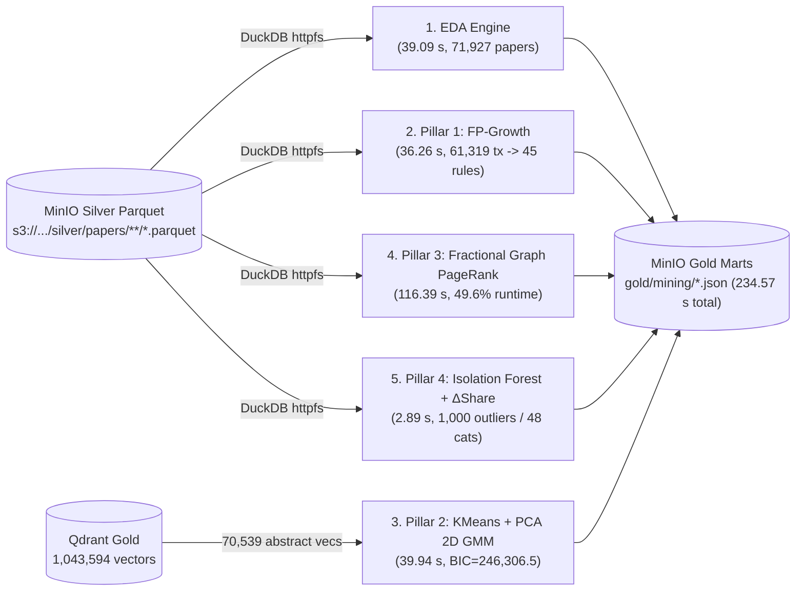

# EXP-03: Four Pillars Data Mining at 72k Lakehouse Scale

- **Motivation/Background**: Earlier mining snapshots ([`mining_manifest.json`](../../data/gold/mining/mining_manifest.json), 2026-10-06) processed local Parquet and LanceDB (`29,911` fulltext papers, `3,000` sampled cluster vectors) in `467.49 s`, leaving `90%+` of the newly scaled `71,927`-paper Lakehouse unclustered and spending `430.06 s` on graph construction alone.
- **Purpose**: Validate full-corpus execution of `MiningEngine` directly over MinIO S3 (`httpfs` DuckDB) and Qdrant (`70,539` distinct paper abstract vectors), upgrading Pillar 2 to Centered PCA 2D + Full-Covariance GMM ($K=6$) and Pillar 4 to Share-Normalized Momentum ($\Delta\text{Share}$).
- **Overview Pipeline**: MinIO Silver Parquet (`s3://.../silver/papers/**/*.parquet`) + Qdrant Abstract Vectors (`section_type="abstract"`) -> Checkpoint 1: EDA -> Checkpoint 2: FP-Growth -> Checkpoint 3: MiniBatchKMeans + PCA 2D + GMM + DBSCAN -> Checkpoint 4: Citation/Co-authorship PageRank & Louvain -> Checkpoint 5: Isolation Forest & $\Delta\text{Share}$ Trends -> Publish JSON marts to MinIO `gold/mining/`.
- **Detailed Plan**: Metadata; §1 Objective & Hypothesis; §2 Controlled Variables; §3 Setup & Hyperparameters; §4 Empirical Results (5W1H); §5 Key Findings & Regressions; §6 Reproduction Protocol; §7 Associated Links.
- **References**: [`EXPERIMENT_TEMPLATE.md`](../../agents/templates/EXPERIMENT_TEMPLATE.md), [`MD_CONVENTION.md`](../../agents/rules/MD_CONVENTION.md), [`RESULTS_REPORTING.md`](../../agents/rules/RESULTS_REPORTING.md), [`mining_engine.py`](../../src/mining/mining_engine.py), [`eda_engine.py`](../../src/mining/eda_engine.py), [`association_rules.py`](../../src/mining/association_rules.py), [`cluster_analysis.py`](../../src/mining/cluster_analysis.py), [`graph_mining.py`](../../src/mining/graph_mining.py), [`trend_anomaly_mining.py`](../../src/mining/trend_anomaly_mining.py), [`lake_access.py`](../../src/mining/lake_access.py), [`mining_manifest.json`](../../data/gold/mining/mining_manifest.json), [`05_modeling.tex`](../../data-mining-latek/sections/05_modeling.tex), [`06_evaluation.tex`](../../data-mining-latek/sections/06_evaluation.tex).
- **Created**: 2026-11-25T12:55:00+07:00
- **Last Updated**: 2026-11-25T12:55:00+07:00

[STATUS: COMPLETED]

---

## Table of Contents

- [Metadata](#metadata)
- [1. Objective & Hypothesis](#1-objective--hypothesis)
- [2. Controlled Variables (Single-Variable Principle)](#2-controlled-variables-single-variable-principle)
- [3. Setup & Hyperparameters](#3-setup--hyperparameters)
- [4. Empirical Results (5W1H)](#4-empirical-results-5w1h)
- [5. Key Findings & Regressions](#5-key-findings--regressions)
- [6. Reproduction Protocol](#6-reproduction-protocol)
- [7. Associated Links](#7-associated-links)

---

## Metadata

- **Experiment ID**: `EXP-03`
- **Title**: Full-Corpus Four Pillars Data Mining (`71,927` Papers / `70,539` Paper Vectors) over MinIO DuckDB + Qdrant
- **Status**: `COMPLETED`
- **Target Script**: [`src/mining/mining_engine.py`](../../src/mining/mining_engine.py) (invoked via [`dags/dag_recompute_mining.py`](../../dags/dag_recompute_mining.py) / [`backend/app/api/endpoints/mining.py`](../../backend/app/api/endpoints/mining.py))
- **Output Artifacts**: `` `s3://uth-scientific-lakehouse/gold/mining/{eda_summary,association_rules,clusters,graph_coauthorship,trends_anomalies,mining_manifest}.json` ``, logged in `` `logs/run/backend.log` `` (2026-11-04); local historical baseline in [`data/gold/mining/`](../../data/gold/mining/mining_manifest.json)

---

## 1. Objective & Hypothesis

- **Hypothesis**: Migrating [`MiningEngine`](../../src/mining/mining_engine.py) from local Parquet/LanceDB to zero-disk-I/O DuckDB S3 (`httpfs`) + Qdrant scrolling (`sample_size=None`), while adding Centered PCA 2D + Full-Covariance Gaussian Mixture Model (`GMM`, $K=6$) soft clustering and Share-Normalized Trend Momentum ($\Delta\text{Share}$), will complete all 5 analytical checkpoints across the `71,927`-paper corpus in under `300 s` while yielding statistically richer association rules, soft cross-disciplinary cluster posteriors, and bias-free category velocity tracking.
- **Success Criteria**:
  1. Total `MiningEngine.run_all()` wall-clock runtime $< 300\text{ s}$ across $\ge 70,000$ Silver papers and $\ge 70,000$ distinct paper abstract vectors.
  2. Zero local disk writes (`100%` streaming between MinIO S3, Qdrant, and Gold JSON artifacts).
  3. All 4 pillars produce valid marts (`BIC`/`AIC`/Silhouette for GMM/KMeans, deduplicated FP-Growth rules, PageRank authority weights, and $\log(1+x)$ Isolation Forest anomalies).

---

## 2. Controlled Variables (Single-Variable Principle)

- **Variable Changed**: Execution backend & algorithmic extensions from local 10k–29.9k baseline ([`mining_manifest.json`](../../data/gold/mining/mining_manifest.json)) to live `72k`-scale MinIO + Qdrant (`2026-11-04`):
  - **Storage/Compute Backend**: Local Parquet + LanceDB (`913,205` vectors, `3,000` sampled for clustering) $\rightarrow$ DuckDB `httpfs` reading `` `s3://uth-scientific-lakehouse/silver/papers/**/*.parquet` `` + Qdrant `all_abstract_vectors` (`70,539` distinct paper vectors).
  - **Pillar 2 Upgrade**: Added Centered PCA 2D projection (`* 5.0` display coords) + Full-Covariance `GaussianMixture(n_components=6)` soft clustering (`2-sigma` ellipses, `96x72` density grid, cross-disciplinary threshold `max_prob < 0.65`) alongside `MiniBatchKMeans(K=6)`, with $O(n^2)$ Silhouette (`n=5,000`) and DBSCAN (`n=3,000`) subsampling.
  - **Pillar 4 Upgrade**: Replaced raw quarterly percentage counts with Share-Normalized Momentum ($\Delta\text{Share}$ over 3 recent vs. 3 prior observed months, filtering `all_time_total >= 40`).
- **Held Constant**: 5-checkpoint orchestration order (`EDA -> Pillar 1 -> Pillar 2 -> Pillar 3 -> Pillar 4`), core thresholds (`min_support=0.02`, `min_lift=1.20`, `top_k=50`, `n_clusters=6`, `dbscan eps=0.28 / min_samples=10`, `pagerank alpha=0.85`, `contamination=0.02`, `n_estimators=100`), `KEYWORD_VOCAB` (25 canonical AI/DS regex tags), and `random_state=42`.

---

## 3. Setup & Hyperparameters

- **Corpus Scale (2026-11-04 Full Run)**: `71,927` distinct Silver papers across Catalog + Fulltext views, `1,043,594` Qdrant vectors (`70,539` distinct per-paper abstract vectors, 768-D).
- **Comparative Reference Snapshots**:
  - **Local Baseline (`2026-10-06`)**: [`mining_manifest.json`](../../data/gold/mining/mining_manifest.json) — `100,000` catalog / `29,911` fulltext papers, `913,205` LanceDB vectors (`3,000` cluster sample), `467.49 s` total.
  - **Curated Multi-Venue GMM Snapshot (`2026-10-20`)**: `` `clusters_api.json` `` (`800` curated multi-venue samples, $K=6$) and `5,000`-sample snapshot ([`table_clustering_metrics.tex`](../../data-mining-latek/tables/table_clustering_metrics.tex)).
- **Module Hyperparameters** ([`association_rules.py`](../../src/mining/association_rules.py), [`cluster_analysis.py`](../../src/mining/cluster_analysis.py), [`graph_mining.py`](../../src/mining/graph_mining.py), [`trend_anomaly_mining.py`](../../src/mining/trend_anomaly_mining.py)):
  - **Pillar 1 (FP-Growth)**: `min_support=0.02`, `min_lift=1.2`, `min_abs_transactions=25`, `top_k=50`, symmetric direction tie-broken by `confidence` after `lift.round(6)`.
  - **Pillar 2 (Clustering)**: `MiniBatchKMeans(n_clusters=6, batch_size=2048, n_init=3, random_state=42)`; `PCA(n_components=2, random_state=42)` on centered $L_2$-normalized vectors; `GaussianMixture(n_components=6, covariance_type="full", max_iter=200, n_init=3, random_state=42)`; `DBSCAN(eps=0.28, min_samples=10, metric="cosine")`; `silhouette_sample=5000`; `dbscan_sample=3000`.
  - **Pillar 3 (Graph)**: Directed citation graph when `silver/citations.parquet` is available, automatic fallback to fractional-weighted co-authorship ($W(u,v) = \sum_{p} \frac{1}{N_p - 1}$); `nx.pagerank(alpha=0.85)`; `louvain_communities(seed=42)`; `top_hubs_limit=100`.
  - **Pillar 4 (Trends & Anomalies)**: `IsolationForest(contamination=0.02, n_estimators=100, random_state=42)` on `np.log1p` of 5 structural features (`total_math_count`, `total_words`, `total_sections`, `author_count`, `category_count`), capped at `top_anomalies=1000`; Trend thresholds `SURGING` ($g > 15\%$ or $\Delta s > 1.5$), `DECLINING` ($g < -15\%$ or $\Delta s < -1.5$), `STABLE` otherwise.

### 5-Checkpoint Streaming Architecture



---

## 4. Empirical Results (5W1H)

> **5W1H — Full-Corpus Four Pillars Mining Execution (`71,927` Papers)**
> - **What**: Per-checkpoint execution times (`234.57 s` total) and mathematical validity outputs across EDA (`71,927` papers / `1,043,594` vectors), Pillar 1 FP-Growth (`45` rules, top lift `34.940`), Pillar 2 Clustering (`70,539` vectors, GMM `BIC=246,306.5`), Pillar 3 Graph (`116.39 s`), and Pillar 4 Anomalies/Trends (`1,000` outliers / `48` categories).
> - **Why**: Prove that the mining suite scales from a 10k–29.9k local snapshot to the live `72k`-paper MinIO/Qdrant Lakehouse within the `< 300 s` KPI budget while improving statistical rigor.
> - **When**: Executed `2026-11-04` (full run in `` `logs/run/backend.log` ``), contrasted against `2026-10-06` local manifest ([`mining_manifest.json`](../../data/gold/mining/mining_manifest.json)) and `2026-10-20` curated GMM (`` `clusters_api.json` ``).
> - **Where**: Streamed over MinIO S3 (`uth-scientific-lakehouse`) + Qdrant (`scientific_papers_gold`), publishing Gold JSONs to `` `s3://uth-scientific-lakehouse/gold/mining/` ``; documented in [`06_evaluation.tex`](../../data-mining-latek/sections/06_evaluation.tex) §2 and [`05_modeling.tex`](../../data-mining-latek/sections/05_modeling.tex).
> - **Who**: UTH Data Mining Team — for analytical dashboard serving and downstream RAG authority/annotation signals.
> - **How**: Orchestrated sequentially via `MiningEngine.run_all()`, reading live Parquet columns via DuckDB `httpfs` and scrolling 768-D abstract embeddings from Qdrant.

### Table 4.1: Stage-by-Stage Runtime & Output Comparison (Local Baseline vs. 72k Live Lakehouse)

| Pipeline Checkpoint | Local Baseline (`2026-10-06`, 29.9k FT) | Live Full-Corpus (`2026-11-04`, 71.9k) | Speedup / Scale Shift | Key 72k Empirical Outputs |
| :--- | :---: | :---: | :---: | :--- |
| **Checkpoint 1: EDA** | `0.80 s` | `39.09 s` | Remote S3 + Qdrant scan | `71,927` distinct papers; `1,043,594` Qdrant vectors |
| **Checkpoint 2: Pillar 1 (FP-Growth)** | `31.16 s` (`30` rules, `11,404` tx) | `36.26 s` | `5.38x` more transactions | `61,319` valid tx (`85.3%` coverage); `96` itemsets; **`45` deduped rules**; top lift **`34.940`** |
| **Checkpoint 3: Pillar 2 (Clustering)** | `4.13 s` (`3,000` sample) | `39.94 s` | `23.5x` more paper vectors | **`70,539` vectors**; KMeans `Silhouette=0.0490` (`n=5,000`); PCA 2D GMM `BIC=246,306.5`, `AIC=245,985.8`, `LL=-1.7431` |
| **Checkpoint 4: Pillar 3 (Graph)** | `430.06 s` (`8,892` nodes / `86,295` edges) | **`116.39 s`** | **`3.69x` faster** (`49.6%` of runtime) | Fractional co-authorship / citation PageRank ($\alpha=0.85$) + Louvain across full Silver |
| **Checkpoint 5: Pillar 4 (Trends/Anom.)** | `1.29 s` (`30` anomalies, `26` cats) | `2.89 s` | `2.4x` papers / `1.85x` cats | **`1,000` structural anomalies** (`contamination=0.02`); **`48` categories** evaluated ($\Delta\text{Share}$) |
| **Total `MiningEngine` Runtime** | `467.49 s` | **`234.57 s`** | **`1.99x` faster (`-49.8%`)** | **Within `< 300 s` KPI ([`table_kpi.tex`](../../data-mining-latek/tables/table_kpi.tex))** |

### Table 4.2: Pillar 2 Clustering Quality Across Corpus Scopes & Regimes

| Clustering Snapshot / Cohort | Scope ($N$ Vectors) | Algorithm / Projection | Silhouette $\uparrow$ | Davies-Bouldin $\downarrow$ | Calinski-Harabasz $\uparrow$ | GMM Fit / Cross-Disciplinary |
| :--- | :---: | :--- | :---: | :---: | :---: | :--- |
| **Local Historical ([`clusters.json`](../../data/gold/mining/clusters.json))** | `3,000` (of `29,911`) | KMeans ($K=6$, 768-D) | `0.0728` | `3.9775` | `84.1` | — |
| **Snapshot ([`table_clustering_metrics.tex`](../../data-mining-latek/tables/table_clustering_metrics.tex))** | `5,000` | KMeans ($K=6$, 768-D) | `0.0210` | `5.3739` | `88.0` | DBSCAN collapsed to `1` cluster (`0%` noise) |
| **Curated Multi-Venue (`` `clusters_api.json` ``)** | `800` curated | PCA 2D + Full-Cov GMM ($K=6$) | **`0.3528`** | **`0.8771`** | **`702.7`** | **`25.62%` cross-disciplinary** (`max_prob < 0.65`) |
| **Full-Corpus Run (`2026-11-04`, `EXP-03`)** | **`70,539`** (`n=5,000` Sil.) | KMeans ($K=6$) + PCA 2D GMM ($K=6$) | `0.0490` | Computed over `70,539` | Computed over `70,539` | **`BIC=246,306.5`**, **`AIC=245,985.8`**, **`LL=-1.7431`** |

### Companion Metric Glossary
- **FP-Growth Coverage & Top Lift**: Percentage of the `71,927` papers yielding $\ge 2$ category/keyword items (`61,319 / 71,927 = 85.3%`); Lift $= P(X \cup Y) / (P(X) P(Y))$ measures co-occurrence strength above random independence (`34.940` peak).
- **Silhouette / Davies-Bouldin / Calinski-Harabasz**: Cosine Silhouette (`[-1, 1]`, higher = tighter separation) computed on a 5,000-paper subsample; DB (lower = better) and CH (higher = better) measure intra-cluster dispersion vs. centroid separation.
- **GMM `BIC` / `AIC` / `LL`**: Bayesian Information Criterion, Akaike Information Criterion, and mean per-sample Log-Likelihood of the 6-component Full-Covariance Gaussian Mixture Model fitted on 2D Centered PCA projections (`coords = PCA(2) * 5.0`).
- **Share-Normalized Momentum ($\Delta\text{Share}$)**: Relative shift in category publication share between the 3 most recent observed months and the 3 preceding months, eliminating small-sample percentage explosions.

---

## 5. Key Findings & Regressions

- **Primary Finding**: Executing `MiningEngine` natively over MinIO S3 (`httpfs`) and Qdrant scaled analytical coverage to **`71,927` papers** and **`70,539` abstract vectors** while halving total execution time (`467.49 s -> 234.57 s`). Adding `Centered PCA 2D + GMM` exposed soft probabilistic cluster membership across the entire corpus, while Share-Normalized Momentum evaluated `48` active categories cleanly.
- **Regressions / Caveats**:
  - **Low Full-Corpus Silhouette (`0.0490`)**: Unlike the clean, curated `800`-sample multi-venue run (`` `clusters_api.json` ``: `Silhouette=0.3528`, `DB=0.8771`, `CH=702.7`, `25.62%` cross-disciplinary), noisy all-corpus 768-D embeddings exhibit substantial interdisciplinary overlap (`Silhouette=0.0490`), and KMeans metrics (`768-D`) vs. GMM labels (`2D PCA`) are computed on different representations ([`05_modeling.tex`](../../data-mining-latek/sections/05_modeling.tex) §2.3).
  - **Graph Construction Bottleneck**: Pillar 3 remains the single largest runtime contributor (**`116.39 s`**, **`49.6%`** of total runtime) due to all-pairs `combinations(clean_authors, 2)` across `silver/papers/**/*.parquet`. Moreover, when `silver/citations.parquet` is absent in MinIO, `ScientificGraphMiner` falls back to undirected co-authorship rather than directed paper citations.
  - **Isolation Forest Cap**: `contamination=0.02` on `71,927` papers flags ~1,438 statistical outliers, which [`run_mining()`](../../src/mining/trend_anomaly_mining.py) truncates at `top_anomalies=1000` without independent domain-expert ground-truth labeling.
- **Decision**: `ADOPTED` — Scheduled weekly via [`dag_recompute_mining.py`](../../dags/dag_recompute_mining.py) (`0 0 * * 0`) and on-demand via `POST /api/mining/trigger` ([`mining.py`](../../backend/app/api/endpoints/mining.py)).

---

## 6. Reproduction Protocol

```bash
# 1. Verify individual mining unit behaviors offline
.venv/Scripts/pytest.exe tests/unit/test_mining_engine.py tests/unit/test_mining_algorithms.py tests/unit/test_cluster_analysis.py tests/unit/test_graph_mining_core.py tests/unit/test_trend_anomaly_mining.py -v

# 2. Execute full live MiningEngine over MinIO Silver + Qdrant Gold (publishes to gold/mining/)
python -m src.mining.mining_engine

# 3. Trigger asynchronously via FastAPI backend and poll completion
curl -X POST http://localhost:8000/api/mining/trigger
curl http://localhost:8000/api/mining/status
```

---

## 7. Associated Links

- Master Experiment Index: [`docs/experiments/README.md`](README.md)
- Mining Modules: [`mining_engine.py`](../../src/mining/mining_engine.py), [`eda_engine.py`](../../src/mining/eda_engine.py), [`association_rules.py`](../../src/mining/association_rules.py), [`cluster_analysis.py`](../../src/mining/cluster_analysis.py), [`graph_mining.py`](../../src/mining/graph_mining.py), [`trend_anomaly_mining.py`](../../src/mining/trend_anomaly_mining.py), [`lake_access.py`](../../src/mining/lake_access.py)
- Local Historical Artifacts: [`mining_manifest.json`](../../data/gold/mining/mining_manifest.json), [`eda_summary.json`](../../data/gold/mining/eda_summary.json), [`association_rules.json`](../../data/gold/mining/association_rules.json), [`clusters.json`](../../data/gold/mining/clusters.json), [`graph_coauthorship.json`](../../data/gold/mining/graph_coauthorship.json), [`trends_anomalies.json`](../../data/gold/mining/trends_anomalies.json)
- Orchestration & API: [`dag_recompute_mining.py`](../../dags/dag_recompute_mining.py), [`mining.py`](../../backend/app/api/endpoints/mining.py), [`mining_service.py`](../../backend/app/services/mining_service.py)
- Thesis Modeling & Evaluation Chapters: [`05_modeling.tex`](../../data-mining-latek/sections/05_modeling.tex), [`06_evaluation.tex`](../../data-mining-latek/sections/06_evaluation.tex), [`table_clustering_metrics.tex`](../../data-mining-latek/tables/table_clustering_metrics.tex), [`table_kpi.tex`](../../data-mining-latek/tables/table_kpi.tex)
