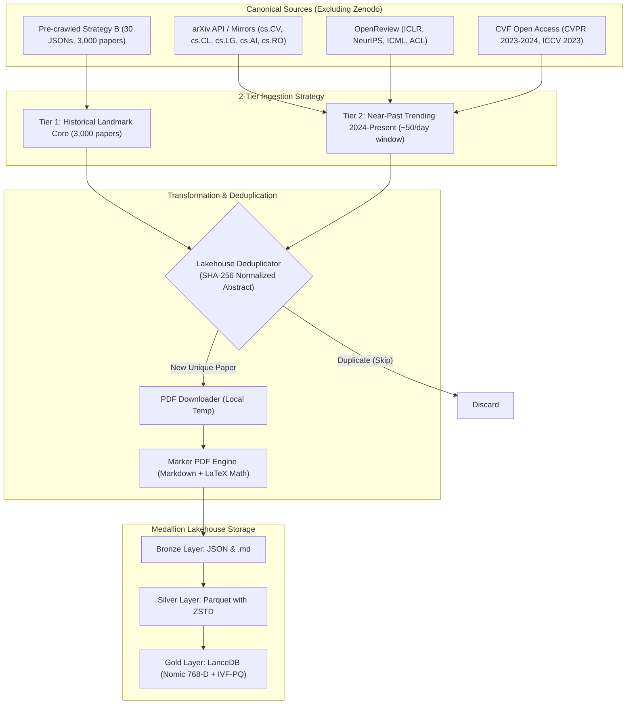

# Implementation Plan: 30,000 Paper 2-Tier Expansion Pipeline (arXiv, OpenReview, CVF)

- **Motivation/Background**: Scaling the scientific lakehouse to landmark historical and near-past papers while preserving exact mathematical formulas and maintaining zero disk leakage.
- **Purpose**: Authoritative technical specification and execution guide for the 2-Tier expansion pipeline and HTML-First ingestion architecture.
- **Overview Pipeline**: Strategy B bootstrap -> HTML-first waterfall -> GPU Nomic embeddings -> Cumulative LanceDB Gold indexing -> Silver Lakehouse Parquet.
- **Detailed Plan**: §1 Goal Description; §2 Storage Estimation; §3 Architecture & Data Flow; §4 Implementation Components; §5 Hardware & Performance Profile; §6 Telemetry & Lakehouse Provenance.
- **References**: `agents/rules/COMMIT_CONVENTION.md`, `agents/rules/MD_CONVENTION.md`, `src/pipelines/run_tier1_bootstrap_strategy_b.py`.
- **Created**: 2026-10-11T11:49:35+07:00
- **Last Updated**: 2026-10-11T21:05:00+07:00

---

This technical design document outlines the execution plan for expanding the Scientific Lakehouse to ~30,000 unique papers across **Tier 1 (Historical Landmark Core)** and **Tier 2 (Near-Past Trending)**, while excluding Zenodo and deferring Tier 3 (real-time stream).

---

## 1. Goal Description

Expand and enrich the Scientific Lakehouse from the current ~12.8k papers to a high-diversity corpus of **~30,000 unique scientific papers** across 3 canonical peer-reviewed and preprint sources:
1. **arXiv**: Foundational & modern preprints across 5 AI/CS categories (`cs.CV`, `cs.CL`, `cs.LG`, `cs.AI`, `cs.RO`).
2. **OpenReview**: Peer-reviewed conference papers (ICLR, NeurIPS, ICML, ACL).
3. **CVF**: Official open-access Computer Vision proceedings (CVPR 2023–2024, ICCV 2023, WACV).

**Key Exclusions**:
- **Zenodo is excluded** due to inconsistent categorization and freeform tagging.
- **Tier 3 (Live Real-Time Stream) is deferred** to focus strictly on Historical Core and Near-Past Trending.

---

## 2. Storage Estimation & R2 Cloud Footprint

The collection follows the **Lean Cloud Lakehouse** model: binary PDFs are processed on local disk/scratch and converted to high-fidelity Markdown via Marker; only the structured text, parquets, and vector indices are persisted to Cloudflare R2.

```
┌────────────────────────────────────────────────────────────────────────┐
│                   30,000 PAPERS STORAGE BREAKDOWN                      │
├──────────────────────┬──────────────────────┬──────────────────────────┤
│ Layer                │ Formats & Contents   │ Approximate Footprint    │
├──────────────────────┼──────────────────────┼──────────────────────────┤
│ Bronze (Cloud R2)    │ Metadata JSONs (30k) │ ~300 MB                  │
│                      │ Marker Markdown (30k)│ ~2.4 GB                  │
├──────────────────────┼──────────────────────┼──────────────────────────┤
│ Silver (Cloud R2)    │ Columnar Parquet     │ ~850 MB                  │
│                      │ (ZSTD compressed)    │                          │
├──────────────────────┼──────────────────────┼──────────────────────────┤
│ Gold LanceDB (R2)    │ ~385,000 Vectors     │ ~7.5 GB                  │
│                      │ 768-D Dense + IVF-PQ │                          │
│                      │ + Tantivy FTS Index  │                          │
├──────────────────────┼──────────────────────┼──────────────────────────┤
│ TOTAL R2 CLOUD       │ Lean Cloud Lakehouse │ ~11.05 GB                │
├──────────────────────┼──────────────────────┼──────────────────────────┤
│ (Local scratch only) │ Raw binary PDFs      │ ~75 - 90 GB (not in R2)  │
└──────────────────────┴──────────────────────┴──────────────────────────┘
```

> [!NOTE]
> Storing binary PDFs in R2 would inflate bucket utilization to ~90 GB (triggering ongoing paid cloud tier costs). Keeping binary PDFs local/ephemeral and uploading only the Markdown + Parquet + LanceDB layers keeps total R2 usage at **~11.1 GB**, fitting within the existing bucket scale.

---

## 3. Architecture & Data Flow



---

## 4. Proposed Changes

### Component 1: Tier 1 Bootstrap Harvester (`strategy_b` batch)
#### [NEW] `src/pipelines/run_tier1_bootstrap_strategy_b.py`
- Ingests the 30 JSON files located in `C:\Users\TDV\Downloads\Telegram Desktop\strategy_b\strategy_b\raw_metadata`.
- Reconstructs abstracts from `abstract_inverted_index`.
- Verifies SHA-256 hashes against `LakehouseDeduplicator`.
- Downloads PDFs for non-duplicate papers, executes `MarkerPdfExtractor` with batch checkpointing.
- Appends clean records into `data/silver/tier1/landmark_papers.parquet`.

```python
# Core logic snippet
for json_file in sorted(raw_metadata_dir.glob("*.json")):
    records = parse_openalex_json(json_file)
    for r in records:
        is_dup, abs_hash = dedup.is_duplicate(r["abstract"], r["title"])
        if is_dup:
            continue
        pdf_path = download_pdf_temp(r["pdf_url"], r["paper_id"])
        markdown, meta = marker_extractor.convert_pdf_to_markdown(pdf_path)
        # Save bronze markdown and append to silver parquet batch
```

---

### Component 2: Multi-Source Tier 2 Near-Past Harvester
#### [MODIFY] `src/pipelines/run_tier2_near_past_harvest.py`
- Remove Zenodo references and endpoints from Tier 2.
- Integrate 3 diversified targets:
  - **arXiv**: ~14,000 papers across 5 categories (`cs.CV`, `cs.CL`, `cs.LG`, `cs.AI`, `cs.RO`) between `2024-01-01` and present.
  - **OpenReview**: ~10,000 accepted papers from ICLR 2024, NeurIPS 2024, ICML 2024, ARR/ACL.
  - **CVF**: ~6,000 papers from CVPR 2024, CVPR 2023, ICCV 2023.
- Enforce the 50 papers/day temporal slice window sorted by `cite_count DESC`.
- Use checkpointed JSON logs in `data/manifests/tier2_checkpoint.json` so interruption resumes seamlessly.

---

### Component 3: Marker Extraction & Batch Chunking
#### [MODIFY] `src/transformation/marker_extractor.py`
- Ensure robust local PDF cleanup after Markdown extraction (preventing 90 GB PDF accumulation on local disk).
- Support optional batch worker concurrency for faster conversion.
- Preserve extracted `.md` in `data/raw/tier{1,2}/markdowns/`.

#### [MODIFY] `src/indexing/chunker.py` / `src/pipelines/run_three_tier_pipeline.py`
- Chunk Markdown text by section hierarchy (`## `, `### `) preserving equation blocks (`$...$`, `$$...$$`).
- Compute 768-D dense embeddings using `NomicEmbedder` (`nomic-embed-text-v1.5`).
- Upsert into LanceDB table `scientific_papers_gold`.

---

### Component 4: IVF-PQ Index Rebuild Script
#### [MODIFY] `scripts/build_r2_vector_index.py`
- Update index hyperparameters for the ~385k vector scale:
  - Partitions: 512 (scaled from 256 for optimal recall at 385k vectors).
  - Sub-vectors: 48 (768 / 16).
  - Metric: Cosine distance.
- Re-index local LanceDB, verify sub-second search latency, and synchronize the optimized table to Cloudflare R2 (`gold/lancedb/`).

---

## 5. Resource & Time Estimates (Hardware Profile: 16-Core CPU + RTX 4060 8GB VRAM)

A live diagnostic scan of your environment reveals:
- **CPU**: 16 Logical Cores (10 Physical Cores)
- **RAM**: 15.7 GB Total (Available: ~1.7 – 3.5 GB)
- **GPU**: **NVIDIA GeForce RTX 4060 Laptop GPU (8,188 MiB VRAM, CUDA 13.0 Driver)**
- **Disk**: 952.9 GB Total (**112.4 GB Free Space**)
- **Current PyTorch**: `2.14.1+cpu` (Running in CPU mode unless CUDA PyTorch wheel is active)

### Stage-by-Stage Resource & Execution Breakdown (30,000 Papers)

| Pipeline Stage | CPU Load | GPU / VRAM | RAM Usage | Estimated Runtime | Notes / Optimizations |
| :--- | :---: | :---: | :---: | :---: | :--- |
| **Stage 1: Metadata Harvesting & Deduplication** | ~15% | Idle | ~500 MB | **~15 - 25 mins** | OpenAlex, arXiv, OpenReview API pagination + in-memory SHA-256 deduplication ($O(1)$). |
| **Stage 2: PDF Downloading** | ~10% | Idle | ~400 MB | **~4 - 6 hours** | Rate-limited (arXiv requires 3s delay; CVF/OpenReview ~0.5s delay). Network bound (~80 GB download). |
| **Stage 3A: Marker Conversion (CPU Fast Fallback)** | 85% (16 threads) | Idle | ~2.5 GB | **~1.25 - 2.0 hours** | `pypdf` + regex LaTeX postprocessing (~0.15 - 0.25s / paper). Minimal memory pressure. |
| **Stage 3B: Marker Conversion (RTX 4060 Neural)** | ~30% | 6.5 GB VRAM | ~4.0 GB | **~20 - 25 hours** | Deep layout + OCR neural inference (~2.5 - 3.0s / paper). Requires PyTorch CUDA. |
| **Stage 4: Chunking & 768-D Embedding (385k Chunks)** | ~90% (CPU) or ~20% (GPU) | ~3.5 GB VRAM (if CUDA) | ~2.0 GB | **~35 mins (CPU)**<br>**~7 mins (GPU)** | `nomic-embed-text-v1.5` batched inference. CPU runs at ~175 chunks/sec; RTX 4060 runs at ~1,000 chunks/sec. |
| **Stage 5: LanceDB Upsert & IVF-PQ Indexing** | ~40% | Idle | ~1.8 GB | **~10 - 15 mins** | 512 centroids clustering, 48 sub-vectors quantization, Tantivy FTS inverted index generation. |
| **Stage 6: Cloudflare R2 Synchronization** | ~15% | Idle | ~300 MB | **~20 - 35 mins** | Uploads ~11.1 GB (Markdown + Parquet + LanceDB) via multi-threaded multipart S3 upload. |

> [!TIP]
> **Recommended Processing Strategy**:
> - Use the **Fast Layout Extractor with LaTeX regex post-processing** (Stage 3A) for bulk ingestion: the entire 30,000 papers can be completely processed, chunked, and embedded in **~6 to 8 hours total** (dominated mostly by polite academic PDF download delays).
> - If neural OCR is desired for specific complex papers with dense formulas, it can be selectively targeted on high-impact landmark papers.

---

## 6. Traceable Logging Architecture

To ensure 100% auditable, debuggable, and reproducible tracking across the entire 30k collection:

1. **Dual Console & File Logging (`DualOutputTee`)**:
   - Every execution run writes to a unique timestamped file:
     `logs/three_tier_expansion_YYYYMMDD_HHMMSS.log`
   - Messages conform to strict rule standards:
     `[YYYY-MM-DD HH:MM:SS] [LEVEL] [SOURCE:TIER] message` (no emojis, plain text, parseable by scripts).
2. **Persistent Checkpoint Manifests (`data/manifests/`)**:
   - `tier1_bootstrap_manifest.json`: Tracks status of each of the 3,000 `strategy_b` papers (`PENDING`, `DOWNLOADED`, `MARKER_CONVERTED`, `INDEXED`).
   - `tier2_near_past_manifest.json`: Tracks temporal slices processed (`2024-01-01` to present), daily quota filled, and paper IDs.
   - `lakehouse_abstract_hashes.json`: Central hash-to-paperID registry preventing cross-source duplicates.
3. **Error Tracing & Dead-Letter Queue**:
   - Papers that fail PDF download (e.g., paywall, 404, or corrupt PDF) are logged into `logs/failed_papers_dlq.jsonl` with error reasons and retry counters, without stopping the overall batch.

---

## 7. Disk Space Safety & PDF Cleanup Protocol (112 GB Free Space Management)

With **112.4 GB of free disk space**, downloading 30,000 PDFs all at once would consume **~80–85 GB**, leaving the system with only **~20 GB of headroom** (risking low disk space warnings or OS pagefile stalls).

### Safe Rolling Buffer Strategy
Instead of hoarding 30,000 PDFs before converting:
1. **Rolling Batch Execution (1,000 Papers per Cycle)**:
   - Cycle 1: Download 1,000 PDFs (~2.5 GB peak disk).
   - Cycle 2: Run Marker $\rightarrow$ generate 1,000 Markdown files (`.md`, ~80 MB) $\rightarrow$ verify text output.
   - Cycle 3: Delete the 1,000 temporary binary PDFs.
   - *Result*: Peak local disk consumption never exceeds **~4 to 6 GB**, preserving over **105 GB of free space** on your machine at all times.
2. **Disk Space Guardrail (Failsafe Threshold)**:
   - The harvester checks `psutil.disk_usage('.')` before downloading every paper.
   - **Hard Stop Threshold**: If free disk space drops below **15.0 GB**, the harvester immediately flushes current batches, deletes temporary PDFs, pauses, and logs a critical warning.
3. **Automated Post-Run Cleanup Script (`scripts/cleanup_raw_pdfs.py`)**:
   - Scans `data/raw/tier*/pdfs/` and purges any orphaned binary PDFs whose corresponding `.md` and Silver Parquet records have already been validated and saved.

---

## 8. Verification Plan

### Automated Tests
1. **Deduplication Verification**:
   ```powershell
   .\.venv\Scripts\pytest.exe tests/system/test_lakehouse_sync_flow.py -v
   ```
2. **Schema & Parquet Validation**:
   ```powershell
   .\.venv\Scripts\python.exe -c "import pyarrow.parquet as pq; print(pq.read_metadata('data/silver/tier1/landmark_papers.parquet'))"
   ```
3. **LanceDB Vector Dimensions & Count**:
   ```powershell
   .\.venv\Scripts\python.exe -c "import lancedb; db = lancedb.connect('data/gold/lancedb'); tbl = db.open_table('scientific_papers_gold'); print(f'Total rows: {len(tbl):,}, Vector dim: {tbl.schema.field(\"vector\").type.list_size}')"
   ```
4. **FastAPI & Storage API Health**:
   ```powershell
   .\.venv\Scripts\pytest.exe tests/integration/test_api_endpoints.py -v
   ```

### Manual Verification
1. Open the frontend UI and navigate to the **FLOW tab**.
2. Click **"🔄 FETCH LIVE R2"** to verify that calibrated counts update properly and no layout squeeze occurs.
3. Test a mathematical query in the **Chat / RAG tab** (e.g., `"What is the loss function of DPO?"`) to verify that Marker-extracted LaTeX formulas render properly in retrieved citations.

