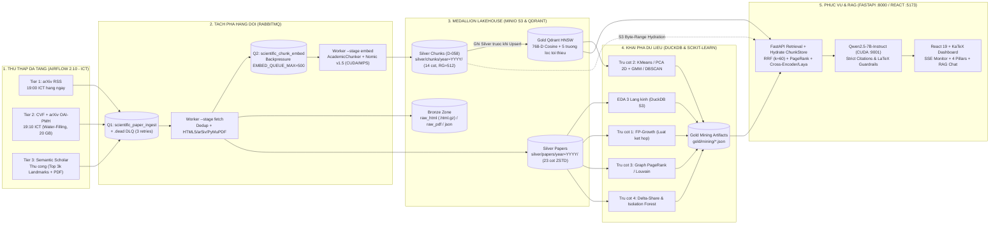

# 01 — Chương 1: Hiểu Bài Toán & Kiến Trúc Tổng Thể (Business Understanding & System Architecture)

- **Motivation/Background**: Tri thức nghiên cứu trong lĩnh vực Trí tuệ Nhân tạo và Khoa học Dữ liệu (AI/DS) tăng trưởng theo cấp số nhân nhưng bị phân mảnh nghiêm trọng trên nhiều kho lưu trữ rời rạc (arXiv, CVF Open Access, Semantic Scholar, các kho hội nghị cũ), kèm theo hiện tượng suy giảm cấu trúc công thức toán khi chuyển đổi PDF truyền thống và nguy cơ ảo giác học thuật (*hallucination*) khi dùng mô hình ngôn ngữ lớn (LLM) hỏi đáp thiếu kiểm chứng.
- **Purpose**: Trình bày đầy đủ bối cảnh bài toán, kiến trúc tổng thể Medallion Lakehouse kết hợp Khai phá Dữ liệu và Hybrid RAG, 5 đóng góp kỹ thuật cốt lõi, ma trận chỉ số hiệu năng (KPI) cập nhật và các đánh đổi thiết kế (*architectural trade-offs*) định hướng cho toàn bộ đồ án.
- **Overview Pipeline**: Phân tích điểm nghẽn học thuật $\rightarrow$ Thiết kế kiến trúc 3 tầng thu thập + RabbitMQ tách pha + Medallion (`Bronze` / `Silver papers` & `Silver chunks` / `Qdrant Gold` + `4 Mining Pillars`) $\rightarrow$ Đối chiếu mục tiêu định lượng qua Ma trận KPI đa mốc (`05/10`–`09/11/2026`).
- **Detailed Plan**: §1.1 Bối cảnh và Động lực Bài toán; §1.2 Kiến trúc Tổng thể Medallion Lakehouse kết hợp Khai phá & RAG; §1.3 Nền tảng Tiếp cận và Đóng góp Kỹ thuật; §1.4 Mục tiêu Kỹ thuật & Ma trận Chỉ số Hiệu năng (KPI); §1.5 Phạm vi, Đối tượng Sử dụng & Các Đánh đổi Thiết kế.
- **References**: [00_MASTER_OUTLINE_AND_LATEX_MAPPING.md](./00_MASTER_OUTLINE_AND_LATEX_MAPPING.md), [02_business_understanding.tex](../../data-mining-latek/sections/02_business_understanding.tex), [table_kpi.tex](../../data-mining-latek/tables/table_kpi.tex), [diagrams.tex](../../data-mining-latek/figures/diagrams.tex), [settings.py](../../src/config/settings.py), [config.py](../../backend/app/core/config.py), [laya_pagerank_benchmark_report.md](../benchmarks/laya_pagerank_benchmark_report.md), [PERFORMANCE_BENCHMARK_REPORT.md](../benchmarks/PERFORMANCE_BENCHMARK_REPORT.md), [RAG_EVALUATION_REPORT_21_SAMPLES.md](../benchmarks/RAG_EVALUATION_REPORT_21_SAMPLES.md), [RAG_EVALUATION_REPORT_768D_COMPARISON.md](../benchmarks/RAG_EVALUATION_REPORT_768D_COMPARISON.md), [laya_ab_final_benchmark.json](../../logs/benchmarks/laya_ab_final_benchmark.json), [vector_final_benchmark.json](../../logs/benchmarks/vector_final_benchmark.json), [OVERVIEW.md](../OVERVIEW.md).
- **Created**: 2026-11-25T12:55:00+07:00
- **Last Updated**: 2026-11-25T12:55:00+07:00

[STATUS: ACTIVE]

---

## Mục Lục

- [1.1 Bối Cảnh và Động Lực Bài Toán](#11-bối-cảnh-và-động-lực-bài-toán)
- [1.2 Kiến Trúc Tổng Thể Medallion Lakehouse kết hợp Khai Phá & RAG](#12-kiến-trúc-tổng-thể-medallion-lakehouse-kết-hợp-khai-phá--rag)
- [1.3 Nền Tảng Tiếp Cận và Đóng Góp Kỹ Thuật](#13-nền-tảng-tiếp-cận-và-đóng-góp-kỹ-thuật)
- [1.4 Mục Tiêu Kỹ Thuật & Ma Trận Chỉ Số Hiệu Năng (KPI)](#14-mục-tiêu-kỹ-thuật--ma-trận-chỉ-số-hiệu-năng-kpi)
- [1.5 Phạm Vi, Đối Tượng Sử Dụng & Các Đánh Đổi Thiết Kế](#15-phạm-vi-đối-tượng-sử-dụng--các-đánh-đổi-thiết-kế)

---

## 1.1 Bối Cảnh và Động Lực Bài Toán

Trong nghiên cứu Trí tuệ Nhân tạo và Khoa học Dữ liệu (AI/DS), quá trình khảo cứu tổng quan tài liệu (*literature review*) thường xuyên đối mặt với bốn rào cản cấu trúc liên hoàn:

1. **Phân mảnh nguồn dữ liệu và trùng lặp đa phiên bản**: Công trình khoa học cùng một ý tưởng xuất hiện song song dưới dạng bản tiền ấn phẩm (*preprint*) trên arXiv (nhiều phiên bản `v1`, `v2`, `v3`), bản kỷ yếu chính thức trên CVF Open Access (CVPR, ICCV, WACV), và bản chỉ mục trích dẫn trên Semantic Scholar. Việc cào dữ liệu thiếu kiểm soát tạo ra bản sao trùng lặp, làm sai lệch thống kê tần suất chủ đề và gây lãng phí ngân sách nhúng vector.
2. **Suy thoái cấu trúc học thuật và công thức toán học**: Đường ống xử lý PDF truyền thống thường phá vỡ thứ tự đọc hai cột, cắt ngang các phân mục (*section*), hoặc chuyển đổi ký hiệu toán học thành chuỗi ký tự vô nghĩa. Điều này làm mất năng lực truy xuất chính xác đối với các câu hỏi đòi hỏi công thức định lượng (như hàm mất mát DPO, định luật tỷ lệ *Scaling Laws*, hay phép biến đổi RoPE).
3. **Ảo giác học thuật và thiếu cơ chế từ chối có kiểm chứng (*Evidence Gate*)**: Khi sử dụng LLM thuần túy hoặc hệ thống RAG chỉ dựa trên độ tương đồng cosine thô, các đoạn văn tổng quan (*survey*) dễ chiếm chỗ của bài báo gốc tại Top-$1$, đồng thời mô hình sinh vẫn có xu hướng bịa đặt dẫn chứng cho các khái niệm không tồn tại trong kho tri thức (*negative queries*).
4. **Đứt gãy giữa Khai phá Dữ liệu (*Data Mining*) và Truy xuất Thông tin (*Retrieval*)**: Các công cụ khai phá dữ liệu (luật kết hợp, phân cụm chủ đề, đồ thị mạng lưới, phát hiện dị biệt) thường tồn tại dưới dạng báo cáo tĩnh tách rời khỏi hệ thống hỏi đáp thời gian thực, không cung cấp tín hiệu uy tín hay ngữ cảnh khám phá trực tiếp cho người nghiên cứu.

Xuất phát từ các yêu cầu thực tiễn này, đồ án đặt mục tiêu xây dựng một **nguyên mẫu thống nhất** kết hợp chặt chẽ **Kỹ thuật Hồ dữ liệu thời gian thực** (*Real-Time Medallion Lakehouse*), **Bốn trụ cột Khai phá Dữ liệu**, và **Hệ thống Hybrid RAG có dẫn nguồn** trên cùng một nền tảng lưu trữ và phục vụ.

---

## 1.2 Kiến Trúc Tổng Thể Medallion Lakehouse kết hợp Khai Phá & RAG

Kiến trúc tổng thể của hệ thống được thiết kế theo nguyên lý tách rời tầng tính toán (*Compute*) khỏi tầng lưu trữ đối tượng (*Object Storage — MinIO S3*), xử lý phi đĩa cục bộ (*Zero Local Disk footprint*) và tách pha thu thập mạng khỏi pha suy luận GPU. Hình 1.1 minh họa toàn bộ luồng dữ liệu từ tầng thu thập 3 cấp đến tầng phục vụ tương tác:

*Hình 1.1: Kiến trúc tổng thể Medallion Lakehouse kết hợp Khai phá Dữ liệu và Hybrid RAG (đối chiếu với sơ đồ TikZ `\DrawSystemArchitecture` trong [diagrams.tex](../../data-mining-latek/figures/diagrams.tex)).*

Điểm cốt lõi của kiến trúc này nằm ở sự phân tách rõ ràng trách nhiệm của từng tầng dữ liệu:
- **Bronze Zone**: Kho lưu trữ nguyên bản bất biến (*Immutable Source of Truth*), nén `gzip` cấp 6 đối với HTML5 (`~6–8x` tỷ lệ nén) và gắn mã băm SHA-256 trên metadata đối tượng S3, cho phép tái xử lý toàn bộ kho khi nâng cấp bộ bóc tách.
- **Silver Zone (Hai bảng cộng sinh)**: Tách riêng bảng tài liệu (`silver/papers/year=YYYY/`, 23 cột) phục vụ phân tích OLAP qua DuckDB/PyArrow và bảng phân đoạn (`silver/chunks/year=YYYY/`, 14 cột theo quyết định `D-058`) làm nguồn chân lý cho nội dung văn bản chunk.
- **Gold Zone**: Lưu song song chỉ mục tìm kiếm lân cận gần đúng **Qdrant HNSW** (`768-D`, Cosine) chỉ chứa vector và 5 trường lọc tối thiểu, cùng các sản phẩm tri thức JSON cô đọng tại `gold/mining/` được tái tính toán định kỳ qua [dag_recompute_mining.py](../../dags/dag_recompute_mining.py).

---

## 1.3 Nền Tảng Tiếp Cận và Đóng Góp Kỹ Thuật

Hệ thống kế thừa các thuật toán nền tảng đã được kiểm chứng trong học thuật: mô hình RAG của Lewis và cộng sự (2020), họ mô hình nhúng ngữ cảnh dài **Nomic Embed** (`nomic-embed-text-v1.5`, mã hóa vị trí quay RoPE 8,192 tokens), **FP-Growth** cho khai phá tập mục phổ biến, **MiniBatchKMeans / GMM / DBSCAN** cho phân tích mật độ và cụm ngữ nghĩa, **PageRank / Louvain** cho cấu trúc mạng học thuật, và **Isolation Forest** cho phát hiện ngoại lai đa biến. Đồ án không đề xuất thuật toán học máy mới về mặt lý thuyết, mà tập trung **đóng góp ở cấp độ kỹ thuật hệ thống (*systems engineering*) và tích hợp pipeline dữ liệu** qua 5 trụ cột thực thi tại Bảng 1.1:

**Bảng 1.1: Năm đóng góp kỹ thuật cốt lõi của hệ thống**

| STT | Đóng góp Kỹ thuật | Vấn đề gốc cần giải quyết | Hiện thực hóa trong Mã nguồn |
| :---: | :--- | :--- | :--- |
| **1** | **Thu thập 3 tầng tự động kèm Cân bằng tải *Water-Filling* & Tách pha RabbitMQ** | Cào tuần tự bị nghẽn mạng làm đói GPU; mất cân đối chuyên ngành (quá tải `cs.CV` / `cs.LG`) và tràn đĩa | [dag_tier1_realtime_stream.py](../../dags/dag_tier1_realtime_stream.py), [dag_tier2_near_past_harvest.py](../../dags/dag_tier2_near_past_harvest.py), [dag_tier3_landmark_harvest.py](../../dags/dag_tier3_landmark_harvest.py), [queue_consumer.py](../../src/ingestion/queue_consumer.py) (`--stage fetch` / `--stage embed`, `EMBED_QUEUE_MAX=500`) |
| **2** | **Hồ cột Zero-Disk & Thủy hóa Byte-Range `ChunkStore` (`D-058`)** | Lưu toàn văn chunk trong payload Qdrant làm phình RAM/băng thông vector DB; ghi đè tệp Parquet theo năm gây chậm $O(N)$ | [lakehouse_io.py](../../src/storage/lakehouse_io.py), [silver_writer.py](../../src/transformation/silver_writer.py), [chunk_store.py](../../src/storage/chunk_store.py) (`ROW_GROUP_SIZE=512`, `ThreadPoolExecutor(16)`), [dag_compact_silver.py](../../dags/dag_compact_silver.py) |
| **3** | **Bộ giải mã Thác nước HTML-First & Lá chắn Chống lỗi Thực thi** | OCR PDF chậm và hỏng công thức; ký tự UTF-16 *lone surrogate* làm sập tokenizer Rust (`BUG-01`) | [unified_content_resolver.py](../../src/transformation/unified_content_resolver.py), [html_parser.py](../../src/transformation/html_parser.py), [embedder.py](../../src/indexing/embedder.py), [hasher.py](../../src/utils/hasher.py) |
| **4** | **Tích hợp 4 Trụ cột Khai phá vào Truy xuất & Giao diện Phân tích** | Khai phá dữ liệu bị cô lập khỏi truy xuất; cần tín hiệu uy tín đồ thị và luật liên kết phục vụ kiểm chứng | [mining_engine.py](../../src/mining/mining_engine.py), [retrieval_service.py](../../backend/app/services/retrieval_service.py) (PageRank Multiplier $\beta=0.25$, `rule_expansions`), React 19 UI |
| **5** | **Đánh giá Thực nghiệm Đa tầng & Kiểm soát Ảo giác (`Evidence Gate`)** | Chưa định lượng tách bạch giữa phân đoạn, reranking, chặn câu hỏi ngoài phạm vi và tốc độ sinh cục bộ | [chunking_ab.py](../../benchmarks/chunking_ab.py), [evaluate_120_ranking_5_scenarios.py](../../benchmarks/evaluate_120_ranking_5_scenarios.py), [run_deepeval_vector_judge.py](../../benchmarks/run_deepeval_vector_judge.py), [test_rag_llm_performance.py](../../tests/performance/test_rag_llm_performance.py) |

---

## 1.4 Mục Tiêu Kỹ Thuật & Ma Trận Chỉ Số Hiệu Năng (KPI)

Hệ thống được định lượng qua 4 nhóm chỉ số mục tiêu: (1) Chất lượng Truy xuất & Cổng bằng chứng (*Retrieval & Evidence Gate*), (2) Chất lượng Sinh câu trả lời (*DeepEval Generation*), (3) Hiệu năng Phần cứng & Độ trễ (*Hardware & Latency*), và (4) Quy mô Hồ dữ liệu & Khai phá (*Lakehouse & Mining*).

> **5W1H — Ma trận Chỉ số Hiệu năng Hệ thống (KPI Matrix)**
> - **What**: Tổng hợp 15 chỉ số KPI định lượng trên 4 nhóm năng lực kỹ thuật, đối chiếu ngưỡng mục tiêu với giá trị đo được tại từng mốc kiểm thử.
> - **Why**: Chứng minh mức độ đạt chuẩn kỹ thuật của từng khâu (thu thập, phân đoạn, xếp hạng, chống ảo giác, khai phá, phần cứng) đồng thời minh bạch phạm vi mốc đo giữa phiên bản Qdrant/ChunkStore mới và LanceDB lịch sử.
> - **When**: Tổng hợp từ các phiên đo `05/10/2026` (`SNAP-02`), `19/10/2026` (`SNAP-04`), `04/11/2026` (`SNAP-06A`) và `06–09/11/2026` (`SNAP-06B`).
> - **Where**: Truy vết tại `logs/run/backend.log`, [laya_5_scenarios_comparison_120q.json](../../logs/benchmarks/laya_5_scenarios_comparison_120q.json), [laya_ab_final_benchmark.json](../../logs/benchmarks/laya_ab_final_benchmark.json), [vector_final_benchmark.json](../../logs/benchmarks/vector_final_benchmark.json), `logs/benchmarks/chunking_ab/summary.json`, `logs/benchmarks/rag_eval/report_retrieval.json`, [PERFORMANCE_BENCHMARK_REPORT.md](../benchmarks/PERFORMANCE_BENCHMARK_REPORT.md), [RAG_EVALUATION_REPORT_21_SAMPLES.md](../benchmarks/RAG_EVALUATION_REPORT_21_SAMPLES.md).
> - **Who**: Nhóm 1 xây dựng cho đánh giá kỹ thuật và phản biện học thuật môn Khai thác Dữ liệu (UTH).
> - **How**: Mỗi dòng KPI ghi rõ giá trị đo thực tế, phương pháp đo và mã mốc snapshot tương ứng; tuyệt đối không trộn số đo khác phiên bản thành một phép đo đơn.

**Bảng 1.2: Ma trận Chỉ số Hiệu năng Kỹ thuật Toàn hệ thống (KPI Matrix)**

| Nhóm KPI | Tên Chỉ số | Mục tiêu Thiết kế | Kết quả Đo Thực nghiệm | Mốc / Nguồn Xác minh |
| :--- | :--- | :---: | :--- | :--- |
| **1. Hồ dữ liệu & Khai phá** | Quy mô bài Silver & Vector Qdrant | $\ge 50,000$ bài | **71,927 bài báo phân biệt** / **1,043,594 vector** | `SNAP-06A` (`logs/run/backend.log`, 04/11/2026) |
| **1. Hồ dữ liệu & Khai phá** | Thời gian chạy EDA + 4 Trụ cột | $< 300\text{ s}$ | **234.57 s** (EDA `39.09 s`, FP `36.26 s`, Clust `39.94 s`, Graph `116.39 s`, Trend `2.89 s`) | `SNAP-06A` (`logs/run/backend.log`) |
| **1. Hồ dữ liệu & Khai phá** | Độ phủ giao dịch & Luật kết hợp | $\ge 80\%$ / $\text{Lift} > 1.2$ | **61,319 giao dịch (85.3%)**, **45 luật**, top lift **34.940** | `SNAP-06A` (`logs/run/backend.log`) |
| **1. Hồ dữ liệu & Khai phá** | Tỷ lệ làm giàu cấu trúc & Công thức | $> 85\%$ / $> 1.5\text{M}$ | **89.38%** (11,619/13k; `2,825,871` CT) \| **90.15%** (9,015/10k; `2,220,938` CT) | `SNAP-03` & `SNAP-01` ([table_kpi.tex](../../data-mining-latek/tables/table_kpi.tex)) |
| **2. Phân đoạn & Truy xuất** | Hiệu quả Phân đoạn (Chunking A/B) | Cải thiện đuôi ngắn & Recall@5 | **`B_new_pct15`**: $p_{10}$ tăng **103 $\rightarrow$ 166 từ**, Recall@5 **0.7679** (so với `0.7143`) | `SNAP-06B` (`logs/benchmarks/chunking_ab/summary.json`) |
| **2. Phân đoạn & Truy xuất** | Xếp hạng 5 Kịch bản Hydrated (`N=120`) | Nâng MRR & Hit@1 so với Vector | **Full (Vector+Laya RRF+PageRank)**: **MRR 0.6076** (`+6.1%`), **Hit@1 55.0%**, Hit@5 **69.2%** | `SNAP-06B` ([laya_pagerank_benchmark_report.md](../benchmarks/laya_pagerank_benchmark_report.md)) |
| **2. Phân đoạn & Truy xuất** | Retrieval v1 + Laya FT (`RAG_TS`, 100+50) | $\text{MRR@10} \ge 0.80$, chặn nhiễu | **`laya_ft1_hybrid`**: **MRR@10 0.824**, **nDCG@10 0.850**, **Hit@5 0.940**, **Gold@5 0.830** | `SNAP-06B` (`logs/benchmarks/rag_eval/report_retrieval.json`) |
| **2. Phân đoạn & Truy xuất** | Cổng Kiểm chứng Bằng chứng (*Evidence Gate*) | $\text{AUROC} \ge 0.90$ | **`laya_ft1_hybrid`**: **AUROC 0.986**, chặn **50/50** câu không có đáp án, giữ **86/100** câu đúng | `SNAP-06B` (`logs/benchmarks/rag_eval/report_retrieval.json`) |
| **2. Phân đoạn & Truy xuất** | Đối chuẩn 3 Bên 150 Mẫu (Vector vs Laya) | Vượt Pure Vector & Laya Baseline | **Laya Mới**: **MRR 0.8939**, **Hit@1 82.0%**, **Hit@5 98.0%** (so với Vector `0.8623` / `79.0%` / `96.0%`) | `SNAP-06B` ([laya_ab_final_benchmark.json](../../logs/benchmarks/laya_ab_final_benchmark.json), [vector_final_benchmark.json](../../logs/benchmarks/vector_final_benchmark.json)) |
| **3. Chất lượng Sinh RAG** | Faithfulness (3-Way 150 Mẫu vs LanceDB) | $\ge 0.70$ | **0.7977** (3-Way Laya Mới, 100 pos) \| **0.699** (LanceDB 21q) \| **0.892** (768-D Reranked) | `SNAP-06B` & `SNAP-02` ([vector_final_benchmark.json](../../logs/benchmarks/vector_final_benchmark.json), [RAG_EVALUATION_REPORT_768D_COMPARISON.md](../benchmarks/RAG_EVALUATION_REPORT_768D_COMPARISON.md)) |
| **3. Chất lượng Sinh RAG** | Contextual Precision / Recall / Citation | $\ge 0.70$ / $\ge 0.85$ / $\ge 80\%$ | **0.860** Prec / **1.000** Rec (19/19) / **90.0%** Cit (18/20) \| **0.900** Rec (`N=105` Hydrated) | `SNAP-02` & `SNAP-06B` ([table_rag_benchmark.tex](../../data-mining-latek/tables/table_rag_benchmark.tex), [laya_pagerank_benchmark_report.md](../benchmarks/laya_pagerank_benchmark_report.md)) |
| **4. Phần cứng & Độ trễ** | Truy vấn Qdrant Độc lập (Top-5, Pool) | $< 500\text{ ms}$ | **269.46 $\pm$ 12.44 ms** ($p_{50} = 268.10\text{ ms}$, $3.71$ QPS trên 374k vectors) | `SNAP-04` ([PERFORMANCE_BENCHMARK_REPORT.md](../benchmarks/PERFORMANCE_BENCHMARK_REPORT.md)) |
| **4. Phần cứng & Độ trễ** | Time To First Token (TTFT) & Sinh CUDA | $< 1.5\text{ s}$ / $> 30\text{ tok/s}$ | **TTFT 609.77 ms**, **46.33 $\pm$ 0.64 tok/s**, tổng E2E **3,392.50 ms** (RTX 4060) | `SNAP-04` ([PERFORMANCE_BENCHMARK_REPORT.md](../benchmarks/PERFORMANCE_BENCHMARK_REPORT.md)) |
| **4. Phần cứng & Độ trễ** | Dung lượng VRAM Đỉnh (*Peak VRAM*) | $< 7.0\text{ GB}$ | **5.7 GB / 8.0 GB** (Qwen2.5-7B `Q4_K_M`, `ctx=4096`, `seq=1`) | `SNAP-04` ([PERFORMANCE_BENCHMARK_REPORT.md](../benchmarks/PERFORMANCE_BENCHMARK_REPORT.md)) |

Để chuẩn hóa cách tính tỷ lệ cải thiện tương đối giữa cấu hình nâng cấp và nền cơ sở xuyên suốt các chương đánh giá, hệ thống sử dụng công thức chuẩn:

$$\Delta_{\text{rel}}(\%) = \frac{M_{\text{upgraded}} - M_{\text{baseline}}}{M_{\text{baseline}}} \times 100\% \tag{1.1}$$

Trong đó: $M_{\text{upgraded}}$ là giá trị chỉ số đánh giá của cấu hình mục tiêu, $M_{\text{baseline}}$ là giá trị của cấu hình đối chứng trên cùng tập mẫu và cùng điều kiện đo, và $\Delta_{\text{rel}}(\%)$ là mức tăng trưởng tương đối tính theo phần trăm.

---

## 1.5 Phạm Vi, Đối Tượng Sử Dụng & Các Đánh Đổi Thiết Kế

### 1.5.1 Phạm vi dữ liệu và Đối tượng sử dụng

- **Phạm vi chuyên ngành**: Tập trung vào hệ sinh thái AI/DS gồm các nhánh nòng cốt `cs.LG`, `cs.CV`, `cs.CL`, `cs.AI`, `cs.RO`, `cs.IR`, `cs.NE`, `cs.MA`, `cs.SD`, `eess.IV`, `eess.AS`, và `stat.ML` (được nhóm thành 7 cụm cân bằng tải tại [dag_tier2_near_past_harvest.py](../../dags/dag_tier2_near_past_harvest.py)). Hệ thống lưu trữ dữ liệu có kiểm soát trong ngân sách `LAKEHOUSE_BUDGET_GB = 20.0 GB` (xem [config.py](../../backend/app/core/config.py)), do đó không đại diện cho toàn bộ sản lượng xuất bản khoa học toàn cầu.
- **Đối tượng sử dụng (3 nhóm Use Cases)**:
  1. *Sinh viên AI/DS và CNTT*: Tra cứu nhanh cơ chế kỹ thuật (như *FlashAttention*, *DPO*, *LoRA*, *RoPE*), kiểm chứng công thức LaTeX KaTeX và đối chiếu trực tiếp tới `[Paper: ID, Section: ...]`.
  2. *Học viên cao học và Nghiên cứu sinh*: Khảo sát mật độ đa ngành, luật kết hợp khái niệm, cụm ngữ nghĩa GMM 2D và mạng lưới hợp tác PageRank để xác định các tác giả trung tâm và xu hướng đang bùng nổ (`SURGING`).
  3. *Giảng viên và Người thẩm định*: Kiểm tra tính minh bạch nguồn gốc (*Bronze $\rightarrow$ Silver $\rightarrow$ Gold lineage*), các trường hợp dị biệt cấu trúc và mức độ từ chối câu hỏi thiếu bằng chứng.

### 1.5.2 Các Đánh đổi Thiết kế Trọng yếu (Architectural Trade-offs)

Mỗi quyết định kiến trúc trong hệ thống đều giải quyết một nút thắt cổ chai thực tế đi kèm đánh đổi minh bạch (Bảng 1.3):

**Bảng 1.3: Tổng hợp các Đánh đổi Kiến trúc (*Architectural Trade-offs*)**

| Quyết định Kiến trúc | Lựa chọn Áp dụng | Phương án Bị từ chối | Lý do & Hệ quả Đánh đổi |
| :--- | :--- | :--- | :--- |
| **Tách payload Qdrant (`D-058`)** | Qdrant chỉ lưu vector 768-D + `5` trường lọc; văn bản nằm trong `silver/chunks/` (`ChunkStore`) | Nhồi toàn bộ `text`, `authors`, `title` vào Qdrant payload | Giảm mạnh bộ nhớ RAM/đĩa của Qdrant và loại bỏ trùng lặp văn bản; đổi lại phát sinh độ trễ thủy hóa qua S3 Byte-Range (`~15–40 ms` khi cold cache) và đòi hỏi quy tắc bất biến ghi Silver trước Qdrant. |
| **Ưu tiên HTML5 trước PDF** | `arxiv.org/html` $\rightarrow$ `ar5iv` $\rightarrow$ PyMuPDF (chỉ Tier 3 ngoài arXiv) $\rightarrow$ Abstract | Chạy OCR neural (`Marker`) cho 100% bài báo | Giảm thời gian bóc tách từ `4–10 s/bài` GPU xuống `0.3–1.5 s/bài` CPU và lấy trực tiếp TeX gốc; đổi lại các bài preprint quá mới chưa render HTML5 hoặc hội nghị PDF-only không thuộc Tier 3 sẽ dừng ở mức Abstract. |
| **Tách pha RabbitMQ (`fetch`/`embed`)** | 2 hàng đợi nối tiếp có backpressure `EMBED_QUEUE_MAX=500` | 1 worker đơn xử lý tuần tự fetch + embed | Ngăn mạng chậm làm GPU nhàn rỗi và ngăn fetch tràn hàng đợi làm đầy RAM; đổi lại cần quản trị 2 worker và 2 DLQ riêng biệt. |
| **Không lọc cứng Retrieval bằng Cụm/Luật** | PageRank điều chỉnh điểm xếp hạng; FP-Growth làm annotation; GMM/Anomalies phục vụ Dashboard | Lọc cứng vector search theo nhãn cụm GMM hoặc tự động nối từ khóa luật vào query | Bảo toàn độ phủ ngữ nghĩa (*Recall*) cho bài báo liên ngành; chấp nhận luật kết hợp chưa trực tiếp tăng độ phủ truy xuất tự động. |
| **Cân bằng cửa sổ `AcademicChunker`** | Cửa sổ cân bằng + overlap `15%` + gộp đuôi `< 40%` + bám ranh giới câu | Cắt trượt cố định `450` từ / `50` từ overlap | Loại bỏ chunk đuôi vụn ($p_{10}$ tăng từ `103` lên `166` từ, Recall@5 đạt `0.7679`); chấp nhận số chunk trên một bài thay đổi nhẹ khi tái lập chỉ mục. |

---
*Chương tiếp theo ([02a_CH2_THU_THAP_DU_LIEU_COLLECT.md](./02a_CH2_THU_THAP_DU_LIEU_COLLECT.md)) đi sâu vào kiến trúc điều phối 3 tầng trên Apache Airflow, mô hình toán học Water-Filling cân bằng chuyên ngành và cơ chế kiểm soát ngân sách lưu trữ theo thời gian thực.*
