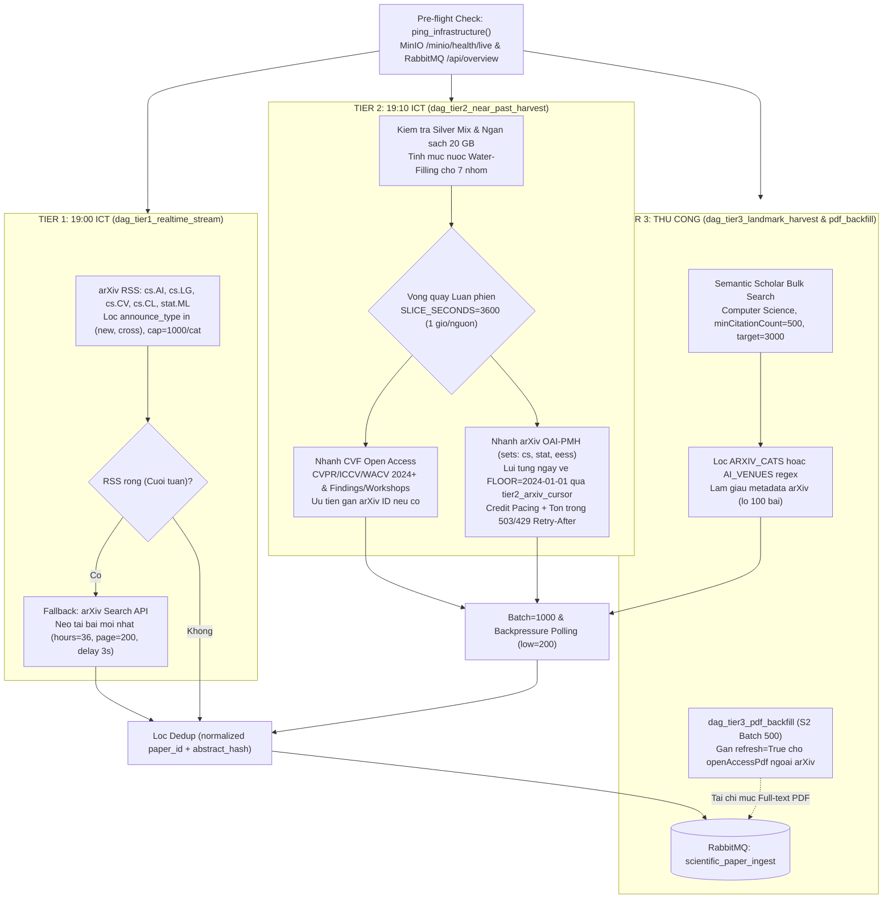

# 02a — Chương 2 (Phần A): Thu Thập Dữ Liệu Đa Tầng (Collect)

- **Motivation/Background**: Việc thu thập dữ liệu học thuật quy mô hàng chục nghìn bài báo từ các API công cộng (arXiv RSS, arXiv OAI-PMH, CVF Open Access, Semantic Scholar) dễ gặp giới hạn tốc độ (`HTTP 429/503`), thiên lệch phân bố chuyên ngành (các nhánh lớn như `cs.CV`, `cs.LG` lấn át `cs.RO`, `cs.IR`, `stat.ML`), thiên lệch thời gian dồn về các tuần mới nhất và nguy cơ tràn ngân sách đĩa lưu trữ (`20 GB`).
- **Purpose**: Đặc tả chi tiết kiến trúc điều phối 3 tầng trên Apache Airflow 2.10, mô hình toán học *Water-Filling* cân bằng nhóm ngành/nguồn, thuật toán điều tiết tín dụng *Credit Pacing*, công thức quản trị ngân sách lưu trữ thời gian thực và cơ chế phân mảnh phân tán *MD5 Hash-Modulo Sharding*.
- **Overview Pipeline**: Kiểm tra hạ tầng `ping_infrastructure` $\rightarrow$ Thu thập Tier 1 (RSS hàng ngày 19:00 ICT) + Tier 2 (Luân phiên CVF/arXiv OAI-PMH 19:10 ICT có Water-Filling & Credit Pacing) + Tier 3 (Semantic Scholar Landmarks & PDF Backfill thủ công) $\rightarrow$ Kiểm soát Backpressure hàng đợi (`HARVEST_BATCH=1000`, `HARVEST_LOW_WATER=200`) $\rightarrow$ Đẩy vào RabbitMQ `scientific_paper_ingest`.
- **Detailed Plan**: §2.1 Kiến trúc Điều phối 3 Tầng trên Apache Airflow 2.10; §2.2 Mô hình Toán học Cân bằng Tải & Quản trị Ngân sách Lưu trữ (*Water-Filling*, *Credit Pacing*, Storage Budget); §2.3 Chiến lược Phân mảnh Thu thập Phân tán (MD5 Hash-Modulo Sharding).
- **References**: [_common.py](../../dags/_common.py), [dag_tier1_realtime_stream.py](../../dags/dag_tier1_realtime_stream.py), [dag_tier2_near_past_harvest.py](../../dags/dag_tier2_near_past_harvest.py), [dag_tier3_landmark_harvest.py](../../dags/dag_tier3_landmark_harvest.py), [dag_tier3_pdf_backfill.py](../../dags/dag_tier3_pdf_backfill.py), [dag_daily_arxiv_harvest.py](../../dags/dag_daily_arxiv_harvest.py), [run_tier1_realtime_stream.py](../../src/pipelines/run_tier1_realtime_stream.py), [run_three_tier_pipeline.py](../../src/pipelines/run_three_tier_pipeline.py), [arxiv_batch_harvester.py](../../src/ingestion/arxiv_batch_harvester.py), [cvf_harvester.py](../../src/ingestion/cvf_harvester.py), [openreview_harvester.py](../../src/ingestion/openreview_harvester.py), [zenodo_harvester.py](../../src/ingestion/zenodo_harvester.py), [settings.py](../../src/config/settings.py), [DISTRIBUTED_HARVESTING_AND_HTML_FIRST_ARCHITECTURE.md](../DISTRIBUTED_HARVESTING_AND_HTML_FIRST_ARCHITECTURE.md), [QUY_TRINH_TIEN_XU_LY_DU_LIEU.md](../QUY_TRINH_TIEN_XU_LY_DU_LIEU.md).
- **Created**: 2026-11-25T12:55:00+07:00
- **Last Updated**: 2026-11-25T12:55:00+07:00

[STATUS: ACTIVE]

---

## Mục Lục

- [2.1 Kiến Trúc Điều Phối 3 Tầng Trên Apache Airflow 2.10](#21-kiến-trúc-điều-phối-3-tầng-trên-apache-airflow-210)
  - [2.1.1 Kiểm tra Tiền điều kiện Hạ tầng (`ping_infrastructure`)](#211-kiểm-tra-tiền-điều-kiện-hạ-tầng-ping_infrastructure)
  - [2.1.2 Tier 1: Luồng Thời gian thực Hàng ngày (`dag_tier1_realtime_stream`)](#212-tier-1-luồng-thời-gian-thực-hàng-ngày-dag_tier1_realtime_stream)
  - [2.1.3 Tier 2: Thu hoạch Cận quá khứ Luân phiên (`dag_tier2_near_past_harvest`)](#213-tier-2-thu-hoạch-cận-quá-khứ-luân-phiên-dag_tier2_near_past_harvest)
  - [2.1.4 Tier 3: Công trình Kinh điển & Bồi hoàn PDF (`dag_tier3_landmark_harvest`, `dag_tier3_pdf_backfill`)](#214-tier-3-công-trình-kinh-điển--bồi-hoàn-pdf-dag_tier3_landmark_harvest-dag_tier3_pdf_backfill)
  - [2.1.5 Phân định Nguồn Live và Nguồn Lịch sử trong Bronze](#215-phân-định-nguồn-live-và-nguồn-lịch-sử-trong-bronze)
- [2.2 Mô Hình Toán Học Cân Bằng Tải & Quản Trị Ngân Sách Lưu Trữ](#22-mô-hình-toán-học-cân-bằng-tải--quản-trị-ngân-sách-lưu-trữ)
  - [2.2.1 Thuật toán Water-Filling Cân bằng 7 Nhóm Chủ đề và Nguồn](#221-thuật-toán-water-filling-cân-bằng-7-nhóm-chủ-đề-và-nguồn)
  - [2.2.2 Thuật toán Điều tiết Tín dụng Theo Ngày (*Credit Pacing*)](#222-thuật-toán-điều-tiết-tín-dụng-theo-ngày-credit-pacing)
  - [2.2.3 Quản trị Ngân sách Lưu trữ Thời gian thực & Backpressure](#223-quản-trị-ngân-sách-lưu-trữ-thời-gian-thực--backpressure)
- [2.3 Chiến Lược Phân Mảnh Thu Thập Phân Tán (MD5 Hash-Modulo Sharding)](#23-chiến-lược-phân-mảnh-thu-thập-phân-tán-md5-hash-modulo-sharding)

---

## 2.1 Kiến Trúc Điều Phối 3 Tầng Trên Apache Airflow 2.10

Toàn bộ hoạt động thu thập (*Collect*) được đóng gói thành các Directed Acyclic Graphs (DAGs) trên **Apache Airflow 2.10**, vận hành theo múi giờ chuẩn Việt Nam (`Asia/Ho_Chi_Minh — ICT`) thông qua `CronTriggerTimetable` (bảo đảm kích hoạt đúng thời điểm đặt lịch thay vì chờ cuối chu kỳ interval). Một nguyên tắc thiết kế bất biến được thực thi xuyên suốt: **các DAG thu thập chỉ đóng vai trò Producer** — kiểm tra trùng lặp nhẹ trên metadata và đẩy JSON thô vào hàng đợi RabbitMQ (`scientific_paper_ingest`), tuyệt đối không tự ý tải toàn văn hay ghi trực tiếp vào kho Bronze/Silver/Gold (nhiệm vụ này thuộc về `QueueConsumer` ở [02b_CH2_TICH_HOP_VA_DIEU_PHOI_INTEGRATE.md](./02b_CH2_TICH_HOP_VA_DIEU_PHOI_INTEGRATE.md)).

*Hình 2.1: Sơ đồ điều phối 3 tầng thu thập dữ liệu trên Apache Airflow 2.10 (`_common.py`, `dag_tier1`, `dag_tier2`, `dag_tier3`).*

> **5W1H — Đặc tả Kỹ thuật 4 DAG Thu thập Đa tầng trên Apache Airflow**
> - **What**: Bảng đối chiếu lịch chạy, giao thức API, ngưỡng giới hạn và cơ chế chống nghẽn/khử trùng của 4 DAG thu thập (`Tier 1`, `Tier 2`, `Tier 3 Landmarks`, `Tier 3 PDF Backfill`).
> - **Why**: Phân tách rạch ròi bài mới trong ngày, dữ liệu cận quá khứ 2024+ và công trình kinh điển đa trích dẫn nhằm tối đa độ bao phủ trong giới hạn lưu trữ `20 GB`.
> - **When**: Kiểm chứng trên mã nguồn DAGs hiện hành ngày 25/11/2026 (`Asia/Ho_Chi_Minh`).
> - **Where**: Thư mục điều phối `dags/` ([_common.py](../../dags/_common.py) và 4 tệp `dag_tier*.py`).
> - **Who**: Nhóm 1 xây dựng và vận hành trên cụm Docker/Airflow.
> - **How**: Trích xuất trực tiếp cấu hình `schedule`, `params`, bộ đếm `SLICE_SECONDS` và hàm điều phối hàng đợi từ mã nguồn Python.

**Bảng 2.1: Đặc tả kỹ thuật các DAG thu thập và lịch vận hành trên Apache Airflow**

| Tầng & Mã DAG | Lịch chạy (`Asia/Ho_Chi_Minh`) | Giao thức / API Nguồn | Tham số Giới hạn Chủ đạo | Cơ chế Khử trùng & Chống nghẽn |
| :--- | :--- | :--- | :--- | :--- |
| **Tier 1** [dag_tier1_realtime_stream.py](../../dags/dag_tier1_realtime_stream.py) | Hàng ngày `19:00 ICT` (`0 19 * * *`) | `rss.arxiv.org/rss/{cat}` & fallback `export.arxiv.org/api/query` | `PER_CATEGORY = 1000`, `hours = 36`, `page = 200`, `delay = 3.0 s` | Lọc `new`/`cross` (bỏ revision), `remember(known)` chống lặp bài cross-listed |
| **Tier 2** [dag_tier2_near_past_harvest.py](../../dags/dag_tier2_near_past_harvest.py) | Hàng ngày `19:10 ICT` (`10 19 * * *`, `max_active_runs=1`) | CVF HTML (`openaccess.thecvf.com`) $\leftrightarrow$ arXiv OAI-PMH (`oaipmh.arxiv.org/oai`) | `SLICE_SECONDS = 3600`, `RUN_HOURS = 23`, `FLOOR = 2024-01-01`, `LAKEHOUSE_BUDGET_GB = 20` | Water-Filling 7 nhóm + Credit Pacing + `HARVEST_BATCH=1000` / `LOW_WATER=200` |
| **Tier 3 (Landmarks)** [dag_tier3_landmark_harvest.py](../../dags/dag_tier3_landmark_harvest.py) | Thủ công (`schedule=None`) | Semantic Scholar Bulk API + arXiv Query API (`id_list` batch 100) | `TARGET_PAPERS = 3000`, `MIN_CITATIONS = 500`, `execution_timeout = 3h` | Lọc `ARXIV_CATS` hoặc `AI_VENUES`; chờ hàng đợi qua `wait_for_queue_room` |
| **Tier 3 (PDF Backfill)** [dag_tier3_pdf_backfill.py](../../dags/dag_tier3_pdf_backfill.py) | Thủ công (`schedule=None`) | Semantic Scholar Batch API (`/graph/v1/paper/batch`) | `BATCH = 500`, lọc `s2_*` chưa có `content_origin == "open_access_pdf"` | Phát hành với cờ `refresh=True` để ghi đè vector tóm tắt cũ bằng toàn văn PDF |

*Nguồn: Tổng hợp từ [\_common.py](../../dags/_common.py) và 4 DAG thu thập tại thư mục `dags/`.*

### 2.1.1 Kiểm tra Tiền điều kiện Hạ tầng (`ping_infrastructure`)

Mọi DAG thu thập đều đặt tác vụ `ping_infrastructure()` từ [\_common.py](../../dags/_common.py#L46-L52) làm nút gốc tiên quyết (*fail-fast gate*). Hàm này thực hiện hai lời gọi HTTP `timeout=5 s` tới MinIO (`GET {MINIO_ENDPOINT_URL}/minio/health/live`) và RabbitMQ Management API (`GET {RABBITMQ_MGMT_URL}/api/overview`). Khác với thiết kế cảnh báo im lặng dễ che giấu sự cố mất kết nối kho, bất kỳ mã lỗi HTTP khác `200` nào đều phát sinh ngoại lệ ngay lập tức, ngắt DAG trước khi tiêu tốn hạn mức API bên ngoài.

### 2.1.2 Tier 1: Luồng Thời gian thực Hàng ngày (`dag_tier1_realtime_stream`)

Tier 1 bảo đảm độ trễ cập nhật trong ngày (*zero-day preprints*) trên 5 chuyên ngành lõi cấu hình tại `ARXIV_CATEGORIES` ([settings.py](../../src/config/settings.py#L85-L87)): `cs.AI`, `cs.LG`, `cs.CV`, `cs.CL`, và `stat.ML`.

1. **Quét RSS chuẩn hóa**: Hàm `fetch_recent(cat, limit=1000)` đọc luồng `https://rss.arxiv.org/rss/{cat}`, chỉ giữ các mục có `arxiv_announce_type` thuộc `("new", "cross")` và bỏ qua các bản cập nhật chỉnh sửa nhỏ (`replace`), đồng thời cắt tiền tố `"Abstract:"` dư thừa. Với mỗi bài hợp lệ, hàm `remember(known, pid, abstract)` đánh dấu ngay trong bộ nhớ để bài báo liên ngành xuất hiện trên nhiều chuyên mục chỉ bị đẩy vào hàng đợi đúng một lần.
2. **Cơ chế Fallback cuối tuần theo neo bài mới nhất**: Do `rss.arxiv.org` trả về danh sách rỗng vào các ngày nghỉ công bố (thứ Bảy, Chủ Nhật và ngày lễ arXiv), `fetch_recent` tự động chuyển sang arXiv Search API (`export.arxiv.org/api/query`). Điểm tinh tế kỹ thuật là cửa sổ truy vấn `hours=36` **không neo theo đồng hồ hệ thống** (*wall clock* — vốn sẽ trả về 0 bài vào Chủ Nhật), mà thực hiện một truy vấn thăm dò `max_results=1&sortBy=submittedDate&sortOrder=descending` để lấy mốc thời gian `anchor` của bài báo mới nhất thực sự trên arXiv, sau đó phân trang (`page=200`, nghỉ `3 s` giữa các trang) trong cửa sổ `[anchor - 36h, anchor + 1m]`.
3. **Đảm bảo gửi hàng đợi (`ensure_published`)**: Cuối mỗi lượt chạy, DAG phát tín hiệu SSE qua `emit(...)` tới Backend và gọi `ensure_published(harvested, queued)` nhằm thất bại rõ ràng nếu nguồn trả về 0 bài hoặc RabbitMQ từ chối định tuyến (`routed=false`).

*(Lưu ý đối chiếu: Repo vẫn giữ [dag_daily_arxiv_harvest.py](../../dags/dag_daily_arxiv_harvest.py) như DAG thử nghiệm tối giản lịch `01:00 UTC` lấy `PER_CATEGORY=5` bài, và kịch bản CLI độc lập [run_tier1_realtime_stream.py](../../src/pipelines/run_tier1_realtime_stream.py) hỗ trợ chạy `--daemon`; trong vận hành chuẩn lịch chính thức, `dag_tier1_realtime_stream` tại `19:00 ICT` là luồng chủ lực.)*

### 2.1.3 Tier 2: Thu hoạch Cận quá khứ Luân phiên (`dag_tier2_near_past_harvest`)

Tier 2 ([dag_tier2_near_past_harvest.py](../../dags/dag_tier2_near_past_harvest.py)) chạy lúc `19:10 ICT` (sau Tier 1 đúng 10 phút, `max_active_runs=1`, thời hạn tối đa `RUN_HOURS = 23` giờ để kết thúc trước phiên ngày kế tiếp). Tác vụ `harvest_rotation` sử dụng mô hình **Python Generator Coroutine luân phiên theo khung giờ (`SLICE_SECONDS = 3600`)** giữa hai nguồn **CVF** và **arXiv**: mỗi nguồn được cấp 1 giờ thực thi rồi tạm nhường quyền ngay điểm `yield`, ghi nhớ trạng thái con trỏ chính xác cho lượt quay tiếp theo, giúp nguồn nhanh không làm chết đói nguồn chậm.

- **Nhánh CVF Open Access (`_cvf_stream`)**: Quét trang thực đơn `https://openaccess.thecvf.com/menu` để thu thập các hội nghị chính thức `CVPR`, `ICCV`, `WACV` (từ năm `2024` trở đi, bao gồm `_findings`) theo thứ tự mới nhất trước, sau đó chuyển sang các chuỗi hội thảo `_workshops`. Parser HTML trích xuất liên kết trang bài báo, tiêu đề, danh sách tác giả (`input[name="query_author"]`) và đặc biệt **bóc tách `arxiv_id`** nếu bài CVF có gắn liên kết `arxiv.org/abs/...`. Khi có `arxiv_id`, `paper_id` được chuẩn hóa về mã arXiv giúp `QueueConsumer` lấy được toàn văn HTML5 LaTeXML đầy đủ; các bài CVF thuần chỉ lấy tóm tắt từ `
` theo lô `60` bài với `ThreadPoolExecutor(max_workers=3)` (tuân thủ nguyên tắc Tier 2 *HTML-only*, không tải PDF nặng).
- **Nhánh arXiv OAI-PMH (`_arxiv_stream`)**: Thay vì dùng Search API (vốn trả về `HTTP 429` khi truy vấn khoảng ngày rộng), hệ thống sử dụng giao thức thu hoạch hàng loạt chuẩn **OAI-PMH** (`https://oaipmh.arxiv.org/oai`, `metadataPrefix=arXiv`) quét qua 3 tập `ARXIV_OAI_SETS = ("cs", "stat", "eess")` lùi dần từng ngày một từ hiện tại về mốc sàn `FLOOR = 2024-01-01`. Con trỏ ngày được lưu bền vững trong Airflow Variable `tier2_arxiv_cursor` và **chỉ cập nhật sau khi toàn bộ bài báo trong ngày đó đã được đẩy hàng đợi**, bảo đảm khả năng khôi phục không mất mát nếu tác vụ bị ngắt giữa chừng.
  - *Xử lý giới hạn tốc độ & Niên đại chính xác*: Hàm `_oai_page` tuân thủ nghiêm ngặt tiêu đề `Retry-After` (+ `2 s` đệm an toàn) khi gặp mã `HTTP 503` (arXiv đang dựng trang OAI tiếp theo) hoặc `429`, tối đa 8 lần thử; khoảng nghỉ giữa các `resumptionToken` là `3.0 s`. Đồng thời, do trường `<created>` trong OAI-PMH có thể phản ánh ngày sửa đổi siêu dữ liệu thay vì ngày công bố `v1`, bộ lọc sử dụng 4 chữ số đầu của `paper_id` (`YYMM >= 2401`) làm khóa thời gian chuẩn xác, và chỉ giữ trường `<created>` khi `created[2:4] + created[5:7] == pid[:4]` (ngược lại chuẩn hóa thành `20YY-MM`). Các bài bị rút (`@status="deleted"` hoặc `_withdrawn`) bị loại bỏ ngay tại nguồn.

### 2.1.4 Tier 3: Công trình Kinh điển & Bồi hoàn PDF (`dag_tier3_landmark_harvest`, `dag_tier3_pdf_backfill`)

Tier 3 thu thập các công trình kinh điển có ảnh hưởng nền tảng trong AI/DS (ví dụ *Attention Is All You Need*, *ResNet*, *BERT*, *LoRA*, *AlexNet*, *LSTM*) chạy theo lệnh thủ công (`schedule=None`):

1. **Xếp hạng & Lọc phạm vi (`dag_tier3_landmark_harvest`)**: Gọi endpoint **Semantic Scholar Bulk Search** (`https://api.semanticscholar.org/graph/v1/paper/search/bulk`) với `fieldsOfStudy=Computer Science`, `minCitationCount=500`, `sort=citationCount:desc` và chỉ tiêu `TARGET_PAPERS=3000`. Với mỗi trang kết quả, các bài có `externalIds.ArXiv` được gom theo lô `100` để truy vấn trực tiếp `export.arxiv.org/api/query` lấy danh mục arXiv chính xác. Một bài báo chỉ được tuyển chọn khi thỏa mãn:
   - Có nhãn arXiv giao với tập `ARXIV_CATS = {"cs.AI", "cs.LG", "stat.ML", "cs.NE", "cs.CV", "cs.CL", "cs.RO"}`; **HOẶC**
   - Đối với các công trình kinh điển không có trên arXiv (gán định danh `s2_{paperId}`), tên hội nghị/tạp chí (`venue`) phải khớp với biểu thức chính quy `AI_VENUES` (bao phủ NeurIPS, ICML, ICLR, CVPR, ICCV, ECCV, PAMI, ACL, EMNLP, NAACL, COLING, AAAI, IJCAI, ICRA, IROS, Neural Computation...).
2. **Bồi hoàn PDF Toàn văn (`dag_tier3_pdf_backfill`)**: Đối với các bài kinh điển ngoài arXiv (`s2_*`) trước đây chỉ mới lưu tóm tắt trong Silver (`content_origin != "open_access_pdf"`), DAG quét Silver Parquet, gọi Semantic Scholar Batch API (`BATCH=500`) để lấy trường `openAccessPdf.url` và tái phát hành vào RabbitMQ kèm cờ `"refresh": True`. Cờ này lệnh cho `QueueConsumer` tải PDF mã nguồn mở bằng `PyMuPDF`, ghi bản ghi Silver giàu hơn và xóa thay thế các vector tóm tắt cũ trong Qdrant.

### 2.1.5 Phân định Nguồn Live và Nguồn Lịch sử trong Bronze

Nhằm bảo đảm tính trung thực tuyệt đối giữa mã nguồn triển khai và dữ liệu quan sát, cần phân định rõ:
- **Các nguồn đang chạy trực tiếp trong Airflow DAGs hiện hành**: arXiv (RSS, Search API, OAI-PMH), CVF Open Access (`CVPR`, `ICCV`, `WACV`), và Semantic Scholar (Bulk + Open-Access PDF cho Tier 3).
- **Các nguồn đã ngừng thu thập live hoặc thuộc dữ liệu lịch sử**: Khối thu thập trực tiếp **OpenReview** đã ngừng trong lịch DAG do API và giao diện web của OpenReview yêu cầu đăng nhập tài khoản; tuy nhiên kho `src/ingestion/` vẫn lưu giữ các module [openreview_harvester.py](../../src/ingestion/openreview_harvester.py) (từng dùng để nạp bình duyệt ICLR/NeurIPS qua mirror HuggingFace kèm chỉ số `consensus_score` và `controversy_variance`), [zenodo_harvester.py](../../src/ingestion/zenodo_harvester.py), [cvf_harvester.py](../../src/ingestion/cvf_harvester.py), [arxiv_batch_harvester.py](../../src/ingestion/arxiv_batch_harvester.py) và các bản ghi thô **OpenAlex** từ các đợt thu thập tháng 10/2026 còn lưu trong tầng Bronze/Silver (phục vụ truy vết và đánh giá tập `gold-022`..`gold-026`).

---

## 2.2 Mô Hình Toán Học Cân Bằng Tải & Quản Trị Ngân Sách Lưu Trữ

Nếu thu thập tự do theo thứ tự thời gian, lượng bài khổng lồ của các chuyên ngành thịnh hành như `cs.CV` hay `cs.LG` sẽ nhanh chóng tiêu thụ hết hạn mức lưu trữ trước khi các ngành `cs.RO`, `cs.IR`, hay `stat.ML` đạt đủ độ sâu đại diện. [dag_tier2_near_past_harvest.py](../../dags/dag_tier2_near_past_harvest.py) giải quyết triệt để vấn đề này bằng hệ thống 3 cơ chế toán học đồng bộ.

> **5W1H — Tham số Mô hình Cân bằng Tải & Ngân sách Lưu trữ Tier 2**
> - **What**: Tập tham số định nghĩa 7 nhóm chuyên ngành, thuật toán lấp đầy mức nước (*Water-Filling*), điều tiết theo ngày (*Credit Pacing*) và giới hạn dung lượng đĩa (`LAKEHOUSE_BUDGET_GB`).
> - **Why**: Bảo đảm sự cân bằng đa ngành giữa 7 nhóm AI/DS, chống dồn cục dữ liệu vào vài tuần gần nhất và chặn tuyệt đối nguy cơ tràn bộ nhớ lưu trữ MinIO + Qdrant.
> - **When**: Kiểm tra và thực thi động tại mỗi lượt chạy của `dag_tier2_near_past_harvest` (đối chiếu mã nguồn commit `f421707` / `aae74de`).
> - **Where**: Cài đặt tại [dag_tier2_near_past_harvest.py](../../dags/dag_tier2_near_past_harvest.py#L52-L194) và [\_common.py](../../dags/_common.py#L146-L194).
> - **Who**: Nhóm 1 chuẩn hóa phục vụ tái lập kỹ thuật hồ dữ liệu.
> - **How**: Đọc hiện trạng `silver/papers/` qua `PyArrow` 8 luồng trước khi lập kế hoạch mức trần; làm mới ngân sách sau mỗi lô `1,000` bài.

**Bảng 2.2: Ánh xạ 7 nhóm chủ đề và các tham số điều tiết tải của Tier 2**

| Nhóm Chủ đề (`GROUPS`) | Mã Chuyên ngành arXiv thành viên | Nguồn cung cấp chính | Tham số Điều tiết & Ngân sách | Giá trị Mặc định |
| :--- | :--- | :--- | :--- | :---: |
| **CV** | `cs.CV`, `eess.IV` | CVF + arXiv OAI-PMH | `LAKEHOUSE_BUDGET_GB` | `20.0 GB` |
| **NLP** | `cs.CL` | arXiv OAI-PMH | `EST_BYTES_PER_PAPER` | `160,000 bytes` (~156 KB) |
| **ML** | `cs.LG`, `stat.ML`, `cs.NE` | arXiv OAI-PMH | `QDRANT_BYTES_PER_POINT` | `6,500 bytes` (~6.3 KB) |
| **AI** | `cs.AI`, `cs.MA` | arXiv OAI-PMH | `HARVEST_BATCH` | `1,000 papers` |
| **Robotics** | `cs.RO` | arXiv OAI-PMH | `HARVEST_LOW_WATER` | `200 papers` |
| **IR** | `cs.IR` | arXiv OAI-PMH | `FLOOR` (mốc đáy ngày) | `2024-01-01` |
| **Speech** | `cs.SD`, `eess.AS` | arXiv OAI-PMH | `SLICE_SECONDS` / `RUN_HOURS` | `3,600 s` / `23 h` |

*Nguồn: [dag_tier2_near_past_harvest.py](../../dags/dag_tier2_near_past_harvest.py) và [\_common.py](../../dags/_common.py).*

### 2.2.1 Thuật toán Water-Filling Cân bằng 7 Nhóm Chủ đề và Nguồn

Tại thời điểm khởi chạy `Harvest.__init__`, hệ thống quét song song (`ThreadPoolExecutor(max_workers=8)`) các cột `["paper_id", "tier", "source", "categories"]` từ Silver để đếm số bài Tier 2 hiện có trên từng nhóm chủ đề $g \in \mathcal{G}$ ($|\mathcal{G}| = 7$) và từng nguồn $s \in \mathcal{S}$. Hàm `_group_of(categories)` ánh xạ mỗi bài báo về **duy nhất một nhóm chủ đề đầu tiên** xuất hiện trong danh sách `categories` (riêng bài từ CVF mặc định thuộc nhóm `CV`).

Bài toán phân bổ sức chứa còn trống $R$ (`self.room`) cho tập các khóa có số lượng hiện tại $c_1 \le c_2 \le \dots \le c_K$ được giải bằng thuật toán **Water-Filling** (đổ nước vào bình thông nhau — ưu tiên lấp đầy các nhóm thiếu hụt nhất lên cùng một mực nước chung $L^*$):

$$L^* = \max \left\{ L \in \mathbb{Z}_{\ge 0} \;\middle|\; \sum_{k=1}^{K} \max\bigl(0,\, L - c_k\bigr) \le R \right\} \tag{2.1}$$

Cụ thể, trong hàm `_fill_level(counts, room)`, các giá trị được sắp xếp tăng dần $v_0 \le v_1 \le \dots \le v_{K-1}$; tại bước $i \in \{1,\dots,K\}$, lượng bài cần thiết để nâng $i$ nhóm thấp nhất từ mực hiện tại lên $v_i$ là $\Delta_i = (v_i - \text{level}) \cdot i$. Nếu $\Delta_i > \text{left}$, mực nước chung được xác định trực tiếp bằng:

$$L^* = \text{level} + \left\lfloor \frac{\text{left}}{i} \right\rfloor \tag{2.2}$$

Trong đó: $c_k$ là số bài Tier 2 hiện có của nhóm (hoặc nguồn) thứ $k$, $R$ là số bài còn trống trong ngân sách lưu trữ (`room`), $\text{level}$ là mực nước trung gian trước bước tràn, $\text{left}$ là phần dư của $R$ còn lại ở bước $i$, và $L^*$ là ngưỡng trần chung áp dụng cho lượt chạy hiện tại (`self.level["group"]` và `self.level["source"]`).

Khi xem xét một bài báo ứng viên thuộc nhóm $g$ và nguồn $s$, hạn mức còn lại mà hệ thống cho phép thu nhận được tính đồng thời theo cả hai chiều:

$$\text{left}(g, s) = \max\Bigl(0,\; \min\bigl(L_{\text{group}}^* - \text{count}_{\text{group}}[g],\; L_{\text{source}}^* - \text{count}_{\text{source}}[s]\bigr)\Bigr) \tag{2.3}$$

Trong đó: $L_{\text{group}}^*, L_{\text{source}}^*$ lần lượt là mực nước Water-Filling theo 7 nhóm chủ đề và theo danh sách nguồn (`cvf`, `arxiv`); $\text{count}_{\text{group}}[g]$ và $\text{count}_{\text{source}}[s]$ là số lượng bài đã ghi nhận của nhóm $g$ và nguồn $s$. Nếu $\text{left}(g, s) = 0$, bài báo bị giữ lại cho các lượt sau (`over_mix += 1`) để nhường chỗ cho các nhóm ít bài hơn.

### 2.2.2 Thuật toán Điều tiết Tín dụng Theo Ngày (*Credit Pacing*)

Thuật toán Water-Filling giải quyết cân bằng *giữa các ngành*, nhưng nếu chỉ lấy tham lam theo thứ tự thời gian đi ngược từ hôm nay, các ngành có hạn mức lớn sẽ tiêu hết toàn bộ chỉ tiêu ngay trong vài tuần gần nhất, gây ra thiên lệch thời gian (*recency bias*). Để rải đều chỉ tiêu của từng nhóm $g$ trên toàn bộ khoảng ngày $D_{\text{left}} = (\text{day} - \text{FLOOR}).\text{days} + 1$ còn phải đi qua, `_arxiv_stream` áp dụng bộ đếm tín dụng xác định (*deterministic credit counter*, không dùng ngẫu nhiên):

$$\text{credit}_g \leftarrow \text{credit}_g + \min\!\left(1.0,\; \frac{\text{left}(g, \text{arxiv})}{\hat{r}_g \cdot D_{\text{left}}}\right), \qquad \text{với } \hat{r}_g = \frac{\text{met}_g}{d + 1} \tag{2.4}$$

Trong đó: $\text{met}_g$ là tổng số bài báo *mới chưa có trong Silver* của nhóm $g$ gặp được sau $d+1$ ngày đã duyệt trong phiên hiện tại; $\hat{r}_g$ là tốc độ xuất hiện trung bình theo ngày của nhóm $g$; $\text{left}(g, \text{arxiv})$ là hạn mức còn lại của nhóm $g$ trên nguồn arXiv; và $D_{\text{left}}$ là số ngày còn lại tính đến `FLOOR = 2024-01-01`. Một bài báo chỉ được đưa vào hàng đợi khi $\text{credit}_g \ge 1.0$, khi đó hệ thống trừ đi $1.0$ tín dụng (`credit[g] -= 1`); ngược lại bài báo tạm bỏ qua (`over_mix += 1`), bảo đảm phân bố bài thu thập trải đều từ 2024 đến hiện tại.

### 2.2.3 Quản trị Ngân sách Lưu trữ Thời gian thực & Backpressure

Trước khi bắt đầu và trước mỗi lô phát hành `HARVEST_BATCH = 1,000` bài, hệ thống đo trực tiếp lượng tài nguyên đang chiếm dụng trên cả 3 thành phần (MinIO bucket, Qdrant points và các bản ghi đang nằm chờ trong hàng đợi chưa kịp ghi xuống đĩa) qua hàm `budget_papers_left()` tại [\_common.py](../../dags/_common.py#L167-L194):

$$\text{Used} = B_{\text{MinIO}} + N_{\text{points}} \cdot 6{,}500 + N_{\text{queued}} \cdot 160{,}000 \;\le\; \text{LAKEHOUSE\_BUDGET\_GB} \cdot 2^{30} \tag{2.5}$$

$$\text{Room}_{\text{papers}} = \max\!\left(0,\; \left\lfloor \frac{\text{LAKEHOUSE\_BUDGET\_GB} \cdot 2^{30} - \text{Used}}{160{,}000} \right\rfloor\right) \tag{2.6}$$

Trong đó: $B_{\text{MinIO}}$ là tổng kích thước byte thực tế của tất cả object trong bucket `uth-scientific-lakehouse` (quét qua paginator `list_objects_v2`), $N_{\text{points}}$ là số điểm vector hiện hữu trong collection `scientific_papers_gold` của Qdrant (mỗi vector 768-D kèm chỉ mục HNSW ước lượng `QDRANT_BYTES_PER_POINT = 6,500` bytes), $N_{\text{queued}}$ là độ sâu hàng đợi `scientific_paper_ingest` (`messages_ready + messages_unacknowledged`), và `EST_BYTES_PER_PAPER = 160,000` bytes là chi phí lưu trữ tổng hợp trung bình (Bronze `.html.gz` + Silver + Chunks + Vector) cho một bài báo. Khác với tài liệu cũ từng đề cập ngưỡng dừng cứng 90%, cài đặt thực tế cho phép dùng trọn ngân sách `20.0 GB` (nhân $2^{30}$) và tự động cập nhật `self.room = min(self.queued + budget_papers_left(), max_papers)` sau từng lô.

Song song với ngân sách đĩa, hàm `wait_for_queue_room("tier2", low=200, poll_seconds=30)` thực thi cơ chế **kiểm soát áp lực ngược (Backpressure)**: cứ mỗi lô `HARVEST_BATCH = 1,000` bài, DAG thu thập tạm dừng và thăm dò RabbitMQ mỗi `30` giây cho đến khi độ sâu hàng đợi `scientific_paper_ingest` rút xuống $\le \text{HARVEST\_LOW\_WATER} = 200$ rồi mới phát lô tiếp theo, ngăn chặn tình trạng thu thập chạy quá xa khả năng xử lý của worker GPU.

---

## 2.3 Chiến Lược Phân Mảnh Thu Thập Phân Tán (MD5 Hash-Modulo Sharding)

Trong các đợt thu hoạch quy mô lớn đa máy trạm (máy trạm Windows RTX, máy chủ Linux, laptop macOS Apple Silicon) được mô tả tại [DISTRIBUTED_HARVESTING_AND_HTML_FIRST_ARCHITECTURE.md](../DISTRIBUTED_HARVESTING_AND_HTML_FIRST_ARCHITECTURE.md) và [QUY_TRINH_TIEN_XU_LY_DU_LIEU.md](../QUY_TRINH_TIEN_XU_LY_DU_LIEU.md), hệ thống sử dụng hàm phân hoạch băm xác định **MD5 Hash-Modulo Partitioning** trên mã định danh `paper_id`:

$$\text{worker\_shard} = \text{int}\Bigl(\text{MD5}(\text{paper\_id}),\; 16\Bigr) \bmod N \tag{2.7}$$

Trong đó: $\text{MD5}(\text{paper\_id})$ là chuỗi băm thập lục phân 128-bit của mã định danh bài báo, $\text{int}(\cdot, 16)$ chuyển đổi sang số nguyên không dấu 128-bit, $N = \text{total\_shards}$ là tổng số worker vật lý tham gia thu thập, và $\text{worker\_shard} \in \{0, 1, \dots, N-1\}$ là chỉ số shard sở hữu bài báo đó.

Cơ chế này mang lại ba bảo đảm kỹ thuật trực tiếp:
1. **Chi phí bỏ qua bằng $0\text{ ms}$ và không tải trùng**: Mỗi worker chỉ thực thi khi $\text{worker\_shard} == \text{shard\_index}$ của chính mình; các bài khác bị loại ngay trên bộ nhớ trước khi mở kết nối HTTP.
2. **Tái phân vùng an toàn (*Safe Resharding*)**: Khi mở rộng cụm từ $N=2$ lên $N=4$ máy, việc thay đổi $N$ không gây tải lại bài cũ vì mỗi worker đều kết hợp tra cứu bộ nhớ đệm `known_paper_ids` từ tầng Silver trước khi xử lý.
3. **Không xung đột ghi S3 (*Collision-free Writes*)**: Khi vận hành theo kiến trúc shard rời, mỗi máy ghi vào phân vùng riêng (`fulltext_papers_shard{k}.parquet`), hoặc trong kiến trúc RabbitMQ hợp nhất hiện đại, broker RabbitMQ đóng vai trò bộ phân phối công việc động (*competing consumers / prefetch QoS*) thay thế phân mảnh tĩnh khi mở rộng ngang tầng tải.

---
*Phần tiếp theo ([02b_CH2_TICH_HOP_VA_DIEU_PHOI_INTEGRATE.md](./02b_CH2_TICH_HOP_VA_DIEU_PHOI_INTEGRATE.md)) trình bày cách dữ liệu đa nguồn từ các DAG được hợp nhất vào lược đồ 23 cột Apache Arrow, khử trùng lặp qua lá chắn hai tầng và điều phối qua hàng đợi RabbitMQ tách pha.*
