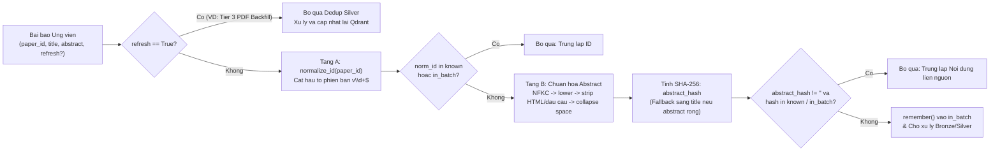
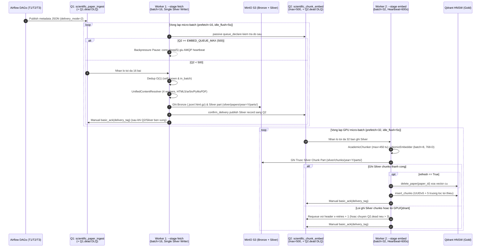

# 02b — Chương 2 (Phần B): Tích Hợp, Khử Trùng Lặp & Điều Phối (Integrate)

- **Motivation/Background**: Dữ liệu thu về từ nhiều nguồn khác nhau (arXiv OAI-PMH/RSS, CVF Open Access, Semantic Scholar và các bản ghi OpenReview/OpenAlex/Zenodo lịch sử) có cấu trúc trường không đồng nhất, tiềm ẩn tỷ lệ trùng lặp cao giữa các phiên bản sửa đổi (`v1`–`vN`) hoặc bản đăng chéo giữa hội nghị và arXiv, đồng thời dễ gây nghẽn tài nguyên nếu tác vụ mạng (I/O) và mô hình nhúng (GPU/MPS) chạy ghép cứng trong cùng một tiến trình.
- **Purpose**: Đặc tả cơ chế hợp nhất lược đồ 23 cột chuẩn Apache Arrow, lá chắn khử trùng lặp hai tầng (`paper_id` chuẩn hóa + SHA-256 `abstract_hash`), và kiến trúc hàng đợi RabbitMQ tách hai pha (`--stage fetch` / `--stage embed`) bảo đảm độ bền dữ liệu, kiểm soát áp lực ngược (*backpressure*) và toàn vẹn tham chiếu (*referential integrity*).
- **Overview Pipeline**: Tin nhắn thô đa nguồn $\rightarrow$ Lá chắn Dedup 2 tầng (`known_papers.py` + `hasher.py`) $\rightarrow$ Lưu gốc Bronze + Ghi Silver `papers` (`SilverLakehouseWriter.SCHEMA`) $\rightarrow$ Hàng đợi pha 2 `scientific_chunk_embed` (`EMBED_QUEUE_MAX=500`) $\rightarrow$ Ghi `ChunkStore` trước khi Upsert Qdrant.
- **Detailed Plan**: §2.4 Hợp nhất Lược đồ Đa nguồn (23-Column Arrow Schema); §2.5 Lá chắn Khử trùng lặp Hai tầng (`normalize_id` + SHA-256 `abstract_hash`); §2.6 Kiến trúc Hàng đợi Tách pha RabbitMQ, Cơ chế Thử lại/DLQ & Đảm bảo Toàn vẹn Tham chiếu.
- **References**: [silver_writer.py](../../src/transformation/silver_writer.py), [known_papers.py](../../src/storage/known_papers.py), [hasher.py](../../src/utils/hasher.py), [queue_consumer.py](../../src/ingestion/queue_consumer.py), [queue_publisher.py](../../src/ingestion/queue_publisher.py), [chunk_store.py](../../src/storage/chunk_store.py), [qdrant_manager.py](../../src/indexing/qdrant_manager.py), [settings.py](../../src/config/settings.py), [_common.py](../../dags/_common.py), [02_bronze_raw_metadata.png](../../data-mining-latek/figures/captured_20261123_082337/02_bronze_raw_metadata.png), [QUY_TRINH_TIEN_XU_LY_DU_LIEU.md](../QUY_TRINH_TIEN_XU_LY_DU_LIEU.md).
- **Created**: 2026-11-25T12:55:00+07:00
- **Last Updated**: 2026-11-25T12:55:00+07:00

[STATUS: ACTIVE]

---

## Mục Lục

- [2.4 Hợp Nhất Lược Đồ Đa Nguồn (Schema Integration)](#24-hợp-nhất-lược-đồ-đa-nguồn-schema-integration)
  - [2.4.1 Lưu trữ Bất biến Tầng Bronze & Ví dụ Thực tế](#241-lưu-trữ-bất-biến-tầng-bronze--ví-dụ-thực-tế)
  - [2.4.2 Lược đồ Chuẩn hóa 23 Cột Tầng Silver Papers](#242-lược-đồ-chuẩn-hóa-23-cột-tầng-silver-papers)
- [2.5 Lá Chắn Khử Trùng Lặp Hai Tầng (Deduplication Shield)](#25-lá-chắn-khử-trùng-lặp-hai-tầng-deduplication-shield)
  - [2.5.1 Tầng A: Chuẩn hóa Định danh (`normalize_id`)](#251-tầng-a-chuẩn-hóa-định-danh-normalize_id)
  - [2.5.2 Tầng B: Dấu vân tay Nội dung SHA-256 (`abstract_hash`)](#252-tầng-b-dấu-vân-tay-nội-dung-sha-256-abstract_hash)
  - [2.5.3 Nạp Tập Khóa $O(1)$ và Bất biến Đơn-Ghi (*Single-Writer Invariant*)](#253-nạp-tập-khóa-o1-và-bất-biến-đơn-ghi-single-writer-invariant)
- [2.6 Kiến Trúc Hàng Đợi Tách Pha RabbitMQ & Toàn Vẹn Tham Chiếu](#26-kiến-trúc-hàng-đợi-tách-pha-rabbitmq--toàn-vẹn-tham-chiếu)
  - [2.6.1 Phát hành Kép AMQP / HTTP (`RabbitMQPublisher`)](#261-phát-hành-kép-amqp--http-rabbitmqpublisher)
  - [2.6.2 Hai Pha Tách biệt (`--stage fetch` và `--stage embed`) & Backpressure](#262-hai-pha-tách-biệt---stage-fetch-và---stage-embed--backpressure)
  - [2.6.3 Bảo đảm Bền vững, DLQ & Bất biến Thứ tự Ghi Silver-trước-Qdrant](#263-bảo-đảm-bền-vững-dlq--bất-biến-thứ-tự-ghi-silver-trước-qdrant)

---

## 2.4 Hợp Nhất Lược Đồ Đa Nguồn (Schema Integration)

### 2.4.1 Lưu trữ Bất biến Tầng Bronze & Ví dụ Thực tế

Trước khi bất kỳ phép biến đổi cấu trúc nào diễn ra, hàm `QueueConsumer._bronze` ([queue_consumer.py](../../src/ingestion/queue_consumer.py#L99-L104)) lưu nguyên bản payload JSON nhận từ hàng đợi vào đường dẫn `bronze/papers/{year}/{paper_id}.json` (cùng bản HTML gốc nếu có sẵn trong thông điệp) trên MinIO S3. Thất bại ở bước ghi Bronze sẽ lập tức hủy xử lý bài báo trong lô hiện tại, bảo đảm **Bất biến Nguồn gốc Thô (*Immutable Raw Invariant*)** phục vụ kiểm tra chéo và tái xử lý.

Trong kho Bronze, siêu dữ liệu thô phản ánh đặc thù từng nguồn (ví dụ bản ghi OpenAlex `bronze/tier1/openalex_W2001598892.json` minh họa ở [02_bronze_raw_metadata.png](../../data-mining-latek/figures/captured_20261123_082337/02_bronze_raw_metadata.png), tương ứng **Hình 2.4** khi chuyển sang LaTeX trong [04_data_preparation.tex](../../data-mining-latek/sections/04_data_preparation.tex), cho thấy một số trường có thể khuyết như `abstract`, `authors`, hoặc `arxiv_id`). Do đó, tầng tích hợp không giả định mọi nguồn đều đầy đủ các trường mà thực hiện ánh xạ phòng thủ tại `SilverLakehouseWriter.prepare_record()` và `_normalize_frame()` ([silver_writer.py](../../src/transformation/silver_writer.py#L55-L125)).

### 2.4.2 Lược đồ Chuẩn hóa 23 Cột Tầng Silver Papers

Mọi bản ghi đến từ arXiv RSS/OAI-PMH, CVF HTML, Semantic Scholar JSON hay dữ liệu kế thừa (OpenReview/OpenAlex/Zenodo) đều được ép kiểu chặt chẽ về lược đồ chuẩn gồm **23 trường cột** trong `SilverLakehouseWriter.SCHEMA` ([silver_writer.py](../../src/transformation/silver_writer.py#L22-L48)).

> **5W1H — Đặc tả Lược đồ Hợp nhất 23 Cột Silver (`SilverLakehouseWriter.SCHEMA`)**
> - **What**: Bảng ánh xạ đầy đủ tên trường, kiểu dữ liệu Apache Arrow, quy tắc điền giá trị mặc định và ngữ nghĩa truy vết của bảng `silver/papers/year=YYYY/`.
> - **Why**: Chuẩn hóa các nguồn học thuật dị thể về một lược đồ cột thống nhất để DuckDB S3 (`eda_engine.py`, `association_rules.py`, `graph_mining.py`, `trend_anomaly_mining.py`) và `AcademicChunker` đọc trực tiếp không cần logic rẽ nhánh theo nguồn.
> - **When**: Kiểm tra trực tiếp trên phiên bản mã nguồn hiện hành (`commit f421707` / `aae74de`, 25/11/2026).
> - **Where**: Định nghĩa tại [silver_writer.py](../../src/transformation/silver_writer.py#L22-L125).
> - **Who**: Nhóm 1 xây dựng cho quy trình chuẩn bị dữ liệu và tái lập kiểm định lược đồ.
> - **How**: Đối chiếu từng trường trong `pa.schema([...])`, hàm `prepare_record()` và `_normalize_frame()`.

**Bảng 2.3: Đặc tả chi tiết 23 cột trong `SilverLakehouseWriter.SCHEMA`**

| STT | Tên Cột | Kiểu Apache Arrow | Quy tắc Chuẩn hóa / Giá trị Mặc định | Nguồn gốc & Vai trò Hệ thống |
| :---: | :--- | :--- | :--- | :--- |
| 1 | `paper_id` | `pa.string()` | Ép chuỗi chuẩn hóa (ví dụ `2401.01234`, `cvf_*`, `s2_*`) | Khóa định danh chính dùng khử trùng & phân mảnh |
| 2 | `abstract_hash` | `pa.string()` | SHA-256 (64 hex) của `abstract`; nếu rỗng dùng `title` | Khóa khử trùng nội dung liên nguồn |
| 3 | `doi` | `pa.string()` | Có thể `None` nếu nguồn không cung cấp | Liên kết chuẩn trích dẫn học thuật |
| 4 | `journal_ref` | `pa.string()` | Tên hội nghị/tạp chí (vd. `CVPR2024`, `venue` S2); có thể `None` | Ngữ cảnh xuất bản |
| 5 | `title` | `pa.string()` | Ưu tiên `parsed_title` từ HTML, fallback `raw_meta["title"]` | Tiêu đề bài báo làm sạch |
| 6 | `abstract` | `pa.string()` | Ưu tiên `parsed_abstract`, fallback `raw_meta["abstract"]` | Nội dung tóm tắt chuẩn |
| 7 | `authors` | `pa.list_(pa.string())` | Chuẩn hóa iterable thành danh sách chuỗi tên tác giả | Đầu vào mạng đồng tác giả PageRank/Louvain |
| 8 | `categories` | `pa.list_(pa.string())` | Danh sách đầy đủ các nhãn ngành; chuyển scalar thành `[str]` | Đầu vào giao dịch FP-Growth & `category_count` |
| 9 | `primary_category` | `pa.string()` | Lấy `raw_meta["primary_category"]`, fallback `categories[0]` hoặc `"unknown"` | Phân tầng EDA, Trend Velocity & lọc Qdrant |
| 10 | `published_date` | `pa.string()` | Chuỗi ISO 8601 hoặc `YYYY-MM` / `YYYY` theo quy tắc OAI/CVF/S2 | Phân vùng theo năm (`year=YYYY`) & tính thị phần theo tháng |
| 11 | `crawled_at` | `pa.string()` | Thời điểm thu thập UTC ISO 8601 từ DAG/Harvester | Truy vết độ trễ thu thập |
| 12 | `pdf_url` | `pa.string()` | URL tệp PDF gốc (arXiv, CVF, hoặc `openAccessPdf` của S2) | Nguồn dự phòng cho Tier 3 ngoài arXiv |
| 13 | `html_url` | `pa.string()` | URL bản HTML5/landing page (rỗng nếu không có) | Nguồn chính cho bóc tách LaTeXML |
| 14 | `total_sections` | `pa.int64()` | Tổng số mục cấu trúc bóc tách được (`len(sections)`) | Quality Gate (`>= 2`) & Enrichment indicator |
| 15 | `total_math_count` | `pa.int64()` | Số phần tử toán `<math>` / `ltx_Math` parser đếm được | EDA & Đặc trưng Isolation Forest |
| 16 | `total_words` | `pa.int64()` | Tổng số từ toàn văn (hoặc fallback đếm từ `clean_full_text`) | Quality Gate (`>= 300`) & Đặc trưng Isolation Forest |
| 17 | `sections_json` | `pa.string()` | Chuỗi JSON UTF-8 (`ensure_ascii=False`) lưu mảng các đối tượng section | Đầu vào cho `AcademicChunker` tầng 2 |
| 18 | `clean_full_text` | `pa.string()` | Văn bản liên tục ghép `Title`, `Abstract` và các mục `## {title}` | Văn bản chuẩn cho phân đoạn tầng 3 & kiểm tra |
| 19 | `transformed_at` | `pa.string()` | Thời điểm UTC ISO 8601 khi tạo bản ghi Silver | Nhật ký chuyển đổi |
| 20 | `cite_count` | `pa.int64()` | Lấy `cite_count` hoặc `citation_count`, điền khuyết `0` | Xếp hạng Semantic Scholar & EDA tương quan |
| 21 | `source` | `pa.string()` | Mặc định `"arxiv"` (`arxiv`, `arxiv_rss_realtime`, `cvf`, `semantic_scholar`, ...) | Truy vết nhà cung cấp |
| 22 | `tier` | `pa.string()` | Mặc định `"tier1"` (`tier1`, `tier2`, `tier3`) | Phân tách tầng thu thập trong cùng bảng Silver |
| 23 | `content_origin` | `pa.string()` | Giá trị thực tế: `arxiv_html5`, `ar5iv_html5`, `cached_html`, `open_access_pdf`, `abstract_fallback`, `abstract_only` | Kiểm toán nguồn gốc bóc tách nội dung |

*Nguồn: [silver_writer.py](../../src/transformation/silver_writer.py#L22-L125) và [unified_content_resolver.py](../../src/transformation/unified_content_resolver.py).*

---

## 2.5 Lá Chắn Khử Trùng Lặp Hai Tầng (Deduplication Shield)

Một bài báo khoa học thường xuất hiện nhiều lần dưới các định danh khác nhau (ví dụ `2401.01234v1` so với `2401.01234v2`, hoặc một công trình xuất hiện trên CVF lẫn arXiv/Semantic Scholar). Lá chắn khử trùng lặp được cài đặt đồng bộ tại cả phía Producer ([`dags/_common.py`](../../dags/_common.py#L55-L85)) và phía Consumer ([`src/storage/known_papers.py`](../../src/storage/known_papers.py) kết hợp [`src/utils/hasher.py`](../../src/utils/hasher.py)) theo cấu trúc hai tầng độc lập (Hình 2.2):

*Hình 2.2: Cơ chế lá chắn khử trùng lặp hai tầng (`paper_id` chuẩn hóa + SHA-256 `abstract_hash`) và nhánh bỏ qua `refresh=True`.*

### 2.5.1 Tầng A: Chuẩn hóa Định danh (`normalize_id`)

Hàm `normalize_id` ([known_papers.py](../../src/storage/known_papers.py#L24-L26)) loại bỏ hậu tố phiên bản ở cuối chuỗi định danh thông qua biểu thức chính quy `_VERSION = re.compile(r"v\d+$")`:

$$\text{normalize\_id}(id) = \operatorname{sub}\!\left(\texttt{r"v\textbackslash d+\$"},\; \texttt{""},\; \operatorname{strip}(id)\right) \tag{2.8}$$

Trong đó: $id$ là chuỗi định danh gốc của bài báo (ví dụ `"2401.01234v2"` được rút gọn về `"2401.01234"`), bảo đảm các lần sửa đổi phiên bản trên arXiv được khớp với bản gốc trong bảng băm `known`.

### 2.5.2 Tầng B: Dấu vân tay Nội dung SHA-256 (`abstract_hash`)

Để phát hiện hai bài báo có cùng nội dung nhưng mang định danh hoàn toàn khác nhau giữa các nền tảng (như `cvf_*` so với mã arXiv hoặc `s2_*`), hàm `compute_abstract_hash` tại [hasher.py](../../src/utils/hasher.py#L28-L50) thực hiện chuỗi biến đổi tất định gồm 5 bước trên văn bản tóm tắt $a$:
1. **Chuẩn hóa Unicode NFKC**: `unicodedata.normalize("NFKC", str(a))` đồng nhất ký tự ghép và ký tự tương thích.
2. **Chuyển chữ thường (*Case Folding*)**: `.lower()`.
3. **Loại bỏ thẻ HTML**: `re.sub(r"<[^>]+>", " ", text)`.
4. **Loại bỏ dấu câu & ký tự đặc biệt**: `re.sub(r"[^\w\s]", "", text)` nhằm bất biến với khác biệt định dạng dấu phẩy, ngoặc hoặc gạch nối giữa các nguồn API.
5. **Chuẩn hóa khoảng trắng & Băm SHA-256**: `re.sub(r"\s+", " ", text).strip()`, rồi tạo chuỗi hex 64 ký tự (hoặc trả về `""` nếu chuỗi sau làm sạch rỗng để tránh các bản ghi khuyết abstract va chạm vào cùng một khóa):

$$\text{abstract\_hash}(a) = \begin{cases} \operatorname{SHA-256}\!\Bigl(\operatorname{normalize\_abstract\_text}(a)\Bigr), & \text{nếu } \operatorname{normalize\_abstract\_text}(a) \neq \varepsilon \\ \varepsilon, & \text{ngược lại} \end{cases} \tag{2.9}$$

Trong đó: $a$ là chuỗi văn bản tóm tắt đầu vào, $\varepsilon$ là chuỗi rỗng (`""`), và phép kiểm tra `bool(h and h in known)` bảo đảm chỉ các dấu vân tay khác rỗng mới tham gia lọc trùng lặp. Khi ghi vào Silver (`SilverLakehouseWriter.prepare_record`), nếu `abstract` rỗng, hệ thống dùng `title` làm đầu vào dự phòng cho `abstract_hash` ([silver_writer.py](../../src/transformation/silver_writer.py#L76)).

### 2.5.3 Nạp Tập Khóa $O(1)$ và Bất biến Đơn-Ghi (*Single-Writer Invariant*)

Hàm `load_known_paper_ids()` ([known_papers.py](../../src/storage/known_papers.py#L41-L70)) kết nối trực tiếp tới `pafs.S3FileSystem` của MinIO và quét song song (`ThreadPoolExecutor(max_workers=8)`) toàn bộ tệp `.parquet` dưới tiền tố `silver/`. Nhờ kỹ thuật **chiếu cột (*Column Projection*)** `pq.read_table(path, columns=["paper_id", "abstract_hash"])`, hệ thống chỉ tải hai cột định danh thay vì đọc toàn bộ nội dung văn bản khổng lồ, gộp thành một tập `Set[str]` duy nhất trong RAM cho phép kiểm tra `is_known(...)` trong độ phức tạp thời gian $O(1)$.

Đặc biệt, trong kiến trúc hai worker ([queue_consumer.py](../../src/ingestion/queue_consumer.py#L13-L16)), **chỉ duy nhất tiến trình `--stage fetch` đóng vai trò người ghi vào Silver (`Single-Writer Invariant`)**. Nhờ tính chất này, tập `self.known` trong bộ nhớ của fetch worker luôn đồng bộ tuyệt đối với trạng thái thực tế của Silver trên MinIO sau mỗi micro-batch (`remember_on_silver=True`), loại trừ hoàn toàn tranh chấp ghi (*race condition*) giữa nhiều tiến trình mà không cần khóa phân tán. Riêng các thông điệp nâng cấp toàn văn (như từ `dag_tier3_pdf_backfill`) mang cờ `"refresh": True` được phép đi qua chốt chặn dedup để thay thế bài cũ.

---

## 2.6 Kiến Trúc Hàng Đợi Tách Pha RabbitMQ & Toàn Vẹn Tham Chiếu

### 2.6.1 Phát hành Kép AMQP / HTTP (`RabbitMQPublisher`)

Ở phía gửi tin từ các pipeline Python, lớp `RabbitMQPublisher` ([queue_publisher.py](../../src/ingestion/queue_publisher.py#L20-L83)) kết nối qua AMQP 0-9-1 (`pika.BlockingConnection`) tới hàng đợi bền vững `scientific_paper_ingest` (`delivery_mode=2`, `content_type="application/json"`). Khi kết nối AMQP bị ngắt hoặc không khả dụng, `publish_paper` tự động chuyển dự phòng sang HTTP Management API (`POST /api/exchanges/%2f/amq.default/publish`) và chỉ trả về `True` khi broker xác nhận `routed == True`. Phía Airflow DAGs ([`dags/_common.py`](../../dags/_common.py#L197-L211)) sử dụng trực tiếp endpoint HTTP Management API này nhằm giữ cho worker Airflow gọn nhẹ, không phụ thuộc trạng thái socket AMQP dài hạn.

### 2.6.2 Hai Pha Tách biệt (`--stage fetch` và `--stage embed`) & Backpressure

Trong phiên bản trước, một worker đơn phải lần lượt tải HTML qua mạng (`0.3–1.5 s/bài`), ghi MinIO, cắt chunk và suy luận mô hình nhúng trên GPU; do đó GPU bị bỏ đói trong lúc chờ mạng và việc thử lại khi lỗi GPU lại gây tải lại HTML vô ích. Phiên bản hiện tại trong [queue_consumer.py](../../src/ingestion/queue_consumer.py) tách luồng tiêu thụ thành **hai pha độc lập kết nối qua hàng đợi trung gian `scientific_chunk_embed`** (Hình 2.3):

*Hình 2.3: Biểu đồ tuần tự kiến trúc hàng đợi RabbitMQ tách hai pha (`fetch` / `embed`), kiểm soát áp lực ngược và bất biến ghi dữ liệu ([queue_consumer.py](../../src/ingestion/queue_consumer.py)).*

> **5W1H — Bảng Tham số Vận hành & Độ tin cậy Hàng đợi RabbitMQ Hai Pha**
> - **What**: Cấu hình kích thước micro-batch, ngưỡng áp lực ngược (*backpressure*), thời gian giữ kết nối (*heartbeat*), chính sách thử lại (`x-retries`) và tên các hàng đợi/DLQ.
> - **Why**: Bảo đảm không mất tin nhắn khi worker sập, không rơi kết nối AMQP khi GPU xử lý lô nặng, và không tràn bộ đệm khi pha fetch nhanh hơn pha embed.
> - **When**: Kiểm chứng trên mã nguồn hiện hành ([settings.py](../../src/config/settings.py), [queue_consumer.py](../../src/ingestion/queue_consumer.py)).
> - **Where**: Các tệp cấu hình [settings.py](../../src/config/settings.py#L68-L80) và [queue_consumer.py](../../src/ingestion/queue_consumer.py#L46-L512).
> - **Who**: Nhóm 1 thiết lập cho vận hành thực tế và tái lập kiểm thử tích hợp.
> - **How**: Đọc trực tiếp giá trị mặc định của các hằng số lớp `Settings` và tham số CLI của `QueueConsumer`.

**Bảng 2.4: Thông số vận hành và độ tin cậy của hệ thống hàng đợi tách pha RabbitMQ**

| Tham số / Hàng đợi | Giá trị Mặc định | Pha Áp dụng | Cơ chế & Vai trò Kỹ thuật |
| :--- | :--- | :--- | :--- |
| `RABBITMQ_QUEUE_INGEST` | `scientific_paper_ingest` | Producer $\rightarrow$ `fetch` | Hàng đợi bền vững (`durable=True`) nhận metadata thô từ DAGs |
| `RABBITMQ_QUEUE_DEAD` | `scientific_paper_ingest.dead` | DLQ pha `fetch` | Lưu các bản ghi hỏng không thể phục hồi kèm trường `_dead_reason` |
| `RABBITMQ_QUEUE_EMBED` | `scientific_chunk_embed` | `fetch` $\rightarrow$ `embed` | Hàng đợi trung gian chứa bản ghi Silver đã bóc tách chờ nhúng |
| `RABBITMQ_QUEUE_EMBED_DEAD` | `scientific_chunk_embed.dead` | DLQ pha `embed` | Lưu bản ghi lỗi ở bước chunk/embed/Qdrant (không cần tải lại từ Internet) |
| `batch_size` / `prefetch_count` | `16` (`fetch`/`all`), `32` (`embed`) | Cả hai pha | Gom micro-batch giảm số file part nhỏ trên MinIO & tối ưu gọi GPU |
| `idle_flush_seconds` | `5.0 s` | Cả hai pha | Xả lô dở dang khi hàng đợi tạm rỗng quá 5 giây |
| `EMBED_QUEUE_MAX` | `500` bản ghi | Pha `fetch` | Ngưỡng áp lực ngược: tạm dừng fetch bằng `conn.sleep(5)` khi Q2 đầy |
| `HEARTBEAT_SECONDS` | `600 s` (10 phút) | Cả hai pha | Chống RabbitMQ ngắt kết nối `BlockingConnection` khi GPU/MPS bận lâu hơn 60 s |
| `RABBITMQ_MAX_RETRIES` | `3` (header `x-retries`) | Cả hai pha | Đếm số lần thất bại riêng từng pha; quá 3 lần chuyển sang DLQ tương ứng |

*Nguồn: [settings.py](../../src/config/settings.py#L68-L80) và [queue_consumer.py](../../src/ingestion/queue_consumer.py#L46-L512).*

### 2.6.3 Bảo đảm Bền vững, DLQ & Bất biến Thứ tự Ghi Silver-trước-Qdrant

Hệ thống áp dụng ba nguyên tắc phòng vệ chặt chẽ bên trong `QueueConsumer.run_pika()` và `gold_batch()`:
1. **Xác nhận phân phối (*Publisher Confirms*) & ACK thủ công muộn**: Kênh AMQP bật `channel.confirm_delivery()`. Ở mỗi pha, `channel.basic_ack(delivery_tag=tag)` **chỉ được gọi sau khi** kết quả của pha đó đã ghi bền vững (Silver part + gửi vào `Q2` thành công đối với `fetch`; `ChunkStore` + Qdrant upsert thành công đối với `embed`), hoặc sau khi bản ghi lỗi đã được chuyển an toàn sang hàng đợi thử lại / DLQ (`_requeue_or_bury`). Nhờ vậy, nếu tiến trình bị tắt đột ngột giữa chừng, tin nhắn chưa ACK tự động quay về hàng đợi và được xử lý lại an toàn do các bước ghi Silver/Qdrant đều mang tính lũy đẳng (*idempotent*).
2. **Tái kết nối tự động khi rớt AMQP**: Vòng lặp ngoài `QueueConsumer.run()` bắt ngoại lệ `AMQPConnectionError` và `AMQPChannelError`, chờ `5` giây và tự kết nối lại; khi kết nối đã đóng, khối `finally` bỏ qua `flush()` để tránh xử lý lô chưa hoàn tất sẽ được broker phát lại.
3. **Bất biến Thứ tự Ghi (`ChunkStore` trước Qdrant)**: Trong `gold_batch()` ([queue_consumer.py](../../src/ingestion/queue_consumer.py#L262-L299)), toàn bộ văn bản phân đoạn được ghi vào `silver/chunks/year={year}/parts/` qua `self.chunk_store.append_part(...)` **trước** khi gọi `self.qdrant.insert_chunks(...)`. Nếu năm xuất bản nào gặp lỗi ghi Silver chunks (`year in chunk_failed_years`), toàn bộ bài báo thuộc năm đó bị bỏ qua bước upsert Qdrant và đánh dấu thất bại để thử lại sau. Nguyên tắc bất biến này bảo đảm **không bao giờ tồn tại vector "mồ côi" trong Qdrant không thể thủy hóa văn bản từ `ChunkStore`**. Khi bản ghi mang cờ `"refresh": True`, `self.qdrant.delete_paper(pid)` được gọi ngay trước `insert_chunks` để dọn sạch các điểm tóm tắt cũ.

---
*Phần tiếp theo ([02c_CH2_LAM_SACH_VA_BOC_TACH_CLEAN.md](./02c_CH2_LAM_SACH_VA_BOC_TACH_CLEAN.md)) đi sâu vào cơ chế phân giải thác nước HTML-First, bóc tách công thức LaTeX trong DOM HTML5, thuật toán làm sạch Unicode Surrogate (`BUG-01`) và cổng kiểm soát chất lượng dữ liệu.*
