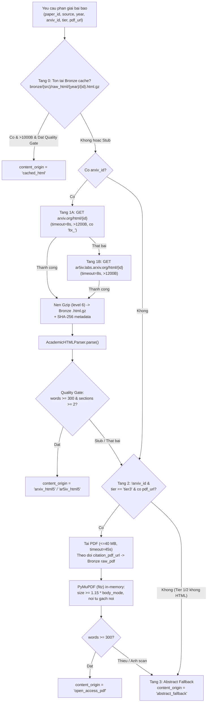
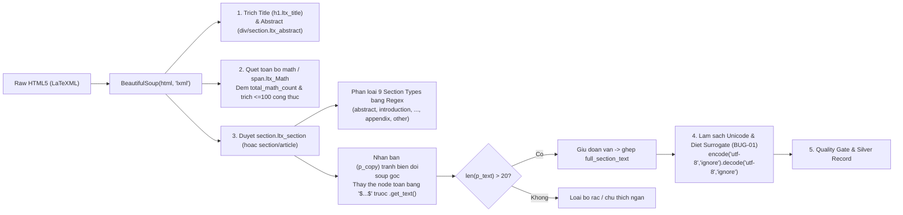

# 02c — Chương 2 (Phần C): Làm Sạch & Bóc Tách Học Thuật (Clean & Extract)

- **Motivation/Background**: Tài liệu khoa học trên Internet tồn tại dưới nhiều dạng thô khác nhau (trang HTML5 biên dịch bằng LaTeXML trên arXiv/ar5iv, tệp PDF nhị phân của các công trình kinh điển ngoài arXiv, hoặc chỉ có tóm tắt khi bị tường thu phí). Nếu bóc tách bằng OCR thuần túy hoặc bộ đọc PDF thông thường, công thức toán học dễ bị biến dạng, cấu trúc section bị xáo trộn, và các chuỗi lỗi mã hóa UTF-16 (*lone surrogates*) từ PDF/HTML bẩn có thể làm sập hoàn toàn bộ tokenizer viết bằng Rust khi nhúng vector.
- **Purpose**: Đặc tả cơ chế phân giải nội dung theo mô hình thác nước HTML-First (`UnifiedContentResolver`), thuật toán bóc tách cây DOM và bảo toàn ký hiệu LaTeX (`AcademicHTMLParser`), bộ phân loại 9 loại phân mục học thuật, phương pháp xử lý lỗi `BUG-01` (UTF-16 Surrogate Stripping) và các cổng kiểm soát chất lượng (*Quality Gates*).
- **Overview Pipeline**: Kiểm tra cache Bronze (`.html.gz` / `.pdf`) $\rightarrow$ Thác nước tải HTML5 (`arxiv.org/html` $\rightarrow$ `ar5iv`) hoặc PDF Tier 3 (`PyMuPDF` heuristic) $\rightarrow$ Phân tích DOM & Bảo toàn `$...$` (`AcademicHTMLParser`) $\rightarrow$ Chuẩn hóa Unicode NFKC + Lọc Surrogate $\rightarrow$ Quality Gate (`total_words >= 300`, `total_sections >= 2`).
- **Detailed Plan**: §2.7 Cơ chế Phân giải Thác nước HTML-First (`UnifiedContentResolver`); §2.8 Bộ Bóc tách HTML Học thuật (`AcademicHTMLParser`); §2.9 Làm sạch Unicode, Diệt Surrogate (`BUG-01`) & Cổng Kiểm soát Chất lượng.
- **References**: [unified_content_resolver.py](../../src/transformation/unified_content_resolver.py), [html_parser.py](../../src/transformation/html_parser.py), [embedder.py](../../src/indexing/embedder.py), [dag_tier2_near_past_harvest.py](../../dags/dag_tier2_near_past_harvest.py), [chunker.py](../../src/indexing/chunker.py), [queue_consumer.py](../../src/ingestion/queue_consumer.py), [hasher.py](../../src/utils/hasher.py), [BUG_01_TOKENIZER_SURROGATE_CRASH.md](../bugs/BUG_01_TOKENIZER_SURROGATE_CRASH.md), [DISTRIBUTED_HARVESTING_AND_HTML_FIRST_ARCHITECTURE.md](../DISTRIBUTED_HARVESTING_AND_HTML_FIRST_ARCHITECTURE.md), [QUY_TRINH_TIEN_XU_LY_DU_LIEU.md](../QUY_TRINH_TIEN_XU_LY_DU_LIEU.md), [04_data_preparation.tex](../../data-mining-latek/sections/04_data_preparation.tex).
- **Created**: 2026-11-25T12:55:00+07:00
- **Last Updated**: 2026-11-25T12:55:00+07:00

[STATUS: ACTIVE]

---

## Mục Lục

- [2.7 Cơ Chế Phân Giải Thác Nước HTML-First (`UnifiedContentResolver`)](#27-cơ-chế-phân-giải-thác-nước-html-first-unifiedcontentresolver)
  - [2.7.1 Tầng 0: Bộ đệm Bronze Gzip và Tính toàn vẹn SHA-256](#271-tầng-0-bộ-đệm-bronze-gzip-và-tính-toàn-vẹn-sha-256)
  - [2.7.2 Tầng 1: Ưu tiên arXiv HTML5 & Dự phòng ar5iv LaTeXML](#272-tầng-1-ưu-tiên-arxiv-html5--dự-phòng-ar5iv-latexml)
  - [2.7.3 Tầng 2: Giải mã PDF bằng `PyMuPDF` cho Công trình Kinh điển Tier 3](#273-tầng-2-giải-mã-pdf-bằng-pymupdf-cho-công-trình-kinh-điển-tier-3)
  - [2.7.4 Tầng 3: Dự phòng Tóm tắt (`abstract_fallback`)](#274-tầng-3-dự-phòng-tóm-tắt-abstract_fallback)
- [2.8 Bộ Bóc Tách HTML Học Thuật (`AcademicHTMLParser`)](#28-bộ-bóc-tách-html-học-thuật-academichtmlparser)
  - [2.8.1 Trích xuất Biểu thức Toán LaTeX & Bảo toàn Inline Math](#281-trích-xuất-biểu-thức-toán-latex--bảo-toàn-inline-math)
  - [2.8.2 Bộ Phân loại 9 Nhãn Mục Học thuật & Lọc Nhiễu Đoạn văn](#282-bộ-phân-loại-9-nhãn-mục-học-thuật--lọc-nhiễu-đoạn-văn)
  - [2.8.3 Phân biệt Chỉ dấu Quy mô Parser và Độ chính xác Nội dung](#283-phân-biệt-chỉ-dấu-quy-mô-parser-và-độ-chính-xác-nội-dung)
- [2.9 Làm Sạch Unicode, Diệt Surrogate (`BUG-01`) & Cổng Chất Lượng](#29-làm-sạch-unicode-diệt-surrogate-bug-01--cổng-chất-lượng)
  - [2.9.1 Phân tích Lỗi `BUG-01`: Rust PyO3 Panic trên Lone UTF-16 Surrogates](#291-phân-tích-lỗi-bug-01-rust-pyo3-panic-trên-lone-utf-16-surrogates)
  - [2.9.2 Lọc Bài bị rút, Chuẩn hóa Năm & Cổng Kiểm soát Chất lượng](#292-lọc-bài-bị-rút-chuẩn-hóa-năm--cổng-kiểm-soát-chất-lượng)

---

## 2.7 Cơ Chế Phân Giải Thác Nước HTML-First (`UnifiedContentResolver`)

Để tối ưu hóa đồng thời tốc độ xử lý CPU/GPU, dung lượng lưu trữ Bronze (`20 GB`) và độ trung thực của công thức toán học, lớp `UnifiedContentResolver` ([unified_content_resolver.py](../../src/transformation/unified_content_resolver.py)) thực thi kiến trúc phân giải song song (`resolve_batch_concurrent`, mặc định `max_workers=4` trong `QueueConsumer`) theo mô hình **thác nước 4 tầng (*4-Tier Waterfall Resolution*)** minh họa ở Hình 2.5:



*Hình 2.5: Sơ đồ thác nước 4 tầng của `UnifiedContentResolver` ([unified_content_resolver.py](../../src/transformation/unified_content_resolver.py)).*

### 2.7.1 Tầng 0: Bộ đệm Bronze Gzip và Tính toàn vẹn SHA-256

Trước khi phát sinh bất kỳ yêu cầu HTTP nào ra mạng ngoài, `resolve_single_paper()` kiểm tra đối tượng lưu trữ tại `bronze/{source}/raw_html/{year}/{clean_id}.html.gz` (kèm khả năng đọc ngược tệp `.html` chưa nén từ phiên bản cũ qua `read_bronze_html()`). Khi tải mới thành công từ Internet, `vault_html_to_bronze()` nén trực tiếp luồng UTF-8 trong RAM bằng `gzip.compress(..., compresslevel=6)` và đẩy lên MinIO kèm thuộc tính metadata `sha256`, `paper_id`, và `inner-type: "text/html"`. Phép nén gzip giảm dung lượng HTML5 thô từ arXiv đi khoảng **6–8 lần** (từ mức `200–800 KB` xuống còn vài chục KB mỗi bài), giữ cho kho Bronze vận hành thoải mái trong giới hạn `20 GB`. Nếu HTML đọc từ cache vượt qua cổng kiểm định chất lượng (`total_words >= 300` và `total_sections >= 2`), hàm gán nhãn `content_origin = "cached_html"` và kết thúc ngay lập tức.

### 2.7.2 Tầng 1: Ưu tiên arXiv HTML5 & Dự phòng ar5iv LaTeXML

Nếu bài báo có mã arXiv (bao gồm cả mã trước năm 2007 dạng `cs/0101001` lẫn mã mới `YYMM.NNNNN`, đã tước hậu tố `v\d+$`, hoặc được suy từ liên kết `pdf_url` dạng `arxiv.org/pdf/...`), bộ giải mã gọi `fetch_arxiv_html()`:
1. **Nguồn chính thức `https://arxiv.org/html/{ar_id}`** (`timeout = 8.0 s`): Yêu cầu mã trạng thái `200`, độ dài thân trang `len(resp.text) > 1200` ký tự, chứa thẻ `<html` và đặc trưng DOM của LaTeXML (`"ltx_"`). Khi đạt chuẩn, gán nhãn phụ `arxiv_html5`.
2. **Nguồn dự phòng `https://ar5iv.labs.arxiv.org/html/{ar_id}`** (`timeout = 8.0 s`): Kích hoạt khi bài báo chưa có bản HTML5 chính thức trên `arxiv.org` (phổ biến với các công trình giai đoạn 2017–2023), gán nhãn `ar5iv_html5`.
3. **Chống trang giữ chỗ (*Stub Guard*)**: Ngay cả khi HTTP trả về `200`, một số trang ar5iv chỉ là thông báo lỗi biên dịch TeX ngắn. Do đó, kết quả bóc tách phải vượt qua điều kiện `total_words >= 300` và `total_sections >= 2` trước khi được chấp nhận làm toàn văn; nếu không đạt, bài báo tự động chuyển xuống nhánh dự phòng tóm tắt.

### 2.7.3 Tầng 2: Giải mã PDF bằng `PyMuPDF` cho Công trình Kinh điển Tier 3

Khác với thiết kế thử nghiệm giai đoạn đầu vốn sử dụng mô hình thị giác `Marker` FP16 (`4–10 s/bài` trên GPU) cho toàn bộ bài hội nghị PDF, kiến trúc sản xuất hiện hành ([unified_content_resolver.py](../../src/transformation/unified_content_resolver.py#L6-L9), [L74-L166](../../src/transformation/unified_content_resolver.py#L74-L166)) áp dụng chiến lược **Tier 1 & Tier 2 thuần HTML (*HTML-only*)** để tối đa hóa thông lượng, và chỉ kích hoạt tải PDF cho **các bài báo kinh điển Tier 3 không có trên arXiv** (ví dụ các bản kỷ yếu gốc *ImageNet*, *LSTM*, *AlexNet* từ `dag_tier3_landmark_harvest` hoặc `dag_tier3_pdf_backfill`):

1. **Tải và Xác thực PDF (`fetch_pdf`)**: Thực thi yêu cầu `timeout = 45.0 s`. Nếu URL trỏ về trang đích của kho lưu trữ đại học/nhà xuất bản (như HAL) thay vì tệp nhị phân trực tiếp, bộ tải trích xuất siêu dữ liệu `<meta name="citation_pdf_url" content="...">` để đi theo liên kết PDF thực. Tệp chỉ được chấp nhận khi có chữ ký byte đầu `%PDF-` (`body[:5] == b"%PDF-"`) và dung lượng không vượt quá `MAX_PDF_BYTES = 40 MB`, sau đó lưu vào Bronze tại `bronze/{source}/raw_pdf/{year}/{clean_id}.pdf` kèm mã băm SHA-256.
2. **Phân tích Cấu trúc Trang & Khử gạch nối (`parse_pdf`)**: Thay vì chuyển đổi qua đĩa tạm, `fitz.open(stream=pdf_bytes, filetype="pdf")` (PyMuPDF) đọc trực tiếp từ buffer bộ nhớ, duyệt toàn bộ `blocks -> lines -> spans` để thu thập cặp `(size, text)` với `size = max(sp["size"])` và thống kê kích thước chữ thân bài phổ biến nhất $s_{\text{body}}$ (*mode* có trọng số độ dài ký tự). Một dòng được nhận diện là tiêu đề mục mới khi thỏa mãn đồng thời ba điều kiện hình thái:

$$s_{\text{line}} \ge 1.15 \cdot s_{\text{body}}, \qquad |\text{text}| \le 90\text{ ký tự}, \qquad \text{có ít nhất } 3 \text{ chữ cái liên tiếp } (\texttt{[A-Za-z]\{3\}}) \tag{2.10}$$

Trong đó: $s_{\text{line}}$ là cỡ chữ lớn nhất trên dòng hiện tại, $s_{\text{body}}$ là cỡ chữ xuất hiện nhiều ký tự nhất toàn tài liệu (`sizes.most_common(1)[0][0]`), và ngưỡng $1.15$ tách biệt tiêu đề chương/mục khỏi chữ thường. Toàn bộ các từ bị ngắt gạch nối qua dòng trong bố cục 2 cột PDF được hàn gắn lại bằng biểu thức chính quy `re.sub(r"-\s+(?=[a-z])", "", ...)` trước khi đóng gói vào các phân mục `section_type = "body"` và gán nhãn `content_origin = "open_access_pdf"`. Nếu văn bản trích xuất có ít hơn `300` từ (dấu hiệu PDF dạng ảnh quét chưa OCR), hệ thống loại bỏ để rơi về tóm tắt.

### 2.7.4 Tầng 3: Dự phòng Tóm tắt (`abstract_fallback`)

Khi một công trình bị khóa bản quyền (*paywall*), là bài báo mới trong ngày chưa kịp biên dịch LaTeXML, hoặc không có bản PDF truy cập mở, tầng 3 đóng gói tiêu đề và tóm tắt thành Markdown tối giản (`# {title}\n\n## Abstract\n\n{abstract}\n`) với `total_sections = 1`, `total_math_count = 0`, và `content_origin = "abstract_fallback"` (hoặc `"abstract_only"` trong `QueueConsumer._silver_record` khi không đi qua resolver). Nhờ cơ chế này, hệ thống vẫn bảo toàn khả năng lập chỉ mục và tìm kiếm ngữ nghĩa ở cấp độ tóm tắt thay vì bỏ sót tài liệu.

> **5W1H — Đặc tả Ma trận 4 Tầng Thác nước Phân giải Nội dung (`UnifiedContentResolver`)**
> - **What**: So sánh 4 tầng phân giải (`Tầng 0 cached_html` đến `Tầng 3 abstract_fallback`) về nguồn cấp, phạm vi tầng thu thập, độ trễ xử lý và mức độ bảo tồn công thức LaTeX.
> - **Why**: Minh chứng cơ sở kỹ thuật cho chiến lược *HTML-First* thay cho OCR PDF truyền thống trên arXiv, đồng thời giữ đường dự phòng `PyMuPDF` cho công trình ngoài arXiv.
> - **When**: Kiểm chứng trên mã nguồn hiện hành ngày 25/11/2026.
> - **Where**: [unified_content_resolver.py](../../src/transformation/unified_content_resolver.py) và [queue_consumer.py](../../src/ingestion/queue_consumer.py).
> - **Who**: Nhóm 1 thiết kế cho pha chuyển đổi `--stage fetch`.
> - **How**: Đối chiếu nhánh rẽ `resolve()` theo nguồn gốc ID (`arxiv_id`, `html_url`, `pdf_url`) và các mốc thời gian chờ (`timeout`).

**Bảng 2.5: So sánh đặc tính kỹ thuật của 4 tầng phân giải nội dung trong `UnifiedContentResolver`**

| Tầng & Nhãn `content_origin` | Nguồn Dữ liệu / Công cụ | Phạm vi Áp dụng | Tốc độ & Tài nguyên | Bảo tồn Công thức & Cấu trúc |
| :--- | :--- | :--- | :--- | :--- |
| **Tầng 0** (`cached_html`) | MinIO `raw_html/*.html.gz` + `AcademicHTMLParser` | Mọi bài đã từng tải HTML vào Bronze | Rất nhanh (~100 ms), 0 request ngoài | Bảo toàn nguyên bản DOM/LaTeX từ kho gốc |
| **Tầng 1** (`arxiv_html5` / `ar5iv_html5`) | `arxiv.org/html` $\rightarrow$ `ar5iv` (`timeout=8s`) + `lxml` | Bài có `arxiv_id` (Tier 1, Tier 2, Tier 3, CVF liên kết arXiv) | `0.3–1.5 s/bài` trên CPU, nén gzip `~6–8x` | Trực tiếp đọc `<annotation encoding="application/x-tex">` |
| **Tầng 2** (`open_access_pdf`) | `PyMuPDF` (`fitz`) in-memory (`<= 40 MB`) | Chỉ Tier 3 không có `arxiv_id` (`s2_*`) có `openAccessPdf` | Nhẹ trên CPU, khử gạch nối qua dòng | Phân mục theo cỡ chữ (`>= 1.15 * body`), `math_count = 0` |
| **Tầng 3** (`abstract_fallback`) | Metadata `title` + `abstract` | Bài mới chưa render HTML5 hoặc CVF/S2 thiếu PDF mở | Tức thời ($< 1\text{ ms}$) | Chỉ có mục `Abstract` (`total_sections = 1`) |

*Nguồn: [unified_content_resolver.py](../../src/transformation/unified_content_resolver.py) và [queue_consumer.py](../../src/ingestion/queue_consumer.py).*

---

## 2.8 Bộ Bóc Tách HTML Học Thuật (`AcademicHTMLParser`)

Lớp `AcademicHTMLParser` ([html_parser.py](../../src/transformation/html_parser.py)) sử dụng `BeautifulSoup` kết hợp trình phân tích tốc độ cao `lxml` để chuyển đổi cây DOM LaTeXML thành cấu trúc phân mục giàu ngữ nghĩa (Hình 2.6):



*Hình 2.6: Quy trình bóc tách DOM, bảo toàn biểu thức toán inline và làm sạch văn bản học thuật.*

### 2.8.1 Trích xuất Biểu thức Toán LaTeX & Bảo toàn Inline Math

Trong tài liệu HTML5 do LaTeXML sinh ra, công thức toán học được biểu diễn dưới dạng MathML lồng trong thẻ `<math>` hoặc `<span class="ltx_Math">` / `class="math"`. Nếu gọi `.get_text()` trực tiếp lên đoạn văn `<p>`, toàn bộ cấu trúc phân số, chỉ số trên/dưới và ký hiệu Hy Lạp sẽ bị làm phẳng thành chuỗi rời rạc không thể đọc hiểu. Để giải quyết triệt để vấn đề này, `AcademicHTMLParser.parse()` thực thi cơ chế **nhân bản nút DOM cục bộ (`p_copy`)**:
- Với mỗi thẻ đoạn văn `<p>` bên trong `<section>`, parser tạo bản sao `p_copy = BeautifulSoup(str(p), "lxml")` nhằm không làm biến đổi cây DOM gốc đang duyệt.
- Tìm mọi phần tử `["math", "span"]` có lớp `ltx_Math` hoặc `math`, giải mã theo thứ tự ưu tiên 3 tầng:
  1. **Ưu tiên 1 (Mã nguồn TeX nguyên thủy)**: Đọc thẻ con `<annotation encoding="application/x-tex">` chứa chính xác lệnh LaTeX do tác giả soạn thảo.
  2. **Ưu tiên 2 (Thuộc tính thay thế)**: Đọc thuộc tính `alttext` trên thẻ `<math>`.
  3. **Ưu tiên 3 (Fallback văn bản hiển thị)**: Đọc `m.get_text().strip()` khi thiếu cả hai nguồn trên.
- Gọi `m.replace_with(f" ${tex_str}$ ")` để chèn trực tiếp chuỗi LaTeX vào đúng vị trí ngữ cảnh bên trong đoạn văn *trước khi* rút trích văn bản thuần bằng `clean_text(p_copy.get_text())`.

Lưu ý kỹ thuật (đối chiếu với [04_data_preparation.tex](../../data-mining-latek/sections/04_data_preparation.tex)): phiên bản hiện tại đóng gói đồng nhất mọi biểu thức toán tìm được trong cặp dấu `$ ... $` (không tách riêng nhánh display math `$$ ... $$`), tương thích hoàn toàn với trình kết xuất KaTeX trên giao diện React 19; đồng thời lưu tối đa `100` công thức tiêu biểu vào `math_equations` và đếm tổng số phần tử toán học vào `total_math_count`.

### 2.8.2 Bộ Phân loại 9 Nhãn Mục Học thuật & Lọc Nhiễu Đoạn văn

Mỗi tiêu đề mục (`h2`, `h3`, `h4`, `h5`) được phân loại tự động bằng hệ thống 9 biểu thức chính quy chuẩn hóa (`SECTION_TYPE_PATTERNS` tại [html_parser.py](../../src/transformation/html_parser.py#L16-L26)), các mục không khớp rơi vào nhãn `"other"`. Đồng thời, các đoạn văn có độ dài $\le 20$ ký tự (thường là số thứ tự phương trình đứng lẻ, nhãn hình ảnh vụn hoặc chú thích điều hướng) bị loại bỏ khỏi danh sách `paragraphs`.

**Bảng 2.6: Bộ phân loại 9 nhãn phân mục học thuật trong `AcademicHTMLParser`**

| STT | Nhãn `section_type` | Mẫu Regex Khớp Tiêu đề (Không phân biệt hoa/thường) | Vai trò Hạ nguồn (RAG & Chunker) |
| :---: | :--- | :--- | :--- |
| 1 | `abstract` | `abstract` | Phân tách riêng làm vector đại diện cấp bài báo (`{pid}_abs`) |
| 2 | `introduction` | `^\s*(\d+(\.\d+)*\.?\s+)?(intro\|introduction)` | Ngữ cảnh đặt vấn đề và đóng góp chính |
| 3 | `related_work` | `^\s*(\d+(\.\d+)*\.?\s+)?(related\|background\|prior)` | Đối chiếu công trình tiền nhiệm |
| 4 | `methodology` | `^\s*(\d+(\.\d+)*\.?\s+)?(method\|approach\|proposed\|architecture\|model\|formulation\|algorithm)` | Trọng tâm cho các truy vấn cơ chế & công thức kỹ thuật |
| 5 | `experiments` | `^\s*(\d+(\.\d+)*\.?\s+)?(experiment\|eval\|evaluation\|result\|ablation\|benchmark)` | Nguồn bằng chứng thực nghiệm & siêu tham số |
| 6 | `discussion` | `^\s*(\d+(\.\d+)*\.?\s+)?(discussion\|analysis\|limitation)` | Phân tích hạn chế và diễn giải kết quả |
| 7 | `conclusion` | `^\s*(\d+(\.\d+)*\.?\s+)?(conclu\|future work\|summary)` | Tóm lược kết luận và hướng mở rộng |
| 8 | `references` | `^\s*(reference\|bibliography)` | Danh mục trích dẫn cuối bài |
| 9 | `appendix` | `^\s*(appendix\|supplementary)` | Chứng minh toán học phụ lục & chi tiết bổ sung |

*Nguồn: [html_parser.py](../../src/transformation/html_parser.py#L16-L36).*

### 2.8.3 Phân biệt Chỉ dấu Quy mô Parser và Độ chính xác Nội dung

Các thống kê quy mô như `2,220,938` công thức (snapshot 10k) hay `2,825,871` công thức (snapshot 13k) và chỉ số tỷ lệ làm giàu (`total_sections > 1`, đạt `90.15%` và `89.38%`) phản ánh **số lượng đơn vị cấu trúc mà parser nhận diện và đếm được**, không đồng nghĩa tự động với tỷ lệ đúng ngữ nghĩa 100% khi đối chiếu thủ công (chẳng hạn khi tài liệu gốc dùng macro `\def` phức tạp hoặc khi parser rơi về nhánh fallback text hiển thị nếu thiếu `annotation`). Việc phân định rõ hai khái niệm này bảo đảm tính chính xác khoa học khi diễn giải kết quả EDA ở Chương 3 và kế hoạch kiểm định mẫu ở Chương 7.

---

## 2.9 Làm Sạch Unicode, Diệt Surrogate (`BUG-01`) & Cổng Chất Lượng

### 2.9.1 Phân tích Lỗi `BUG-01`: Rust PyO3 Panic trên Lone UTF-16 Surrogates

Trong quá trình chạy nhúng hàng loạt quy mô lớn (`635,901` chunks trên `12,641` bài toàn văn được ghi nhận tại [BUG_01_TOKENIZER_SURROGATE_CRASH.md](../bugs/BUG_01_TOKENIZER_SURROGATE_CRASH.md)), hệ thống gặp sự cố sập tiến trình nghiêm trọng (`pyo3_runtime.PanicException: called Result::unwrap() on an Err value: Utf8Error`).

- **Nguyên nhân gốc rễ**: Chuỗi `str` của Python cho phép tồn tại các điểm mã *lone surrogate* UTF-16 nằm trong dải `\uD800` đến `\uDFFF` (phát sinh từ các ligature toán học bị lỗi mã hóa trong tệp PDF hoặc thực thể HTML lỗi). Tuy nhiên, thư viện `tokenizers` của HuggingFace được viết bằng ngôn ngữ Rust và liên kết qua PyO3; kiểu `&str` / `String` trong Rust **bắt buộc dữ liệu phải là UTF-8 hợp lệ 100%** (UTF-8 cấm tuyệt đối các điểm mã surrogate đơn lẻ). Khi PyO3 gọi `str::from_utf8(...).unwrap()`, một ký tự lỗi duy nhất làm sập toàn bộ worker thay vì ném ngoại lệ Python có thể bắt được.
- **Giải pháp triệt để trong `NomicEmbedder`**: Trước khi đưa bất kỳ chuỗi tài liệu (`embed_documents`) hay câu truy vấn (`embed_query`) nào vào bộ `self.tokenizer`, [embedder.py](../../src/indexing/embedder.py#L82-L86) và [L132](../../src/indexing/embedder.py#L132) thực hiện phép lọc mã hóa kép UTF-8 an toàn:
  ```python
  # Strip lone UTF-16 surrogates (U+D800..U+DFFF) to prevent Rust PyO3 PanicException
  clean_text = text.encode("utf-8", "ignore").decode("utf-8", "ignore")
  ```
  Phép xử lý này loại bỏ chính xác các byte surrogate không hợp lệ mà không làm sai lệch bảng chữ cái Unicode chuẩn (tiếng Anh, ký hiệu toán học Hy Lạp, tiếng Việt). Kết quả kiểm chứng sau khi vá lỗi trên `635,901` chunks hoàn thành trọn vẹn với tốc độ `4,012.3 chunks/s` và 0 lần crash.

### 2.9.2 Lọc Bài bị rút, Chuẩn hóa Năm & Cổng Kiểm soát Chất lượng

Bên cạnh việc lọc surrogate và chuẩn hóa khoảng trắng (`re.sub(r"\s+", " ", text).strip()`), hệ thống áp dụng các chốt chặn làm sạch sau trước khi đưa dữ liệu vào Silver và Gold:

1. **Loại bỏ bài báo bị rút (*Withdrawn Detection*)**: Trong [dag_tier2_near_past_harvest.py](../../dags/dag_tier2_near_past_harvest.py#L87-L88), hàm `_withdrawn(abstract, comment)` kiểm tra từ khóa `"withdrawn"` trong trường bình luận `comments` của arXiv hoặc tiền tố `"this paper has been withdrawn"` trong phần tóm tắt để loại bỏ ngay từ bước thu thập (`h.dropped += 1`).
2. **Chuẩn hóa Năm Xuất bản**: Do trường `published_date` từ nhiều nguồn mang các định dạng khác nhau (ISO 8601 `2024-05-12T...`, RFC-2822 của RSS, hoặc chuỗi 4 chữ số `"2024"`), hàm `AcademicChunker._parse_year()` ([chunker.py](../../src/indexing/chunker.py#L109-L112)) trích xuất biểu thức chính quy `r"(?:19|20)\d{2}"` về số nguyên `int` cho cột `year` của `ChunkStore` và chỉ mục Qdrant, phục vụ lọc khoảng thời gian trên giao diện 3D và RAG.
3. **Cổng Kiểm soát Chất lượng Toàn văn (*Quality Gate*)**: Một tài liệu tải về từ HTML5 hoặc PDF chỉ được công nhận là bản ghi toàn văn (*Full-Text*) khi thỏa mãn đồng thời điều kiện định lượng tại [unified_content_resolver.py](../../src/transformation/unified_content_resolver.py#L230):

$$\text{IsFullText}(d) \iff \Bigl(\text{total\_words}(d) \ge 300\Bigr) \;\land\; \Bigl(\text{total\_sections}(d) \ge 2\Bigr) \tag{2.11}$$

Trong đó: $\text{total\_words}(d)$ là tổng số từ trong toàn văn và phần tóm tắt của tài liệu $d$, và $\text{total\_sections}(d)$ là tổng số phân mục bóc tách được có nội dung khác rỗng sau khi đã lọc đoạn văn ngắn $\le 20$ ký tự.

> **5W1H — Bảng Tổng hợp Các Chốt chặn Làm sạch & Cổng Chất lượng Dữ liệu**
> - **What**: Tổng hợp 6 chốt chặn làm sạch văn bản, xử lý ngoại lệ mã hóa và điều kiện vượt cổng chất lượng trước khi ghi tầng Silver/Gold.
> - **Why**: Bảo vệ bộ tokenizer Rust khỏi lỗi sập quá trình (`BUG-01`), ngăn bài lỗi/bài rút làm nhiễu phân phối thống kê EDA và bảo đảm tính đồng nhất kiểu dữ liệu phân vùng năm.
> - **When**: Kiểm chứng trên mã nguồn hiện tại và báo cáo lỗi [BUG_01_TOKENIZER_SURROGATE_CRASH.md](../bugs/BUG_01_TOKENIZER_SURROGATE_CRASH.md).
> - **Where**: Cài đặt rải rác đúng trách nhiệm tại [unified_content_resolver.py](../../src/transformation/unified_content_resolver.py), [html_parser.py](../../src/transformation/html_parser.py), [embedder.py](../../src/indexing/embedder.py), [chunker.py](../../src/indexing/chunker.py), [dag_tier2_near_past_harvest.py](../../dags/dag_tier2_near_past_harvest.py).
> - **Who**: Nhóm 1 xây dựng và đối chứng qua bộ kiểm thử đơn vị (`tests/unit/`).
> - **How**: Kiểm tra trực tiếp ngưỡng hằng số, biểu thức chính quy và luồng xử lý ngoại lệ trong từng module.

**Bảng 2.7: Tổng hợp các quy tắc làm sạch và cổng chất lượng dữ liệu**

| Chốt chặn Chất lượng | Ngưỡng / Điều kiện | Hành động khi Vi phạm | Module Thực thi |
| :--- | :--- | :--- | :--- |
| **Lọc bài bị rút** | `"withdrawn"` trong `comment` hoặc đầu `abstract` | Hủy bản ghi ngay tại Tier 2 (`dropped += 1`) | [dag_tier2_near_past_harvest.py](../../dags/dag_tier2_near_past_harvest.py) |
| **Xác thực PDF nhị phân** | `body[:5] == b"%PDF-"` và `<= 40 MB` | Rơi xuống tầng dự phòng tóm tắt | [unified_content_resolver.py](../../src/transformation/unified_content_resolver.py) |
| **Lọc đoạn văn rác** | `len(p_text) > 20` ký tự | Loại bỏ mảnh DOM ngắn/nhãn điều hướng | [html_parser.py](../../src/transformation/html_parser.py) |
| **Quality Gate toàn văn** | `total_words >= 300` và `total_sections >= 2` | Chặn trang stub HTML/scan PDF; gắn `abstract_fallback` | [unified_content_resolver.py](../../src/transformation/unified_content_resolver.py) |
| **Diệt Lone Surrogates (`BUG-01`)** | `.encode("utf-8", "ignore").decode("utf-8", "ignore")` | Lọc bỏ điểm mã `\uD800`–`\uDFFF` trước tokenizer | [embedder.py](../../src/indexing/embedder.py) |
| **Chuẩn hóa Năm & Khoảng trắng** | Regex `(?:19\|20)\d{2}` và `\s+` $\rightarrow$ `" "` | Trả về `None` (hoặc năm hiện tại khi ghi part) | [chunker.py](../../src/indexing/chunker.py), [queue_consumer.py](../../src/ingestion/queue_consumer.py) |

*Nguồn: Tổng hợp từ 5 module tiền xử lý và [BUG_01_TOKENIZER_SURROGATE_CRASH.md](../bugs/BUG_01_TOKENIZER_SURROGATE_CRASH.md).*

---
*Phần cuối của Chương 2 ([02d_CH2_CHUYEN_DOI_PHAN_MANH_VA_CHI_MUC_TRANSFORM.md](./02d_CH2_CHUYEN_DOI_PHAN_MANH_VA_CHI_MUC_TRANSFORM.md)) trình bày chi tiết kiến trúc lưu trữ cột Zero-Disk, cơ chế compaction LSM-style, thiết kế `ChunkStore` S3 Byte-Range (`D-058`), toán học phân mảnh `AcademicChunker`, vector hóa Nomic 768-D và phép biến đổi đặc trưng cho Chương 3 & 4.*
