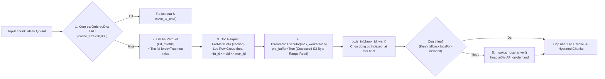
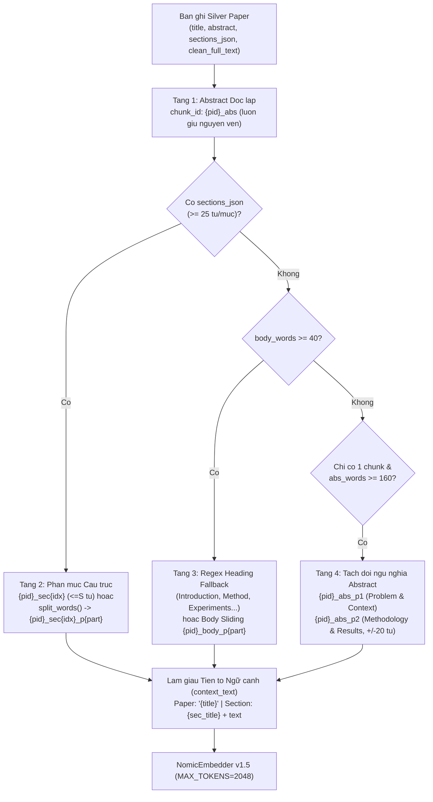

# 02d — Chương 2 (Phần D): Chuyển Đổi, Phân Mảnh & Đánh Chỉ Mục (Transform, Reduce & Index)

- **Motivation/Background**: Khi mở rộng kho dữ liệu từ `13,000` bài lên `71,927` bài và hơn `1,043,594` phân đoạn vector, việc ghi lại toàn bộ tệp Parquet lớn theo năm ở mỗi micro-batch trở thành nút thắt $O(N)$, đồng thời việc lưu nguyên văn bản chunk trong payload của Qdrant (`D-058`) gây phình RAM và lặp lại dữ liệu giữa Silver và Gold. Ngoài ra, chiến lược cắt đoạn theo cửa sổ trượt cố định cũ tạo ra nhiều đoạn đuôi quá ngắn ($p_{10} = 103$ từ) làm suy giảm độ phủ truy xuất, còn giới hạn `512` tokens của BERT làm cắt mất công thức toán học ở cuối đoạn.
- **Purpose**: Trình bày kiến trúc lưu trữ cột Zero-Local-Disk kèm cơ chế nén hợp nhất kiểu LSM (`dag_compact_silver`), thiết kế bảng `ChunkStore` và thuật toán thủy hóa dải byte S3 (`D-058`), dẫn xuất toán học đầy đủ cho bộ phân mảnh cân bằng bám ranh giới câu (`AcademicChunker`), quy trình vector hóa ngữ cảnh dài `2,048` tokens (`NomicEmbedder`), đánh chỉ mục Qdrant HNSW và các phép biến đổi đặc trưng (*feature engineering*) làm cầu nối trực tiếp sang Chương 3 & 4.
- **Overview Pipeline**: Silver `papers` ZSTD (Parts + Compaction 3 giờ) $\rightarrow$ `AcademicChunker` (4 tầng, cửa sổ cân bằng, overlap 15%, bám câu, gộp đuôi) $\rightarrow$ `NomicEmbedder` 768-D (`MAX_TOKENS=2048`, Mean Pooling, $L_2$) $\rightarrow$ Ghi `ChunkStore` (`silver/chunks/`, `ROW_GROUP_SIZE=512`) $\rightarrow$ Upsert Qdrant HNSW (UUIDv5 + 5 trường lọc) + Feature Engineering (`log1p`, One-Hot, Fractional Graph).
- **Detailed Plan**: §2.10 Kiến trúc Lưu trữ Cột Zero-Local-Disk & Compaction LSM-Style; §2.11 Thiết kế `ChunkStore` & Thủy hóa Byte-Range Trên S3 (`D-058`); §2.12 Thuật toán Phân mảnh Ngữ cảnh Đa tầng (`AcademicChunker`); §2.13 Vector hóa Ngữ nghĩa, Chỉ mục Qdrant HNSW & Biến đổi Đặc trưng cho Khai phá.
- **References**: [lakehouse_io.py](../../src/storage/lakehouse_io.py), [silver_writer.py](../../src/transformation/silver_writer.py), [chunk_store.py](../../src/storage/chunk_store.py), [chunker.py](../../src/indexing/chunker.py), [embedder.py](../../src/indexing/embedder.py), [qdrant_manager.py](../../src/indexing/qdrant_manager.py), [dag_compact_silver.py](../../dags/dag_compact_silver.py), [ingestion.py](../../backend/app/api/endpoints/ingestion.py), [migrate_chunks_to_silver.py](../../scripts/migrate_chunks_to_silver.py), [backfill_missing_papers.py](../../scripts/backfill_missing_papers.py), [backfill_qdrant_year.py](../../scripts/backfill_qdrant_year.py), [chunking_ab.py](../../benchmarks/chunking_ab.py), [laya_pagerank_benchmark_report.md](../benchmarks/laya_pagerank_benchmark_report.md), [PERFORMANCE_BENCHMARK_REPORT.md](../benchmarks/PERFORMANCE_BENCHMARK_REPORT.md), [QUY_TRINH_TIEN_XU_LY_DU_LIEU.md](../QUY_TRINH_TIEN_XU_LY_DU_LIEU.md).
- **Created**: 2026-11-25T12:55:00+07:00
- **Last Updated**: 2026-11-25T12:55:00+07:00

[STATUS: ACTIVE]

---

## Mục Lục

- [2.10 Kiến Trúc Lưu Trữ Cột Zero-Local-Disk & Compaction LSM-Style](#210-kiến-trúc-lưu-trữ-cột-zero-local-disk--compaction-lsm-style)
  - [2.10.1 Ghi Bất biến Theo Lô nhỏ (`O(batch)`) trên Bộ đệm RAM](#2101-ghi-bất-biến-theo-lô-nhỏ-obatch-trên-bộ-đệm-ram)
  - [2.10.2 Cơ chế Compaction Chu kỳ 3 Giờ (`dag_compact_silver`) & Khóa Đồng thời](#2102-cơ-chế-compaction-chu-kỳ-3-giờ-dag_compact_silver--khóa-đồng-thời)
- [2.11 Thiết Kế `ChunkStore` & Thủy Hóa Byte-Range Trên S3 (`D-058`)](#211-thiết-kế-chunkstore--thủy-hóa-byte-range-trên-s3-d-058)
  - [2.11.1 Kiến trúc Tách Payload Qdrant (`D-058`) & Lược đồ 14 Cột](#2111-kiến-trúc-tách-payload-qdrant-d-058--lược-đồ-14-cột)
  - [2.11.2 Thuật toán Đọc Dải Byte Song Song (*S3 Byte-Range Read*) & Bộ nhớ đệm LRU](#2112-thuật-toán-đọc-dải-byte-song-song-s3-byte-range-read--bộ-nhớ-đệm-lru)
  - [2.11.3 Công cụ Di trú Payload & Bù khuyết Chỉ mục](#2113-công-cụ-di-trú-payload--bù-khuyết-chỉ-mục)
- [2.12 Thuật Toán Phân Mảnh Ngữ Cảnh Đa Tầng (`AcademicChunker`)](#212-thuật-toán-phân-mảnh-ngữ-cảnh-đa-tầng-academicchunker)
  - [2.12.1 Dẫn xuất Toán học Cửa sổ Cân bằng & Bám Ranh giới Câu](#2121-dẫn-xuất-toán-học-cửa-sổ-cân-bằng--bám-ranh-giới-câu)
  - [2.12.2 Phân cấp Ngữ nghĩa 4 Tầng & Làm giàu Tiền tố (`context_text`)](#2122-phân-cấp-ngữ-nghĩa-4-tầng--làm-giàu-tiền-tố-context_text)
  - [2.12.3 Kiểm chứng Thực nghiệm Chunking A/B (`B_new_pct15` vs `A_old_fixed50`)](#2123-kiểm-chứng-thực-nghiệm-chunking-ab-b_new_pct15-vs-a_old_fixed50)
- [2.13 Vector Hóa Ngữ Nghĩa, Chỉ Mục Qdrant HNSW & Biến Đổi Đặc Trưng](#213-vector-hóa-ngữ-nghĩa-chỉ-mục-qdrant-hnsw--biến-đổi-đặc-trưng)
  - [2.13.1 Kiến trúc `NomicEmbedder` v1.5 (`MAX_TOKENS=2048`, FP16 CUDA, Mean Pooling & $L_2$)](#2131-kiến-trúc-nomicembedder-v15-max_tokens2048-fp16-cuda-mean-pooling--l_2)
  - [2.13.2 Quản trị Chỉ mục Qdrant HNSW (`QdrantManager`) & Tối ưu Connection Pool](#2132-quản-trị-chỉ-mục-qdrant-hnsw-qdrantmanager--tối-ưu-connection-pool)
  - [2.13.3 Kỹ thuật Biến đổi Đặc trưng (*Feature Engineering*) Nối sang Chương 3 & 4](#2133-kỹ-thuật-biến-đổi-đặc-trưng-feature-engineering-nối-sang-chương-3--4)

---

## 2.10 Kiến Trúc Lưu Trữ Cột Zero-Local-Disk & Compaction LSM-Style

### 2.10.1 Ghi Bất biến Theo Lô nhỏ (`O(batch)`) trên Bộ đệm RAM

Toàn bộ tầng lưu trữ trung gian sử dụng lớp `LakehouseIO` ([lakehouse_io.py](../../src/storage/lakehouse_io.py)) để tuần tự hóa bảng dữ liệu thành tệp Apache Parquet nén **ZSTD** trực tiếp qua bộ nhớ đệm `io.BytesIO()` trước khi tải thẳng lên MinIO S3 (*Zero Local Disk footprint*). Khi worker `fetch` hoặc `embed` xử lý mỗi micro-batch (`16` hoặc `32` bài), việc đọc-sửa-ghi đè toàn bộ tệp lớn theo năm (`papers.parquet` hoặc `chunks.parquet`) sẽ gây độ phức tạp $O(N)$ và nghẽn mạng. Thay vào đó, cả `SilverLakehouseWriter.append_part()` ([silver_writer.py](../../src/transformation/silver_writer.py#L127-L136)) và `ChunkStore.append_part()` ([chunk_store.py](../../src/storage/chunk_store.py#L215-L235)) ghi các phân đoạn nhỏ **bất biến** với độ phức tạp $O(\text{batch})$:
- Bảng tài liệu: `silver/papers/year={YYYY}/parts/part-{YYYYMMDDTHHMMSS}-{uuid8}.parquet`
- Bảng phân đoạn chunk: `silver/chunks/year={YYYY}/parts/part-{YYYYMMDDTHHMMSS}-{uuid8}.parquet`

### 2.10.2 Cơ chế Compaction Chu kỳ 3 Giờ (`dag_compact_silver`) & Khóa Đồng thời

Một đợt thu thập Tier 2 có thể sinh ra xấp xỉ `2,000` tệp `part-*` mỗi ngày; nếu để phân mảnh quá lâu, các truy vấn DuckDB S3 trên tầng Silver phải mở hàng nghìn kết nối HTTP khiến độ trễ tăng cao. DAG [dag_compact_silver.py](../../dags/dag_compact_silver.py) kích hoạt định kỳ mỗi 3 giờ (`0 */3 * * *`) gọi `POST /api/ingestion/compact-silver` ([ingestion.py](../../backend/app/api/endpoints/ingestion.py#L67-L89)), thực thi theo cơ chế kiểu **LSM-Tree Compaction** an toàn bên cạnh worker đang chạy:

1. **Chốt chặn đơn tiến trình (`_compact_lock`)**: Endpoint dùng `threading.Lock().acquire(blocking=False)` để trả ngay mã `HTTP 409 Conflict` nếu một lượt compaction khác đang thực thi.
2. **Hợp nhất `silver/papers/` (`SilverLakehouseWriter.compact_all`)**: Liệt kê danh sách khóa `part_keys` hiện hữu tại từng năm, hợp nhất cùng `papers.parquet`, khử trùng theo khóa `paper_id` (`keep="last"`), ghi tệp mới lên S3 và **chỉ gọi `delete_objects_batch(part_keys)` sau khi tệp gộp đã ghi thành công**. Các tệp `part-*` mới sinh ra trong lúc compaction đang chạy không nằm trong danh sách chụp ban đầu nên được giữ nguyên cho chu kỳ 3 giờ kế tiếp.
3. **Hợp nhất `silver/chunks/` (`ChunkStore.compact_all` & `latest_only`)**: Đọc bảng cũ cùng các `part_keys`, chạy hàm `ChunkStore.latest_only()` ([chunk_store.py](../../src/storage/chunk_store.py#L241-L263)) để giữ lại đúng phiên bản mới nhất (`max(indexed_at)`) cho từng `paper_id` (xóa sạch dấu vết chunk cũ của các bài đã `refresh=True`), chọn dòng cuối cùng cho mỗi `chunk_id`, rồi **sắp xếp tăng dần toàn bộ bảng theo `chunk_id`** và ghi xuất bằng nén ZSTD với kích thước nhóm dòng nhỏ `ROW_GROUP_SIZE = 512` (~0.3 MB sau nén mỗi group).

---

## 2.11 Thiết Kế `ChunkStore` & Thủy Hóa Byte-Range Trên S3 (`D-058`)

### 2.11.1 Kiến trúc Tách Payload Qdrant (`D-058`) & Lược đồ 14 Cột

Trong giai đoạn đầu, toàn bộ văn bản phân đoạn (`text`, `context_text`), danh sách tác giả và tiêu đề bài báo được nhồi thẳng vào payload JSON của từng điểm vector trong Qdrant. Khi quy mô vượt mốc `1,000,000` vector, thiết kế này gây phình bộ nhớ RAM của Qdrant, nhân đôi dung lượng lưu trữ với bảng Silver và làm chậm thao tác quét điểm (*scroll*). Theo quyết định kiến trúc **`D-058`** (ghi nhận tại [laya_pagerank_benchmark_report.md](../benchmarks/laya_pagerank_benchmark_report.md#L99) và [chunk_store.py](../../src/storage/chunk_store.py#L75-L121)), toàn bộ văn bản và siêu dữ liệu đầy đủ được tách về bảng cột `silver/chunks/` (`ChunkStore`), còn payload trong Qdrant chỉ giữ **5 trường tối thiểu** (`QDRANT_PAYLOAD_FIELDS = ("chunk_id", "paper_id", "year", "primary_category", "section_type")`).

> **5W1H — Đối chiếu Kiến trúc Lưu trữ Vector Trước và Sau Quyết định `D-058`**
> - **What**: So sánh hai phương án tổ chức payload vector giữa kiến trúc cũ (nhồi toàn bộ văn bản trong Vector DB) và kiến trúc `D-058` (`Qdrant Minimal` + `ChunkStore` trên MinIO S3).
> - **Why**: Giải thích động lực tách văn bản gốc ra khỏi chỉ mục vector khi hệ thống vượt ngưỡng `1,000,000` vector và các biện pháp bảo đảm toàn vẹn khi thủy hóa (*hydration*).
> - **When**: Quyết định kiến trúc `D-058` xác lập tháng 11/2026 và kiểm chứng trên mã nguồn 25/11/2026.
> - **Where**: [chunk_store.py](../../src/storage/chunk_store.py), [qdrant_manager.py](../../src/indexing/qdrant_manager.py) và [laya_pagerank_benchmark_report.md](../benchmarks/laya_pagerank_benchmark_report.md).
> - **Who**: Nhóm 1 thực hiện khi nâng cấp kiến trúc Lakehouse lên MinIO + Qdrant.
> - **How**: Đối chiếu danh sách trường `QDRANT_PAYLOAD_FIELDS`, quy trình ghi `SilverChunkPart` trước khi `insert_chunks`, và cơ chế thủy hóa trong `RetrievalService`.

**Bảng 2.8: So sánh kiến trúc lưu trữ vector trước và sau quyết định `D-058`**

| Chiều So sánh | Kiến trúc Cũ (Full Payload trong Vector DB) | Kiến trúc `D-058` (`Qdrant Minimal` + `ChunkStore`) |
| :--- | :--- | :--- |
| **Payload trong Qdrant** | Vector 768-D + toàn bộ `text`, `context_text`, `title`, `authors`, `doi` | Vector 768-D + **5 trường lọc**: `chunk_id`, `paper_id`, `year`, `primary_category`, `section_type` |
| **Nơi giữ văn bản gốc** | Nhân bản trong Qdrant / LanceDB | Nguồn chân lý duy nhất tại `silver/chunks/year=YYYY/chunks.parquet` (nén ZSTD) |
| **Đọc kết quả Top-$k$** | Trả trực tiếp từ payload vector | Qdrant trả Top-$k$ ID $\rightarrow$ `ChunkStore.hydrate()` đọc dải byte S3 có LRU cache |
| **Rủi ro & Biện pháp kiểm soát** | Tốn RAM chỉ mục vector khi đạt >1M điểm | Nếu quên hydrate, reranker nhận chuỗi rỗng (`0%` delta); khắc phục bằng ghi Silver trước Qdrant + hydrate trong `QdrantManager._hydrate()` và `RetrievalService` |

*Nguồn: [chunk_store.py](../../src/storage/chunk_store.py), [qdrant_manager.py](../../src/indexing/qdrant_manager.py) và [laya_pagerank_benchmark_report.md](../benchmarks/laya_pagerank_benchmark_report.md).*

> **5W1H — Đặc tả Lược đồ 14 Cột của Bảng Phân đoạn `ChunkStore.SCHEMA`**
> - **What**: Định nghĩa chính xác 14 cột dữ liệu Apache Arrow của bảng `silver/chunks/` phục vụ thủy hóa văn bản chunk theo `chunk_id`.
> - **Why**: Lưu trữ đầy đủ nội dung văn bản (`text`), danh sách tác giả (`authors` cho PageRank), tiêu đề bài/mục và dấu thời gian `indexed_at` tách khỏi chỉ mục vector Qdrant.
> - **When**: Kiểm chứng trên mã nguồn hiện hành ([chunk_store.py](../../src/storage/chunk_store.py#L87-L121), 25/11/2026).
> - **Where**: [chunk_store.py](../../src/storage/chunk_store.py#L87-L121).
> - **Who**: Nhóm 1 xây dựng cho quản trị hồ Silver chunks.
> - **How**: Đối chiếu từng trường trong `ChunkStore.SCHEMA` và hàm `ChunkStore.to_table()`.

**Bảng 2.9: Đặc tả lược đồ 14 cột của `ChunkStore.SCHEMA`**

| STT | Tên Cột | Kiểu Apache Arrow | Ý nghĩa & Vai trò Thủy hóa / Khai phá |
| :---: | :--- | :--- | :--- |
| 1 | `chunk_id` | `pa.string()` | Khóa chính phân đoạn (`{pid}_abs`, `{pid}_sec{idx}_p{part}`), khóa sắp xếp & thống kê Min/Max Row Group |
| 2 | `paper_id` | `pa.string()` | Mã định danh bài báo gốc dùng nhóm phiên bản theo bài trong `latest_only()` |
| 3 | `title` | `pa.string()` | Tiêu đề bài báo dùng ghép ngữ cảnh cho Cross-Encoder reranker và hiển thị citation |
| 4 | `authors` | `pa.list_(pa.string())` | Danh sách tác giả truyền vào bộ khớp uy tín PageRank (`_match_authority`) |
| 5 | `primary_category` | `pa.string()` | Nhãn chuyên ngành chính (đồng bộ với trường lọc Qdrant) |
| 6 | `year` | `pa.int64()` | Năm công bố kiểu nguyên (trích qua `_parse_year`), hỗ trợ phân vùng và lọc thời gian |
| 7 | `section_title` | `pa.string()` | Tên mục cụ thể (ví dụ `3. Methodology (Part 1)`), dùng cho gắn thẻ `[Paper: ID, Section: ...]` |
| 8 | `section_type` | `pa.string()` | Nhãn chuẩn hóa 9 loại mục (`abstract`, `methodology`, `experiments`, ...) |
| 9 | `text` | `pa.string()` | Toàn văn nội dung đoạn trích (không lặp tiền tố `Paper:` để trình bày sạch trên UI & Prompt) |
| 10 | `word_count` | `pa.int64()` | Số từ thực tế của đoạn trích (`len(words)`) |
| 11 | `source` | `pa.string()` | Nguồn thu thập bài báo (`arxiv`, `cvf`, `semantic_scholar`, ...) |
| 12 | `tier` | `pa.string()` | Tầng thu thập (`tier1`, `tier2`, `tier3`) |
| 13 | `content_origin` | `pa.string()` | Nguồn gốc nội dung (`arxiv_html5`, `ar5iv_html5`, `open_access_pdf`, `abstract_fallback`) |
| 14 | `indexed_at` | `pa.string()` | Dấu thời gian UTC ISO 8601 khi lập chỉ mục; phân giải xung đột ghi mới nhất khi `refresh=True` |

*Nguồn: [chunk_store.py](../../src/storage/chunk_store.py#L87-L212).*

### 2.11.2 Thuật toán Đọc Dải Byte Song Song (*S3 Byte-Range Read*) & Bộ nhớ đệm LRU

Thách thức lớn nhất của việc tách văn bản về MinIO S3 là làm sao thủy hóa `10–40` `chunk_id` trong vài chục mili-giây mà không phải tải cả tệp Parquet hàng trăm megabyte. Lớp `ChunkStore` giải quyết bằng kiến trúc truy xuất 5 bước (Hình 2.7):

*Hình 2.7: Quy trình thủy hóa văn bản dải byte S3 của `ChunkStore` ([chunk_store.py](../../src/storage/chunk_store.py)).*

1. **Bộ nhớ đệm LRU trong RAM (`_cache`)**: Cấu trúc `collections.OrderedDict` lưu tối đa `20,000` bản ghi chunk nóng, bảo vệ truy cập đa luồng bằng `threading.Lock()` và đẩy mục vừa đọc lên cuối (`move_to_end`).
2. **Cache Footer & Cắt tỉa Row Group theo Thống kê Min/Max (`_file_meta`)**: Khi một tệp Parquet (hoặc phiên bản `(key, size, last_modified)` mới) được tiếp cận lần đầu, `ChunkStore` chỉ đọc phần **Parquet Footer** để trích xuất siêu dữ liệu các Row Group (`ROW_GROUP_SIZE = 512` dòng $\approx 0.3\text{ MB}$ nén mỗi nhóm) và lưu mảng cặp cận `(min, max)` của cột `chunk_id`. Vì `chunks.parquet` sau compaction được sắp xếp tăng dần theo `chunk_id`, tập khoảng `(min, max)` gần như không giao nhau, cho phép loại bỏ $>99\%$ Row Group ngay trên bộ nhớ mà không tốn một byte truyền tải mạng nào.
3. **Đọc Dải Byte Song Song Gom Lô (`pre_buffer=True`, `max_workers=16`)**: Đối với một số ít cặp `(file, row_group)` thỏa điều kiện `lo <= cid <= hi`, hệ thống điều phối trên `ThreadPoolExecutor(max_workers=16)`. Mỗi tác vụ gọi `pq.ParquetFile(fh, metadata=meta, pre_buffer=True).read_row_group(group)` để PyArrow tự động gộp các khoảng byte liền kề thành một yêu cầu HTTP S3 Range Read duy nhất, sau đó lọc chính xác bằng nhân C++ `pc.is_in(t["chunk_id"], value_set=want)`.
4. **Cơ chế Thử lại Danh sách Hai lượt (*Double-Pass Relist*)**: Danh sách tệp trên S3 được cache `list_ttl = 30.0 s`. Nếu truy vấn gặp một `chunk_id` mới vừa được worker `embed` ghi trong vòng vài giây trước đó (`attempt == 0` bị hụt), `get()` tự động làm mới danh sách tệp (`force=True`) ở lượt thứ hai để phát hiện các `part-*` vừa sinh.
5. **Kênh Dự phòng Địa phương & Theo yêu cầu (`_lookup_local_silver`)**: Khi một điểm thuộc tập kiểm thử lịch sử vắng mặt trên kho S3 chunks hiện tại, `hydrate()` tự động tra cứu vào các bảng Silver cục bộ (`data/silver/...`) hoặc gọi API arXiv theo yêu cầu (`_fetch_arxiv_on_demand`, có lưu đệm `data/silver/arxiv_metadata_cache.json`).

### 2.11.3 Công cụ Di trú Payload & Bù khuyết Chỉ mục

Để chuyển đổi dữ liệu hiện hữu sang kiến trúc `D-058` mà không mất mát lịch sử, thư mục `scripts/` cung cấp bộ ba công cụ kiểm toán và đồng bộ an toàn:
- [migrate_chunks_to_silver.py](../../scripts/migrate_chunks_to_silver.py): Thực thi 4 bước tuần tự `export` (quét payload Qdrant thành lô `50,000` dòng ghi vào `silver/chunks/`) $\rightarrow$ `compact` $\rightarrow$ `verify` (đối chiếu tập `chunk_id` giữa Qdrant và Silver đảm bảo `missing_in_silver == 0` và không trùng lặp) $\rightarrow$ `--strip` (chỉ xóa các khóa payload cũ ngoài `QDRANT_PAYLOAD_FIELDS` sau khi bước `verify` vượt qua 100%).
- [backfill_missing_papers.py](../../scripts/backfill_missing_papers.py): Phát hiện các bài trong `silver/papers/` chưa có điểm nào trong Qdrant, hỗ trợ `--chunker legacy` (commit `c50a651`) hoặc `--chunker current`, ghi Silver chunks trước rồi mới upsert vector theo đúng bất biến của `QueueConsumer`.
- [backfill_qdrant_year.py](../../scripts/backfill_qdrant_year.py): Cập nhật hàng loạt trường `year` (lô `200` phép toán `set_payload` mỗi HTTP request) cho các điểm cũ trong Qdrant từ `published_date` mà không phải nhúng lại vector.

---

## 2.12 Thuật Toán Phân Mảnh Ngữ Cảnh Đa Tầng (`AcademicChunker`)

### 2.12.1 Dẫn xuất Toán học Cửa sổ Cân bằng & Bám Ranh giới Câu

Ở các phiên bản tiền nhiệm (commit `c50a651`), chiến lược cắt đoạn dùng cửa sổ trượt kích thước tối đa cố định $S$ và độ gối đầu cố định `50` từ. Nhược điểm toán học của cách tiếp cận này là khi một mục có độ dài vượt nhẹ bội số hiệu dụng — chẳng hạn $L = 460$ từ với $S = 450$ — cửa sổ cuối cùng chỉ còn lại vài chục từ ngắn ngủi ($p_{10} = 103$ từ), nghèo ngữ nghĩa khi vector hóa nhưng vẫn chiếm vị trí ứng viên Top-$k$.

Module `AcademicChunker` ([chunker.py](../../src/indexing/chunker.py#L17-L106)) giải quyết triệt để vấn đề này bằng thuật toán `split_words(words)` với tham số mặc định `max_chunk_words = 300` (được `QueueConsumer` cấu hình thành `S = 450` để bao trọn các đoạn giàu công thức toán học), `overlap_ratio` $r = 0.15$, giới hạn gối đầu $[o_{\min}, o_{\max}] = [20, 80]$ từ, và ngưỡng gộp đuôi `min_tail_ratio` $\tau = 0.4$:

1. **Xác định số cửa sổ tối thiểu $n$ và cân bằng độ dài cửa sổ**:
   Nếu tổng số từ của mục thỏa $L \le S$, giữ nguyên một phân đoạn duy nhất `[words]`. Ngược lại ($L > S$), số cửa sổ tối thiểu $n \ge 2$ được khởi tạo và lặp tăng dần cho đến khi độ dài thực tế $c \le S$:

   $$n_0 = \max\!\left(2,\; \left\lceil \frac{L - r \cdot S}{S - r \cdot S} \right\rceil\right) \tag{2.12}$$

   Trong đó: $L$ là tổng số từ của phân mục hiện tại, $S$ là kích thước cửa sổ tối đa (`max_chunk_words`, cấu hình `450` trong `QueueConsumer`), $r = 0.15$ là tỷ lệ gối đầu mục tiêu, và $n_0$ là cận dưới số phân đoạn ban đầu.

   Tại mỗi vòng kiểm tra số cửa sổ $n \ge n_0$, độ dài ước lượng cân bằng $c_0$, số từ gối đầu động $o$ (tỷ lệ `15%` độ dài cửa sổ thực tế thay vì cố định `50` từ), và độ dài cửa sổ phân bố đều $c$ được tính như sau:

   $$c_0 = \frac{L}{n - r(n - 1)}, \qquad o = \min\!\Bigl(o_{\max},\; \max\bigl(o_{\min},\; \operatorname{round}(r \cdot c_0)\bigr)\Bigr), \qquad c = \left\lceil \frac{L + (n - 1) \cdot o}{n} \right\rceil \tag{2.13}$$

   Trong đó: $n$ là số cửa sổ thử hiện tại, $[o_{\min}, o_{\max}] = [20, 80]$ là biên độ từ gối đầu cho phép, $o$ là số từ gối đầu thực tế sau khi kẹp biên, và $c$ là độ dài mục tiêu mỗi cửa sổ; nếu $c > S$, thuật toán tăng $n \leftarrow n + 1$ và tính lại cho tới khi $c \le S$, bảo đảm kích thước các đoạn đồng đều thay vì dồn phần dư về đoạn cuối.

2. **Tính bước trượt đều & Bám ranh giới câu có nhận thức viết tắt học thuật**:
   Khoảng dịch lý tưởng giữa các cửa sổ và bán kính dung sai tìm kiếm ranh giới câu được xác định bởi:

   $$\text{stride} = \frac{L - c}{n - 1}, \qquad \text{tol} = \max\!\left(5,\; \left\lfloor \frac{o}{2} \right\rfloor\right) \tag{2.14}$$

   Trong đó: $\text{stride}$ là bước dịch lý tưởng (số từ thực) giữa điểm bắt đầu hai cửa sổ liên tiếp và $\text{tol}$ là bán kính dung sai (tối thiểu `5` từ) dùng để neo điểm cắt về ranh giới câu tự nhiên.

   Hàm `_sentence_starts(words)` quét trước các chỉ mục từ bắt đầu câu mới (từ liền trước kết thúc bằng dấu `.`, `!`, `?` theo sau bởi dấu ngoặc kép/đơn tùy chọn `_SENT_END`), đồng thời **loại trừ các chữ viết tắt học thuật phổ biến** trong tập `_NOT_SENT_END = {"e.g.", "i.e.", "al.", "etc.", "vs.", "cf.", "fig.", "figs.", "eq.", "eqs.", "sec.", "no.", "dr.", "mr.", "ms."}` cũng như ký hiệu viết tắt một chữ cái hoặc số mục (`[A-Z]\.|\d{1,2}\.`). Với mỗi cửa sổ $k \in \{0, \dots, n-1\}$, điểm bắt đầu lý tưởng $s_{\text{ideal}} = \operatorname{round}(k \cdot \text{stride})$ và kết thúc $e_{\text{ideal}} = s_{\text{ideal}} + c$ được kéo về ranh giới câu gần nhất trong khoảng dung sai `[lo, hi]` qua hàm `_snap()`, đồng thời ràng buộc $e_{\text{prev}} - s \ge o_{\min}$ để không bao giờ mất vùng gối đầu tối thiểu.

3. **Gộp đuôi ngắn (*Short-Tail Merge*)**:
   Sau khi bám ranh giới câu, nếu khoảng $(l_s, l_e)$ của cửa sổ cuối cùng ngắn hơn $40\%$ ngưỡng trần và khi nhập vào cửa sổ liền trước $(p_s, p_e)$ vẫn không vượt quá kích thước tối đa $S$:

   $$\bigl(l_e - l_s < 0.4 \cdot S\bigr) \;\land\; \bigl(l_e - p_s \le S\bigr) \;\implies\; [(p_s, p_e), (l_s, l_e)] \leftarrow [(p_s, l_e)] \tag{2.15}$$

   Trong đó: $(p_s, p_e)$ và $(l_s, l_e)$ lần lượt là cặp chỉ số từ bắt đầu–kết thúc của cửa sổ kế cuối và cửa sổ cuối cùng, còn $0.4$ (`min_tail_ratio`) là ngưỡng tỷ lệ kích hoạt gộp nhằm triệt tiêu triệt để đoạn đuôi vụn.

### 2.12.2 Phân cấp Ngữ nghĩa 4 Tầng & Làm giàu Tiền tố (`context_text`)

Áp dụng thuật toán `split_words()` trên nền cấu trúc tài liệu, hàm `AcademicChunker.chunk_paper()` phân rã mỗi bài báo thành cây phân đoạn 4 tầng (Hình 2.8):

*Hình 2.8: Phân cấp 4 tầng của `AcademicChunker` kết hợp làm giàu ngữ cảnh `context_text` ([chunker.py](../../src/indexing/chunker.py)).*

- **Phân tách vai trò `text` vs `context_text`**: Trước khi vector hóa, mỗi chunk được gắn tiền tố ngữ cảnh vĩ mô:
  `context_text = f'Paper: "{title}" | Section: {section_title}\n\n{chunk_text}'`
  Chuỗi `context_text` này được đưa vào `NomicEmbedder` để vector hóa, giúp embedding của một đoạn phương pháp hoặc thực nghiệm luôn neo chặt vào tên công trình gốc và vị trí phân mục, trong khi `ChunkStore` lưu riêng trường `text` sạch sẽ để trình bày trên trích dẫn RAG và tính điểm từ vựng.

### 2.12.3 Kiểm chứng Thực nghiệm Chunking A/B (`B_new_pct15` vs `A_old_fixed50`)

Để kiểm chứng định lượng hiệu quả của thuật toán phân mảnh mới so với phiên bản cố định cũ (`c50a651`), kịch bản [chunking_ab.py](../../benchmarks/chunking_ab.py) tiến hành đánh giá đối chứng mù (*controlled ablation*) trên cùng một tập `1,000` bài báo (`49` bài chuẩn từ `scientific_eval_v2.jsonl` + các bài nhiễu khó từ Qdrant + mẫu ngẫu nhiên từ Silver), cùng mô hình nhúng `Nomic v1.5` (`MAX_WORDS=450`) và tìm kiếm cosine chính xác trong NumPy.

> **5W1H — Thử nghiệm A/B Chiến lược Phân đoạn Văn bản (`Chunking A/B`)**
> - **What**: So sánh 3 biến thể phân đoạn: `A_old_fixed50` (cửa sổ trượt 450 từ, overlap cố định 50 từ tại `c50a651`), `B_new_pct15` (`AcademicChunker` hiện tại với overlap 15%, cân bằng cửa sổ, bám câu, gộp đuôi), và `C_new_pct0` (biến thể không overlap để cô lập tác dụng của overlap).
> - **Why**: Kiểm chứng xem thuật toán cân bằng cửa sổ + bám câu có loại bỏ được các chunk đuôi ngắn vụn và nâng cao độ phủ truy xuất (*Recall@K* / *nDCG@10*) hay không.
> - **When**: Thực hiện và ghi nhận kết quả giai đoạn 06–08/11/2026 tại commit `f421707`.
> - **Where**: Mã nguồn đối chứng tại [chunking_ab.py](../../benchmarks/chunking_ab.py), số liệu tổng hợp tại `logs/benchmarks/chunking_ab/summary.json` và bảng trích xuất [table_chunking_ab.tex](../../data-mining-latek/tables/table_chunking_ab.tex).
> - **Who**: Nhóm 1 thực hiện; kết quả dùng trực tiếp để chọn cấu hình mặc định cho `QueueConsumer`.
> - **How**: Giữ cố định 100% tập bài báo Silver, mô hình nhúng Nomic v1.5 và tập câu hỏi; chỉ thay đổi duy nhất lớp `AcademicChunker`.

**Bảng 2.10: Kết quả đối chứng A/B ba biến thể chiến lược phân đoạn (`MAX_WORDS=450`)**

| Chỉ số Đo lường | `A_old_fixed50` (Cũ) | `B_new_pct15` (Hiện hành) | `C_new_pct0` (Overlap 0%) | Nhận xét Kỹ thuật |
| :--- | :---: | :---: | :---: | :--- |
| **Tổng số chunks** | `18,449` | `18,440` | `17,218` | `B_new_pct15` giữ quy mô chunk tương đương cũ |
| **Độ dài trung vị (từ)** | `450` | `380` | `366` | Cân bằng độ dài thay vì ép cứng 450 từ |
| **Phân vị $p_{10}$ độ dài (từ)** | `103` | **`166`** | `159` | **Tăng +61.2%** độ dài nhóm 10% chunk ngắn nhất |
| **Recall@5** $\uparrow$ | `0.7143` | **`0.7679`** | `0.7500` | **`B_new_pct15` đạt đỉnh +0.0536 (+7.5% tương đối)** |
| **Recall@10** $\uparrow$ | `0.8571` | `0.8929` | **`0.9286`** | Cả hai biến thể mới đều vượt xa bản cũ `0.8571` |
| **MRR@10** $\uparrow$ | `0.6126` | `0.6153` | **`0.6291`** | Cải thiện xếp hạng liên tục so với bản cũ |
| **nDCG@10** $\uparrow$ | `0.6635` | `0.6701` | **`0.6844`** | Nhờ không bị chia loãng bởi chunk lặp overlap |
| **Chunk Hit@5** $\uparrow$ | `0.7143` | **`0.7321`** | **`0.7321`** | Tăng độ trúng đoạn trích đúng ở Top-5 |

*Nguồn: `logs/benchmarks/chunking_ab/summary.json` và [table_chunking_ab.tex](../../data-mining-latek/tables/table_chunking_ab.tex) (phân tích chi tiết hơn trong `EXP_02_DOMAIN_AWARE_CHUNKING_AB.md`).*

Kết quả chứng minh việc chuyển sang **`B_new_pct15`** (lựa chọn mặc định của `AcademicChunker` hiện hành) vừa khắc phục hiện tượng phân mảnh đuôi vụn ($p_{10}$ nâng từ `103` lên `166` từ), vừa tối ưu **Recall@5 đạt `0.7679`** — thông số trực tiếp quyết định ngưỡng bao phủ ngữ cảnh khi backend trích chọn Top-5 đoạn trích đưa vào LLM.

---

## 2.13 Vector Hóa Ngữ Nghĩa, Chỉ Mục Qdrant HNSW & Biến Đổi Đặc Trưng

### 2.13.1 Kiến trúc `NomicEmbedder` v1.5 (`MAX_TOKENS=2048`, FP16 CUDA, Mean Pooling & $L_2$)

Mô-đun [embedder.py](../../src/indexing/embedder.py) triển khai bộ sinh vector ngữ nghĩa cục bộ dựa trên mô hình mã nguồn mở `nomic-ai/nomic-embed-text-v1.5` (768 chiều) với bốn thiết kế kỹ thuật trọng tâm:

1. **Cửa sổ Ngữ cảnh Siêu rộng `MAX_TOKENS = 2048` (RoPE)**: Khác với các bộ mã hóa BERT truyền thống (`all-MiniLM`, `bge-small`) bị giới hạn cứng ở `512` tokens — vốn làm cắt cụt phần đuôi của các chunk `450` từ chứa khoảng `650` token văn bản hoặc lên tới `1,600` token khi dày đặc ký hiệu LaTeX — kiến trúc **Rotary Position Embeddings (RoPE)** của Nomic v1.5 (hỗ trợ tối đa `8,192` tokens) cho phép cấu hình `MAX_TOKENS = 2048` bao phủ trọn vẹn 100% nội dung phân đoạn học thuật.
2. **Tối ưu Phần cứng Tự động & Bản vá FP16 (`_patch_extended_mask`)**: Hàm khởi tạo tự động dò thiết bị theo thứ tự ưu tiên Apple Silicon `mps` $\rightarrow$ NVIDIA `cuda` (bật bán chính xác `torch.float16` để tăng gấp đôi thông lượng) $\rightarrow$ `cpu`. Đồng thời, bản vá `PreTrainedModel.get_extended_attention_mask` bảo đảm mặt nạ mở rộng kế thừa đúng `dtype` (`float16` trên CUDA), khắc phục lỗi xung đột kiểu trên `transformers` phiên bản mới, và kèm nhánh bắt ngoại lệ tràn VRAM tự động hạ tải sang CPU cho micro-batch lỗi.
3. **Tiền tố Bất đối xứng (*Asymmetric Task Prefixing*)**: Tuân thủ đúng đặc tả huấn luyện tương phản của Nomic v1.5, văn bản lưu trữ luôn được gắn tiền tố `"search_document: "` trước khi làm sạch surrogate, còn truy vấn người dùng được gắn tiền tố `"search_query: "`.
4. **Mean Pooling có Mặt nạ & Chuẩn hóa Mặt cầu Đơn vị $L_2$**: Từ các trạng thái ẩn lớp cuối $\mathbf{h}_i \in \mathbb{R}^{768}$ và mặt nạ chú ý $m_i \in \{0, 1\}$ tại vị trí token $i \in \{1, \dots, T\}$, vector thô $\mathbf{v}_{\text{raw}}$ và vector chuẩn hóa $\hat{\mathbf{v}}$ được tính theo công thức:

$$\mathbf{v}_{\text{raw}} = \frac{\sum_{i=1}^{T} m_i \, \mathbf{h}_i}{\max\!\left(10^{-9},\; \sum_{i=1}^{T} m_i\right)}, \qquad \hat{\mathbf{v}} = \frac{\mathbf{v}_{\text{raw}}}{\|\mathbf{v}_{\text{raw}}\|_2} \tag{2.16}$$

$$\operatorname{CosineSim}(\hat{\mathbf{u}}, \hat{\mathbf{v}}) = \frac{\hat{\mathbf{u}} \cdot \hat{\mathbf{v}}}{\|\hat{\mathbf{u}}\|_2 \|\hat{\mathbf{v}}\|_2} = \hat{\mathbf{u}} \cdot \hat{\mathbf{v}} \tag{2.17}$$

Trong đó: $T \le 2048$ là độ dài chuỗi token sau đệm, $\mathbf{h}_i$ là vector ẩn tại vị trí $i$, $m_i$ là giá trị attention mask ($1$ cho token thật, $0$ cho padding), và $\hat{\mathbf{u}}, \hat{\mathbf{v}} \in \mathbb{R}^{768}$ là các vector đã được đưa về mặt cầu đơn vị $\|\hat{\mathbf{v}}\|_2 = 1$, giúp phép đo khoảng cách Cosine thu gọn thành tích vô hướng tốc độ cao.

### 2.13.2 Quản trị Chỉ mục Qdrant HNSW (`QdrantManager`) & Tối ưu Connection Pool

Lớp `QdrantManager` ([qdrant_manager.py](../../src/indexing/qdrant_manager.py)) đóng vai trò cổng kết nối duy nhất tới collection `scientific_papers_gold` trên Qdrant:

- **Định danh điểm tất định UUIDv5**: Mỗi `chunk_id` được ánh xạ thành mã UUID chuẩn RFC 4122 v5 thông qua namespace DNS để bảo đảm phép ghi `upsert` (`PUT /collections/{col}/points?wait=true`, lô `100` điểm) luôn lũy đẳng không sinh điểm trùng khi chạy lại:

  $$\text{point\_id} = \operatorname{UUIDv5}\bigl(\texttt{NAMESPACE\_DNS},\; \text{chunk\_id}\bigr) \tag{2.18}$$

  Trong đó: $\texttt{NAMESPACE\_DNS}$ là hằng số chuẩn UUID (`uuid.NAMESPACE_DNS`) khớp đồng nhất giữa Python và dịch vụ TypeScript, còn `chunk_id` là định danh duy nhất của phân đoạn trong `ChunkStore`.

- **Đồ thị HNSW & Chỉ mục Payload Lọc nhanh**: Khi khởi tạo collection mới (`ensure_collection`), hệ thống cấu hình kích thước `768`, khoảng cách `Cosine`, và tạo 4 chỉ mục payload phục vụ lọc kết hợp trước khi duyệt đồ thị HNSW: `primary_category` (`keyword`), `paper_id` (`keyword`), `year` (`integer`), và `section_type` (`keyword`). Ngoài ra, `QdrantManager` cung cấp lớp bọc tương thích ngược `QdrantTableCompat` / `QdrantQueryBuilder` (`.where()`, `.limit()`, `.select()`, `.to_pandas()`) giúp toàn bộ tầng `RetrievalService` chuyển đổi từ LanceDB sang Qdrant mà không gãy hợp đồng API, đồng thời duy trì kết nối bền vững `requests.Session()` loại bỏ chi phí bắt tay TLS lặp lại (giảm độ trễ truy vấn Top-5 qua WAN từ `> 1,000 ms` xuống `269.46 ms` như đo lường tại [PERFORMANCE_BENCHMARK_REPORT.md](../benchmarks/PERFORMANCE_BENCHMARK_REPORT.md)).

> **5W1H — Bảng Đặc tả Siêu tham số Vector hóa & Chỉ mục Qdrant Gold**
> - **What**: Tổng hợp toàn bộ tham số cấu hình phần cứng, mô hình nhúng Nomic v1.5 và cấu trúc chỉ mục Qdrant HNSW hiện hành.
> - **Why**: Cố định các thông số kỹ thuật chuẩn xác cho tái lập quy trình đánh chỉ mục trên `1,043,594` vector và benchmark độ trễ.
> - **When**: Đối chiếu tại mã nguồn ngày 25/11/2026 và benchmark phần cứng ngày 19/10/2026 (`SNAP-04`).
> - **Where**: [embedder.py](../../src/indexing/embedder.py), [qdrant_manager.py](../../src/indexing/qdrant_manager.py), [chunk_store.py](../../src/storage/chunk_store.py), [PERFORMANCE_BENCHMARK_REPORT.md](../benchmarks/PERFORMANCE_BENCHMARK_REPORT.md).
> - **Who**: Nhóm 1 chuẩn hóa thông số triển khai.
> - **How**: Kiểm tra trực tiếp hằng số trong code (`MAX_TOKENS`, `VECTOR_DIM`, `QDRANT_PAYLOAD_FIELDS`, `batch_size`).

**Bảng 2.11: Thông số kỹ thuật của `NomicEmbedder` và `QdrantManager`**

| Thành phần | Tham số Kỹ thuật | Giá trị Cấu hình | Ý nghĩa & Mục đích Thiết kế |
| :--- | :--- | :--- | :--- |
| **Embedder** | Mô hình nền tảng | `nomic-ai/nomic-embed-text-v1.5` | Kiến trúc RoPE hỗ trợ ngữ cảnh dài `8,192` tokens |
| **Embedder** | `MAX_TOKENS` / Số chiều $D$ | `2,048` tokens / `768-D` | Bao phủ trọn vẹn chunk `450` từ kèm công thức toán |
| **Embedder** | Tiền tố tác vụ (*Task Prefix*) | `search_document:` / `search_query:` | Tối ưu độ tương đồng bất đối xứng tài liệu–câu hỏi |
| **Embedder** | Chính xác phần cứng | `MPS` / `CUDA FP16` / `CPU` | Batch mặc định `8` chunks (tốc độ `73.0 chunks/s` trên RTX 4060) |
| **Qdrant** | Collection & Metric | `scientific_papers_gold` / `Cosine` | Đồ thị HNSW với vector đã chuẩn hóa $L_2$ ($\|\hat{\mathbf{v}}\|_2 = 1$) |
| **Qdrant** | `QDRANT_PAYLOAD_FIELDS` | `5` trường tối thiểu | `chunk_id`, `paper_id`, `year`, `primary_category`, `section_type` |
| **Qdrant** | Payload Indexes | `keyword` (3), `integer` (1) | Lọc tức thời theo ngành, mã bài, loại mục và khoảng năm |

*Nguồn: [embedder.py](../../src/indexing/embedder.py), [qdrant_manager.py](../../src/indexing/qdrant_manager.py), [chunk_store.py](../../src/storage/chunk_store.py).*

### 2.13.3 Kỹ thuật Biến đổi Đặc trưng (*Feature Engineering*) Nối sang Chương 3 & 4

Dữ liệu sau khi hoàn tất chu trình thu thập, tích hợp, làm sạch, phân mảnh và đánh chỉ mục ở Chương 2 không chỉ phục vụ tìm kiếm ngữ nghĩa RAG mà còn được biến đổi trực tiếp thành bốn tập đặc trưng đầu vào cho các mô-đun EDA (Chương 3) và 4 Trụ cột Khai phá Dữ liệu (Chương 4). Bốn phép biến đổi toán học chuẩn hóa bao gồm:

1. **Biến đổi Lệch phải Bằng Hàm Logarit $\log(1+\mathbf{x})$ (Pillar 4 — `TrendAnomalyMiner`)**:
   Do phân phối số từ (`total_words`) và số công thức (`total_math_count`) có đuôi phải cực dài (skewness dương lớn và cực trị lên tới hàng trăm nghìn từ), vector đặc trưng 5 chiều $\mathbf{x} = [\text{math}, \text{words}, \text{sections}, \text{authors}, \text{categories}]^\top$ được nén khoảng giá trị trước khi đưa vào `IsolationForest`:

   $$\mathbf{x}_{\log} = \log(1 + \mathbf{x}) \tag{2.19}$$

   Trong đó: $\mathbf{x} \in \mathbb{R}_{\ge 0}^{5}$ là vector đếm cấu trúc nguyên thủy của bài báo (điền khuyết `0` nếu thiếu), và phép biến đổi $\log(1 + \cdot)$ giữ điểm gốc tại $0$ trong khi nén các giá trị ngoại lai nhiều bậc độ lớn về cùng thang đo ổn định.

2. **Mã hóa Giỏ Giao dịch Nhị phân One-Hot (`TransactionEncoder` — Pillar 1 `AssociationRuleMiner`)**:
   Mỗi bài báo $p$ được ánh xạ thành tập giao dịch $T_p$ hợp từ nhãn chuyên ngành (`cat:*`), từ khóa từ điển `KEYWORD_VOCAB` (`tag:*` trên 25 khái niệm AI/DS) và chủ đề phụ (nếu có); chỉ giữ lại các giỏ có $|T_p| \ge 2$ rồi mã hóa thành ma trận nhị phân thưa $\mathbf{B} \in \{0, 1\}^{|D_{\mathrm{tx}}| \times |I|}$ để tính độ hỗ trợ:

   $$\operatorname{Support}(X) = \frac{|\{T_p \in D_{\mathrm{tx}} : X \subseteq T_p\}|}{|D_{\mathrm{tx}}|} \tag{2.20}$$

   Trong đó: $D_{\mathrm{tx}}$ là tập hợp các giao dịch hợp lệ ($|T_p| \ge 2$), $I$ là toàn bộ tập mục sau chuẩn hóa, và $X \subseteq I$ là một tập mục phổ biến.

3. **Trọng số Đồ thị Hợp tác Phân số (Pillar 3 — `ScientificGraphMiner`)**:
   Khi xây dựng mạng lưới đồng tác giả dự phòng (khi thiếu `silver/citations.parquet`), để ngăn hiện tượng bùng nổ cạnh từ các bài báo quy mô hàng trăm tác giả, mỗi cặp đồng tác giả $(u, v)$ trong một bài báo có $N_p > 1$ tác giả nhận trọng số phân số tỷ lệ nghịch:

   $$W(u, v) = \sum_{p \in P_{uv}} \frac{1}{N_p - 1} \tag{2.21}$$

   Trong đó: $P_{uv}$ là tập các bài báo có cả hai tác giả $u$ và $v$ cùng đứng tên, và $N_p$ là tổng số tác giả của bài báo $p$.

4. **Chiếu Không gian Giảm chiều Centered PCA & Chuẩn hóa Động lượng Thị phần (Pillar 2 & Pillar 4)**:
   Vector abstract $768\text{-D}$ chuẩn hóa $L_2$ từ Qdrant được trừ kỳ vọng trung bình, chiếu qua `PCA(n_components=2)` và nhân hệ số phóng đại `5.0` phục vụ fit Gaussian Mixture Model (GMM) và lưới mật độ `96 x 72`; đồng thời số bài theo từng chuyên ngành được chuẩn hóa theo tỷ trọng thị phần từng quý ($\Delta\text{Share}$) để triệt tiêu nhiễu tăng trưởng quy mô chung của kho.

**Bảng 2.12: Ma trận kết nối đầu ra Chương 2 làm đặc trưng đầu vào cho Chương 3 & Chương 4**

| Nguồn Đầu ra (Chương 2) | Phép Biến đổi Đặc trưng (*Feature Engineering*) | Mô-đun Tiêu thụ Hạ nguồn | Chương Liên kết |
| :--- | :--- | :--- | :--- |
| `silver/papers/` (23 cột ZSTD) | Chiếu cột DuckDB S3 + dẫn xuất `math_density` trên 1,000 từ | `EdaEngine` (3 Lăng kính & Tương quan) | `03_CH3_PHAN_TICH_KHAM_PHA_EDA.md` |
| `silver/papers/` (`categories`, `title`, `abstract`) | Từ điển 25 mẫu `KEYWORD_VOCAB` + One-Hot `TransactionEncoder` | Pillar 1: `AssociationRuleMiner` (FP-Growth) | `04a_CH4_BON_TRU_COT_KHAI_PHA_DU_LIEU.md` |
| Qdrant `section_type="abstract"` (`768-D` $L_2$) | Trừ trung bình + `PCA(2) * 5.0` + `normalize()` | Pillar 2: `SemanticClusterAnalyzer` (KMeans/GMM/DBSCAN) | `04a_CH4_BON_TRU_COT_KHAI_PHA_DU_LIEU.md` |
| `silver/papers/` (`authors`) | Trọng số phân số $1/(N_p - 1)$ trên cặp `combinations(authors, 2)` | Pillar 3: `ScientificGraphMiner` (PageRank/Louvain) | `04a_CH4_BON_TRU_COT_KHAI_PHA_DU_LIEU.md` |
| `silver/papers/` (5 đặc trưng đếm & ngày) | Biến đổi $\log(1 + \mathbf{x})$ + chuẩn hóa thị phần $\Delta\text{Share}$ | Pillar 4: `TrendAnomalyMiner` (Isolation Forest) | `04a_CH4_BON_TRU_COT_KHAI_PHA_DU_LIEU.md` |
| `ChunkStore` (`silver/chunks/`) + Qdrant HNSW | Thủy hóa Byte-Range S3 + tiền tố `search_query:` | `RetrievalService` + `RerankerService` + `RagService` | `04b_CH4_KIEN_TRUC_HYBRID_RAG_VA_RERANKING.md` |

*Nguồn: Tổng hợp thiết kế tích hợp từ `src/mining/` và `backend/app/services/`.*

---
*Kết thúc Chương 2 (Thu thập, Tích hợp, Làm sạch và Chuyển đổi/Đánh chỉ mục). Toàn bộ bảng cột Silver và không gian vector Gold đã sẵn sàng cho bước Khám phá Dữ liệu (EDA) ở Chương 3 (`03_CH3_PHAN_TICH_KHAM_PHA_EDA.md`).*
